# Session 1. TOP Design Project (RTL-to-GDSII)

[← 메인으로](../README.md) · [다음 Session: CISC →](../02_CISC/README.md)

> 📅 2026.10.12 · ⏱ Clock 1.17 ns · 📐 Die 72 × 72 µm · 🧰 VCS / Design Compiler / Formality / IC Compiler II

**목차**
1. [TOP design RTL](#1-top-design-rtl) (Slide 3 ~ 9)
2. [Logic Synthesis (DC)](#2-logic-synthesis-dc) (Slide 10 ~ 19)
3. [Physical Design (ICC2)](#3-physical-design-icc2) (Slide 20 ~ 54)
   - [Library (NDM)](#slide-20--library-ndm-1--cell-ndm-생성) · [Nlib / MCMM](#slide-23--nlib-flow) · [Floorplan](#slide-25--floorplan-1) · [Powerplan](#slide-28--powerplan-1) · [Placement](#slide-36--placement-1--사전-점검) · [CTS](#slide-40--cts-setup) · [Routing](#slide-47--routing-1--routing-옵션) · [Filler Cell](#slide-51--filler-cell-1)

---

### Slide 1 · 표지


5단 파이프라인 Max / Min / Error Detector를 RTL부터 Logic Synthesis, ICC2 Physical Design(Floorplan ~ Filler Cell)까지 완주한 프로젝트입니다.

---

### Slide 2 · Contents

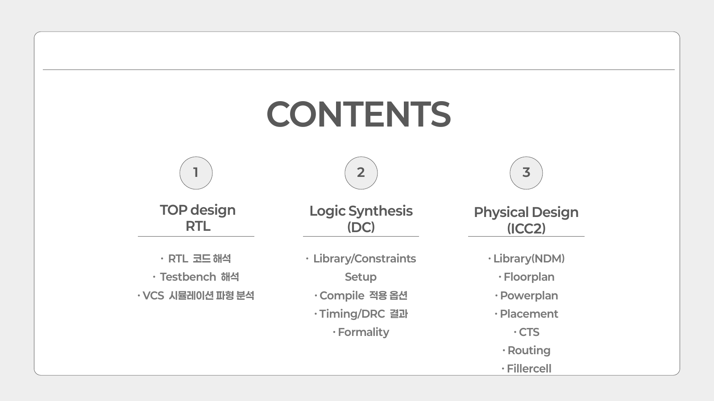

RTL 분석 → Logic Synthesis(DC) → Physical Design(ICC2: Library ~ Filler Cell) 순서로 구성했습니다.

---

## 1. TOP design RTL

### Slide 3 · TOP module (1)

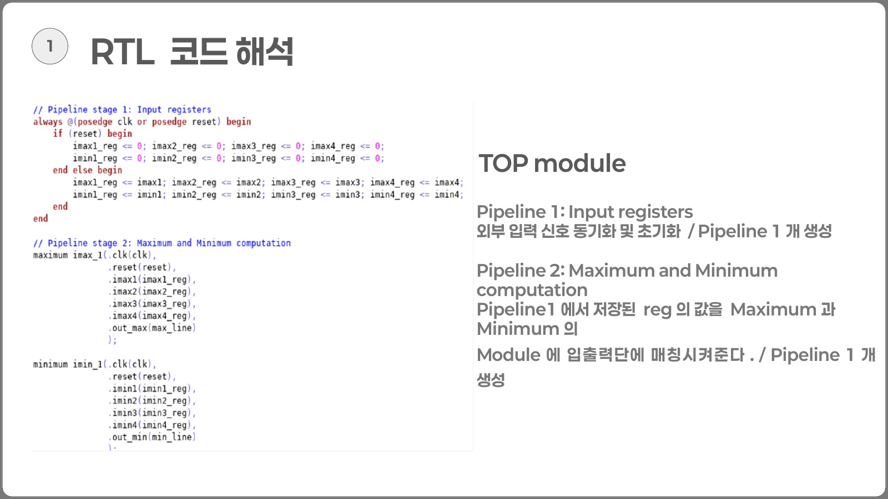

**Pipeline 1 — Input registers**
reset 시 `imax1~4_reg`, `imin1~4_reg`를 0으로 초기화하고, 평소에는 매 clock 외부 입력을 레지스터에 저장해 동기화합니다.

**Pipeline 2 — Maximum / Minimum computation**
Pipeline 1에 저장된 레지스터 값을 `maximum imax_1`, `minimum imin_1` 모듈의 입력에 연결하고, 결과를 `max_line`, `min_line`으로 받습니다. 두 모듈 내부에 출력 레지스터가 있어 pipeline 1단이 추가됩니다.

---

### Slide 4 · TOP module (2)

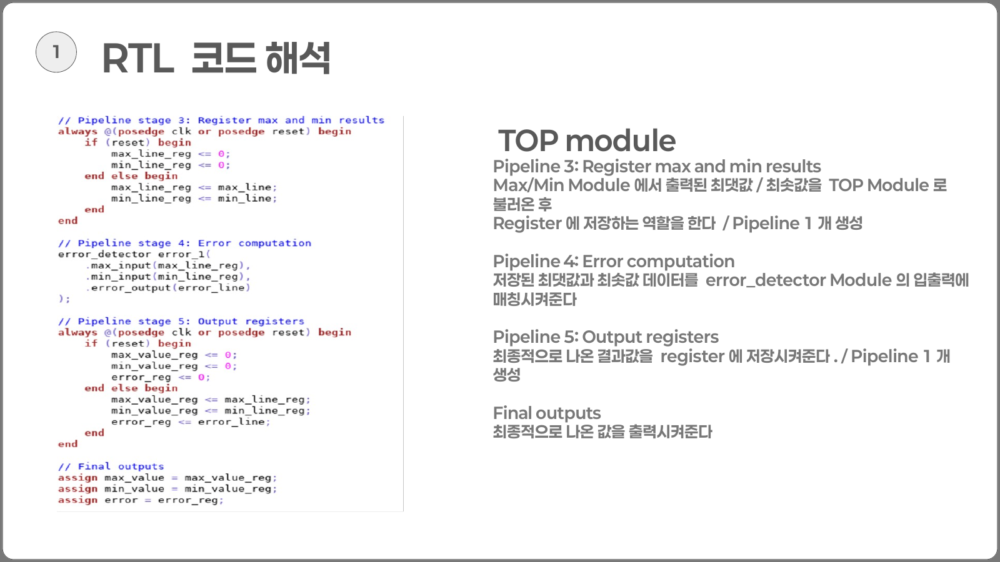

**Pipeline 3 — Register max and min results** — `max_line`, `min_line`을 `max_line_reg`, `min_line_reg`에 저장합니다.

**Pipeline 4 — Error computation** — 저장된 값을 `error_detector error_1`의 `max_input`, `min_input`에 연결합니다.

**Pipeline 5 — Output registers** — `max_value_reg`, `min_value_reg`, `error_reg`에 최종 결과를 저장합니다.

**Final outputs** — `assign`으로 레지스터 값을 `max_value`, `min_value`, `error` 포트로 출력합니다.

---

### Slide 5 · Maximum / Minimum module

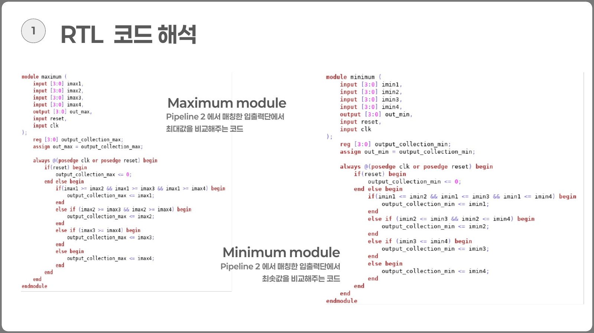

4-bit 입력 4개 중 최댓값 / 최솟값을 고르는 모듈입니다.

- **Maximum** — `imax1 >= imax2 && imax1 >= imax3 && imax1 >= imax4` 이면 imax1, 아니면 imax2 → imax3 → imax4 순으로 비교해 `output_collection_max` 레지스터에 저장합니다.
- **Minimum** — 같은 구조로 `<=` 비교를 수행해 `output_collection_min`에 저장합니다.

두 모듈 모두 `posedge clk`에서 결과를 레지스터에 저장하므로 pipeline 1단 역할을 합니다.

---

### Slide 6 · Error_detector

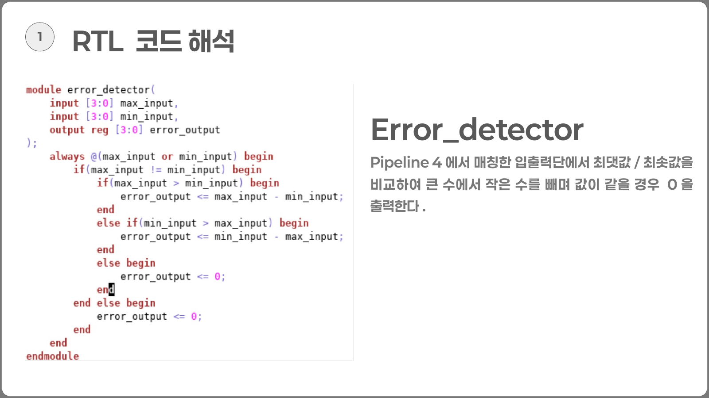

```verilog
always @(max_input or min_input) begin
    if (max_input != min_input) begin
        if (max_input > min_input)      error_output <= max_input - min_input;
        else if (min_input > max_input) error_output <= min_input - max_input;
        else                            error_output <= 0;
    end else
        error_output <= 0;
end
```

Pipeline 4에서 연결된 최댓값과 최솟값을 비교해 **큰 수에서 작은 수를 빼고**, 두 값이 같으면 0을 출력하는 조합논리 모듈입니다.

---

### Slide 7 · Testbench 해석

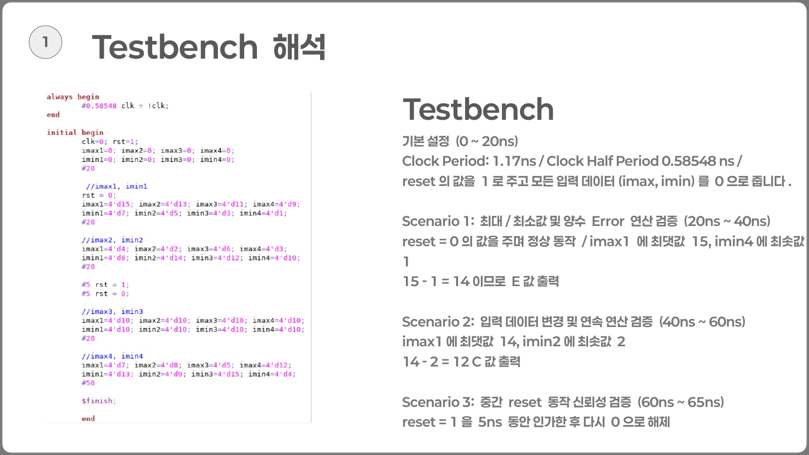

| 구간 | 내용 |
|---|---|
| 기본 설정 (0 ~ 20 ns) | Clock period 1.17 ns (half 0.58548 ns), reset = 1, 모든 입력 0 |
| Scenario 1 (20 ~ 40 ns) | reset 해제, imax1 = 15, imin4 = 1 → 15 − 1 = 14 → **E** 출력 |
| Scenario 2 (40 ~ 60 ns) | imax1 = 14, imin2 = 2 → 14 − 2 = 12 → **C** 출력 |
| Scenario 3 (60 ~ 65 ns) | reset = 1을 5 ns 인가 후 해제 → 중간 reset 신뢰성 검증 |

---

### Slide 8 · VCS 시뮬레이션 파형

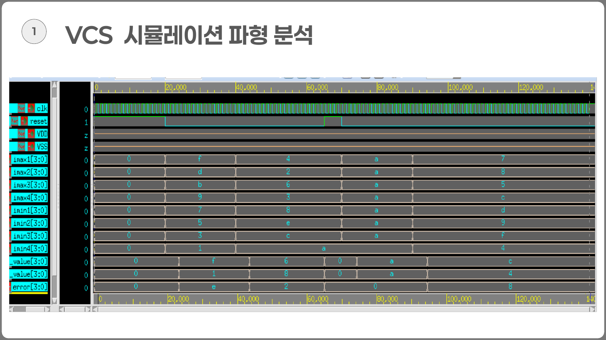

VCS 시뮬레이션 파형입니다. 위에서부터 `clk`, `reset`, 입력 `imax1~4`, `imin1~4`, 출력 `max_value`, `min_value`, `error` 순서입니다.

20 ns 이후 F / 1 / E, 40 ns 이후 6 / 8 / 2가 출력되고, 60 ns 부근의 reset 펄스에서 출력이 0으로 초기화된 뒤 다시 A / A / 0, C / 4 / 8이 출력되는 것을 확인할 수 있습니다.

---

### Slide 9 · 시뮬레이션 결과 검증

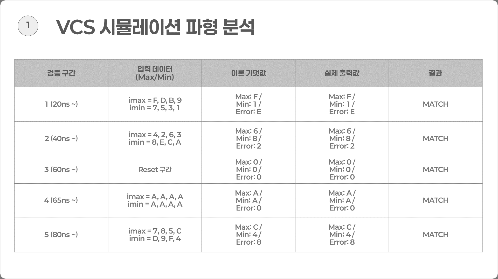

| 구간 | 입력 (imax / imin) | 기댓값 | 실제 출력 | 결과 |
|---|---|---|---|:---:|
| 20 ns~ | F,D,B,9 / 7,5,3,1 | Max F / Min 1 / Err E | Max F / Min 1 / Err E | ✅ MATCH |
| 40 ns~ | 4,2,6,3 / 8,E,C,A | Max 6 / Min 8 / Err 2 | Max 6 / Min 8 / Err 2 | ✅ MATCH |
| 60 ns~ | Reset | 0 / 0 / 0 | 0 / 0 / 0 | ✅ MATCH |
| 65 ns~ | A,A,A,A / A,A,A,A | Max A / Min A / Err 0 | Max A / Min A / Err 0 | ✅ MATCH |
| 80 ns~ | 7,8,5,C / D,9,F,4 | Max C / Min 4 / Err 8 | Max C / Min 4 / Err 8 | ✅ MATCH |

모든 구간에서 기댓값과 실제 출력이 일치했습니다.

---

## 2. Logic Synthesis (DC)

### Slide 10 · Reference / Topo / Multi-Vth

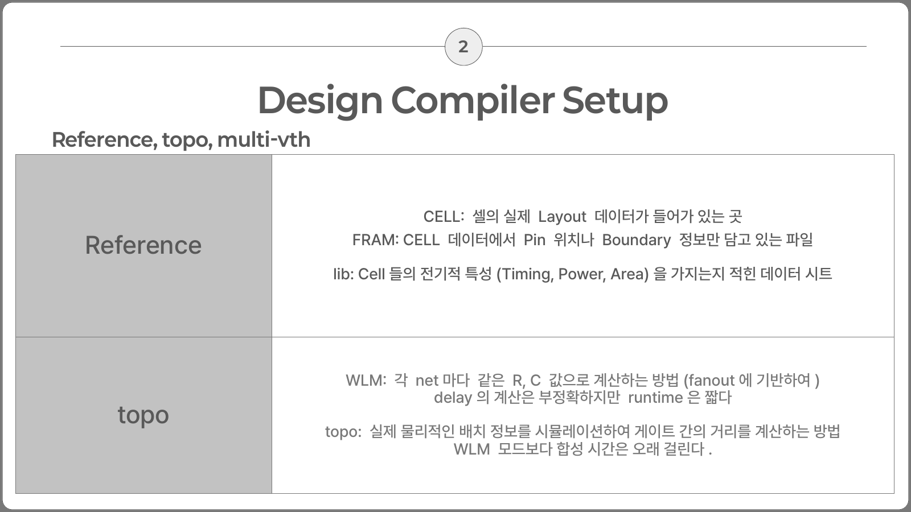

**Reference 구성**
- `CELL` — cell의 실제 layout 데이터
- `FRAM` — CELL에서 pin 위치와 boundary 정보만 담은 파일
- `lib` — cell의 전기적 특성(timing, power, area) 데이터 시트

**WLM vs Topo**
- **WLM** — fanout 기반으로 모든 net에 같은 R, C를 적용. delay 계산은 부정확하지만 runtime이 짧음
- **Topo** — 실제 물리 배치를 시뮬레이션해 게이트 간 거리를 계산. 더 정확하지만 합성 시간이 김

---

### Slide 11 · Library Setup

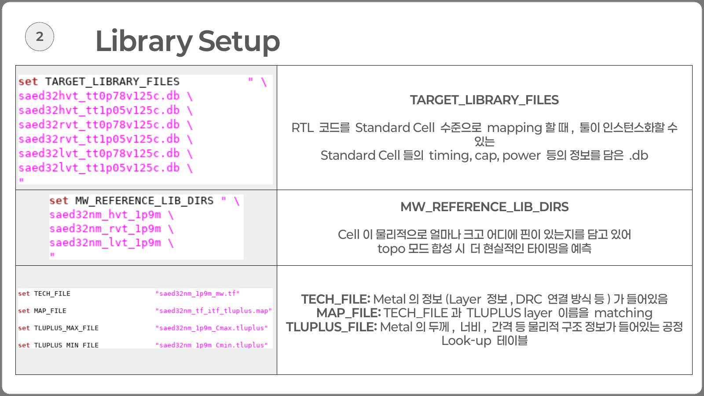

| 설정 | 의미 |
|---|---|
| `TARGET_LIBRARY_FILES` | RTL을 standard cell로 매핑할 때 사용할 cell 정보(.db) |
| `MW_REFERENCE_LIB_DIRS` | cell의 물리 크기 / pin 위치 → topo 합성 시 현실적인 timing 예측 |
| `TECH_FILE` | Metal layer 정보, 연결 방식 |
| `MAP_FILE` | TECH_FILE과 TLUPLUS layer 이름 매칭 |
| `TLUPLUS_FILE` | Metal 두께·너비·간격 기반 RC look-up 테이블 |

---

### Slide 12 · Constraints Setup

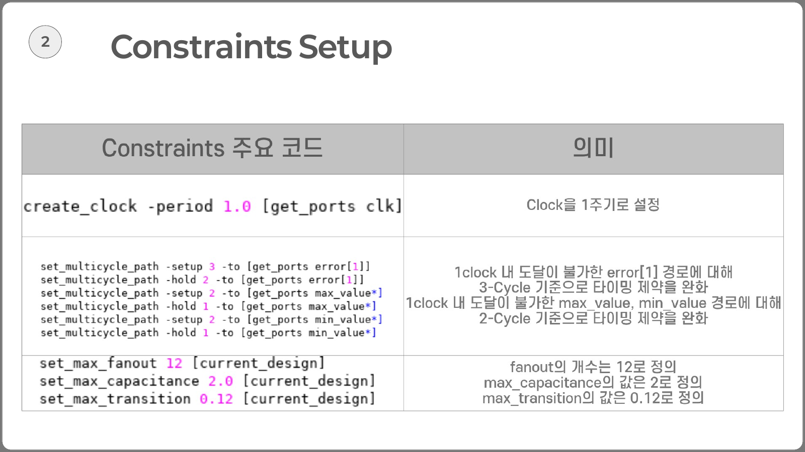

| Constraints 주요 코드 | 의미 |
|---|---|
| `create_clock -period 1.0 [get_ports clk]` | Clock을 1 ns 주기로 설정 |
| `set_multicycle_path -setup 3 -to [get_ports error[1]]`<br>`set_multicycle_path -hold 2 -to [get_ports error[1]]` | 1 cycle 안에 도달할 수 없는 `error[1]` 경로를 3-cycle 기준으로 완화 |
| `set_multicycle_path -setup 2 / -hold 1 -to [get_ports max_value*]`<br>`set_multicycle_path -setup 2 / -hold 1 -to [get_ports min_value*]` | `max_value`, `min_value` 경로를 2-cycle 기준으로 완화 |
| `set_max_fanout 12` | fanout 최대 12 |
| `set_max_capacitance 2.0` | max capacitance 2.0 |
| `set_max_transition 0.12` | max transition 0.12 |

multicycle path는 setup을 N으로 늘리면 hold 기준도 함께 이동하므로, hold를 N−1로 같이 지정해 hold 검사 시점을 원래대로 되돌렸습니다.

---

### Slide 13 · Compile 적용 옵션 (1)

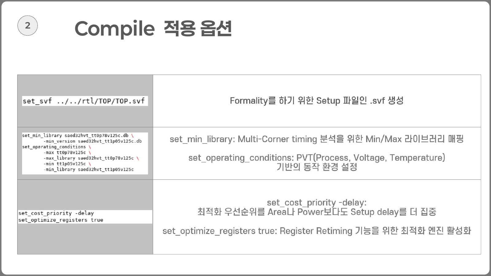

| 명령어 | 의미 |
|---|---|
| `set_svf ../../rtl/TOP/TOP.svf` | Formality를 위한 setup 파일(.svf) 생성 |
| `set_min_library saed32hvt_tt0p78v125c.db -min_version saed32hvt_tt1p05v125c.db` | Multi-corner timing 분석을 위한 Max / Min 라이브러리 매핑 |
| `set_operating_conditions -max tt0p78v125c -min tt1p05v125c` | PVT(Process, Voltage, Temperature) 기반 동작 환경 설정 |
| `set_cost_priority -delay` | Area나 Power보다 setup delay 최적화를 우선 |
| `set_optimize_registers true` | Register retiming을 위한 최적화 엔진 활성화 |

---

### Slide 14 · Compile 적용 옵션 (2)

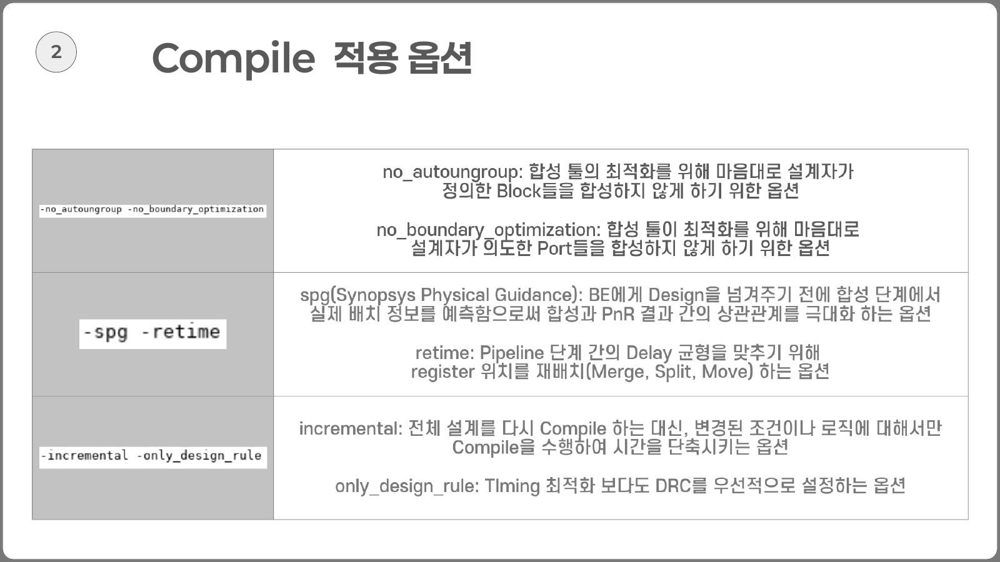

| 옵션 | 의미 |
|---|---|
| `-no_autoungroup` | 합성 툴이 최적화를 위해 설계자가 정의한 block을 임의로 풀지 않도록 |
| `-no_boundary_optimization` | 설계자가 의도한 port를 합성 툴이 임의로 최적화하지 않도록 |
| `-spg` | Synopsys Physical Guidance — 합성 단계에서 실제 배치 정보를 예측해 합성과 P&R 결과 간 상관관계 극대화 |
| `-retime` | pipeline 단계 간 delay 균형을 맞추기 위해 register 위치를 재배치 (merge, split, move) |
| `-incremental` | 전체를 다시 compile하지 않고 변경된 조건이나 로직만 compile해 시간 단축 |
| `-only_design_rule` | timing 최적화보다 DRC를 우선 |

---

### Slide 15 · Timing Report

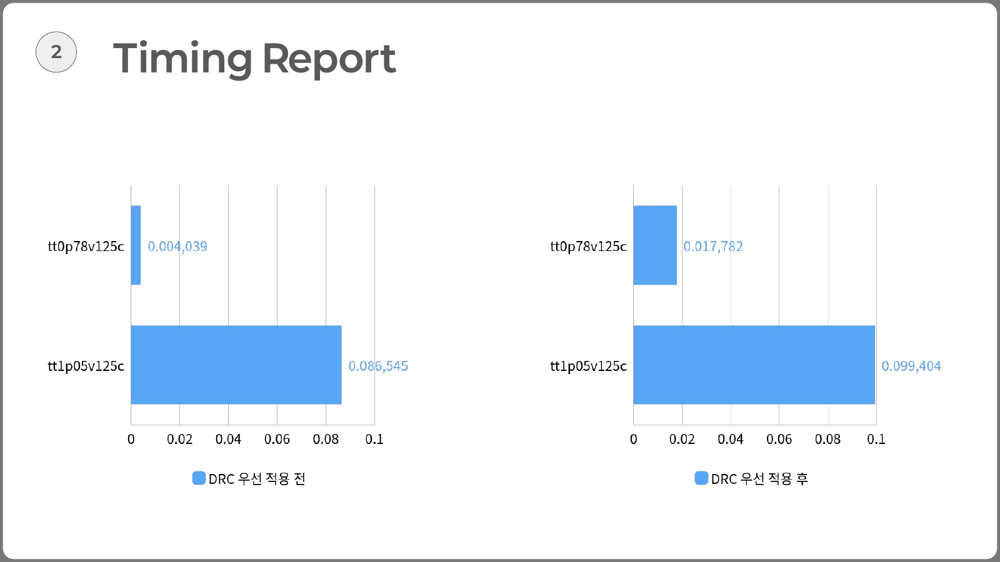

corner별 worst slack을 DRC 우선 적용 전후로 비교했습니다.

| Corner | DRC 우선 적용 전 | DRC 우선 적용 후 |
|---|---:|---:|
| tt0p78v125c (worst) | 0.004039 | **0.017782** |
| tt1p05v125c (best) | 0.086545 | **0.099404** |

DRC를 우선 최적화한 뒤에도 timing이 나빠지지 않고 오히려 두 corner 모두 slack이 개선되었습니다.

---

### Slide 16 · DRC Report

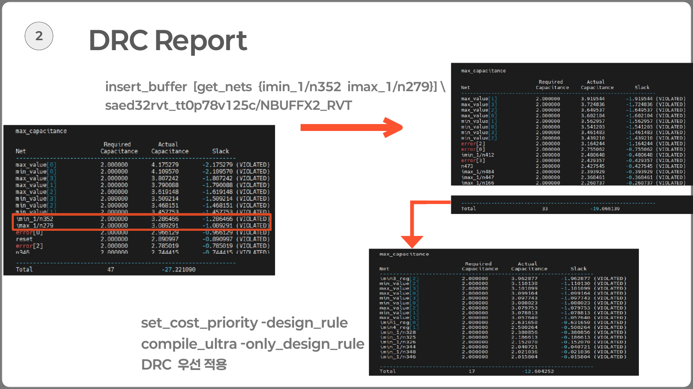

초기 DRC 리포트에서 `max_value`, `min_value`, `error`, 내부 net 등 **max_capacitance 위반 47건**(Total -27.221090)이 있었습니다.

1. 위반이 큰 내부 net 2개에 buffer를 직접 삽입했습니다.
   ```tcl
   insert_buffer [get_nets {imin_1/n352 imax_1/n279}] saed32rvt_tt0p78v125c/NBUFFX2_RVT
   ```
   → **33건** (Total -19.066186)
2. DRC를 우선 순위로 바꿔 DRC 전용 최적화를 진행했습니다.
   ```tcl
   set_cost_priority -design_rule
   compile_ultra -only_design_rule
   ```
   → **17건** (Total -12.664252)

남은 max_capacitance 위반은 대부분 출력 port와 입력 레지스터 주변 net으로, 이후 ICC2 단계에서 실제 배치를 반영해 최적화했습니다.

---

### Slide 17 · RTL vs Netlist 비교

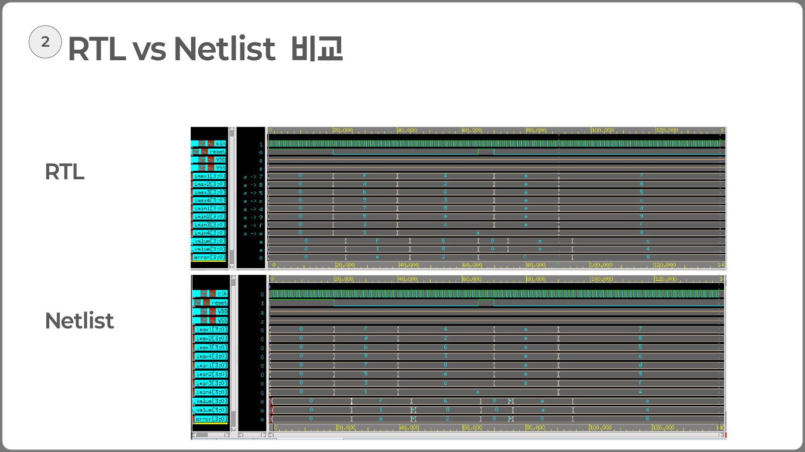

RTL 시뮬레이션과 합성 netlist(Gate-level) 시뮬레이션 파형을 비교했습니다. 입력과 출력(`max_value`, `min_value`, `error`) 값의 변화가 두 파형에서 동일해 합성 후에도 기능이 유지됨을 확인했습니다.

---

### Slide 18 · Formality

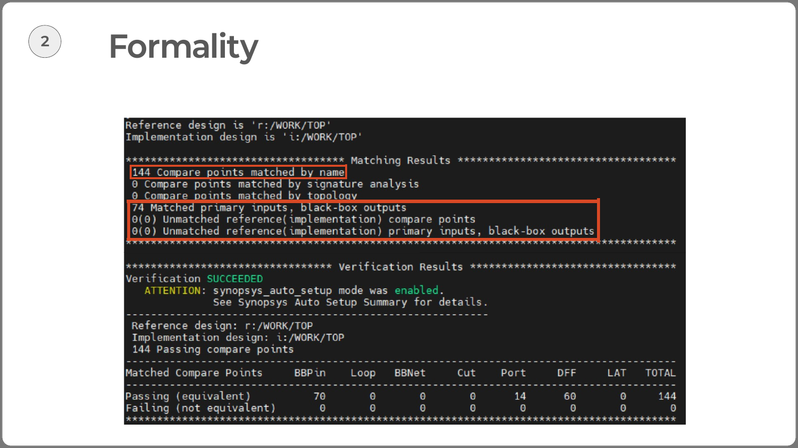

Formality 등가성 검증 결과 **Verification SUCCEEDED** 입니다.

- **144** compare points matched by name, 미매칭 0개
- **74** primary inputs / black-box outputs 매칭
- Passing 144 = BBPin 70 + Port 14 + DFF 60, Failing 0

---

### Slide 19 · TSMC 180nm 공정과 비교

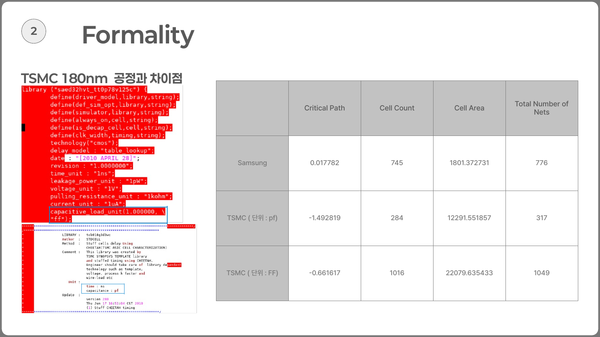

| 공정 | Critical Path | Cell Count | Cell Area | Total Nets |
|---|---:|---:|---:|---:|
| SAED 32nm | **0.017782** | 745 | 1801.372731 | 776 |
| TSMC (단위: pF) | -1.492819 | 284 | 12291.551857 | 317 |
| TSMC (단위: fF) | -0.661617 | 1016 | 22079.635433 | 1049 |

왼쪽 `.lib` 헤더에서 볼 수 있듯이 SAED는 `capacitive_load_unit`이 **fF**, TSMC는 **pF** 입니다. 그래서 같은 `set_max_capacitance 2.0`이라도 TSMC에서는 2 pF로 해석되어 훨씬 느슨한 제약이 됩니다. 단위를 그대로 둔 경우(pF)와 fF 기준으로 맞춘 경우를 비교해, 제약 단위에 따라 buffer 삽입량과 cell 수가 크게 달라지는 것을 확인했습니다.

---

## 3. Physical Design (ICC2)

### Slide 20 · Library (NDM) (1) — Cell NDM 생성

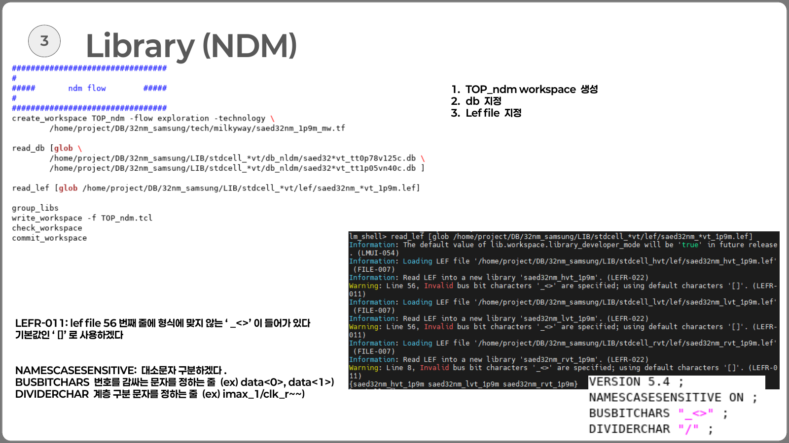

`TOP_ndm` workspace를 생성하고 .db와 .lef 파일을 지정했습니다.

LEF를 읽을 때 나온 메시지와 LEF 헤더 항목은 다음과 같습니다.

- `LEFR-011` — LEF 56번째 줄의 `_<>` 형식이 맞지 않아 기본값 `[]` 사용
- `NAMESCASESENSITIVE` — 대소문자 구분
- `BUSBITCHARS` — bus 번호를 감싸는 문자 (예: `data<0>`)
- `DIVIDERCHAR` — 계층 구분 문자 (예: `imax_1/clk_r`)

---

### Slide 21 · Library (NDM) (2) — check / commit

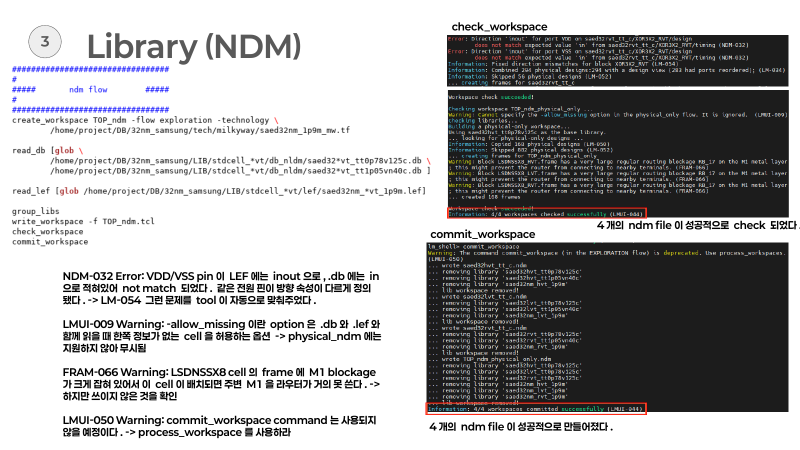

`check_workspace` 와 `commit_workspace` 로 NDM을 검증하고 생성했습니다. 캡처의 붉은 박스처럼 **4/4 workspace checked successfully**, **4/4 workspaces committed successfully** 로 4개의 NDM 파일이 만들어졌습니다.

| 메시지 | 내용 및 조치 |
|---|---|
| `NDM-032` Error → `LM-054` | VDD/VSS pin이 LEF에는 inout, .db에는 in으로 정의되어 불일치 → 툴이 자동으로 정합 |
| `LMUI-009` Warning | `-allow_missing`(한쪽 정보가 없는 cell 허용)은 physical NDM에서 지원하지 않아 무시됨 |
| `FRAM-066` Warning | `LSDNSSX8` frame에 큰 M1 blockage → 배치되면 주변 M1 사용 불가. 실제 design에서 미사용 확인 |
| `LMUI-050` Warning | `commit_workspace`는 deprecated 예정 → `process_workspace` 권장 |

---

### Slide 22 · Library (NDM) (3) — Tech-only NDM

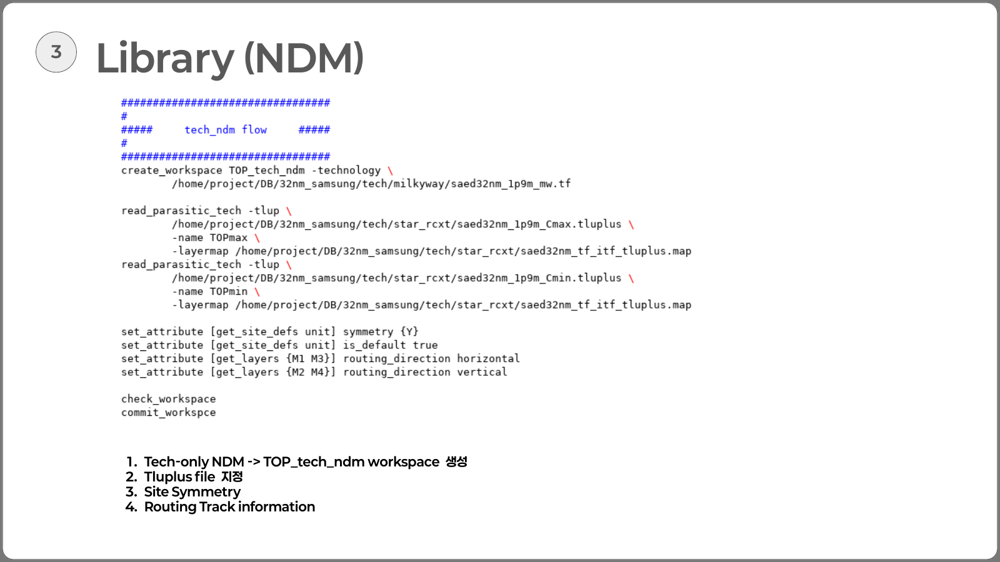

```tcl
create_workspace TOP_tech_ndm -technology saed32nm_1p9m_mw.tf
read_parasitic_tech -tlup saed32nm_1p9m_Cmax.tluplus -name TOPmax -layermap saed32nm_tf_itf_tluplus.map
read_parasitic_tech -tlup saed32nm_1p9m_Cmin.tluplus -name TOPmin -layermap saed32nm_tf_itf_tluplus.map
set_attribute [get_site_defs unit] symmetry {Y}
set_attribute [get_site_defs unit] is_default true
set_attribute [get_layers {M1 M3}] routing_direction horizontal
set_attribute [get_layers {M2 M4}] routing_direction vertical
```

Tech-only NDM에 Cmax / Cmin TLUplus를 `TOPmax`, `TOPmin` 이름으로 등록하고, site symmetry와 layer별 routing 방향(M1·M3 수평, M2·M4 수직)을 지정했습니다.

---

### Slide 23 · Nlib flow

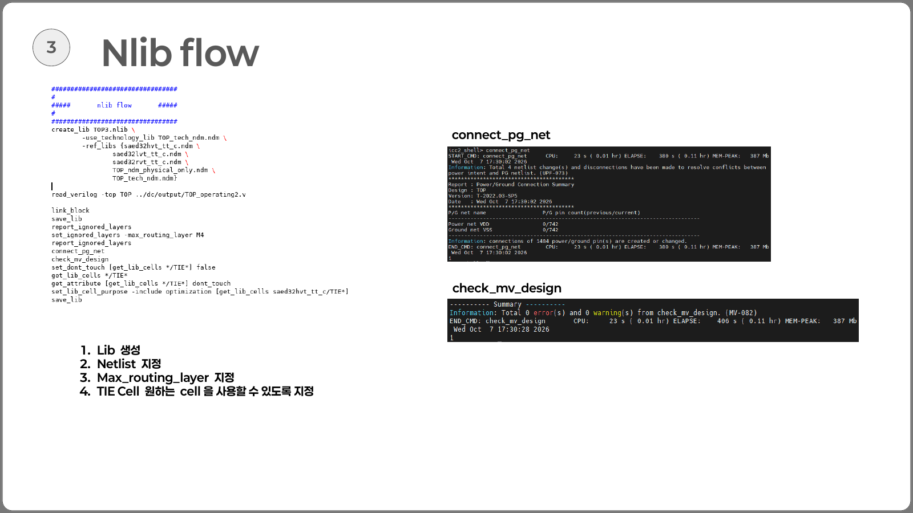

- `create_lib TOP.nlib -use_technology_lib TOP_tech_ndm.ndm -ref_libs {...}` 로 design library 생성
- `read_verilog -top TOP` 으로 DC netlist 읽기 → `link_block`
- `set_ignored_layers -max_routing_layer M4` 로 M4까지만 routing
- `set_dont_touch [get_lib_cells */TIE*] false` + `set_lib_cell_purpose -include optimization` 으로 TIE cell 사용 허용
- `connect_pg_net` — 모든 cell의 VDD/VSS pin을 PG net에 연결
- `check_mv_design` — **0 errors, 0 warnings**

---

### Slide 24 · MCMM

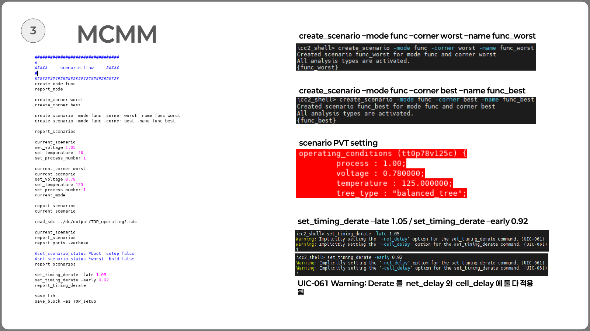

```tcl
create_scenario -mode func -corner worst -name func_worst
create_scenario -mode func -corner best  -name func_best
set_timing_derate -late  1.05
set_timing_derate -early 0.92
```

| Corner | Process | Voltage | Temperature |
|---|---|---|---|
| worst | 1 | 0.78 V | 125 ℃ |
| best | 1 | 1.05 V | −40 ℃ |

worst / best corner의 scenario를 만들고 DC에서 넘어온 SDC를 읽었습니다. timing derate로 late path는 5% 느리게, early path는 8% 빠르게 가정해 OCV 마진을 확보했습니다.

- `UIC-061` Warning — derate가 net delay와 cell delay에 모두 적용됨

---

### Slide 25 · Floorplan (1)

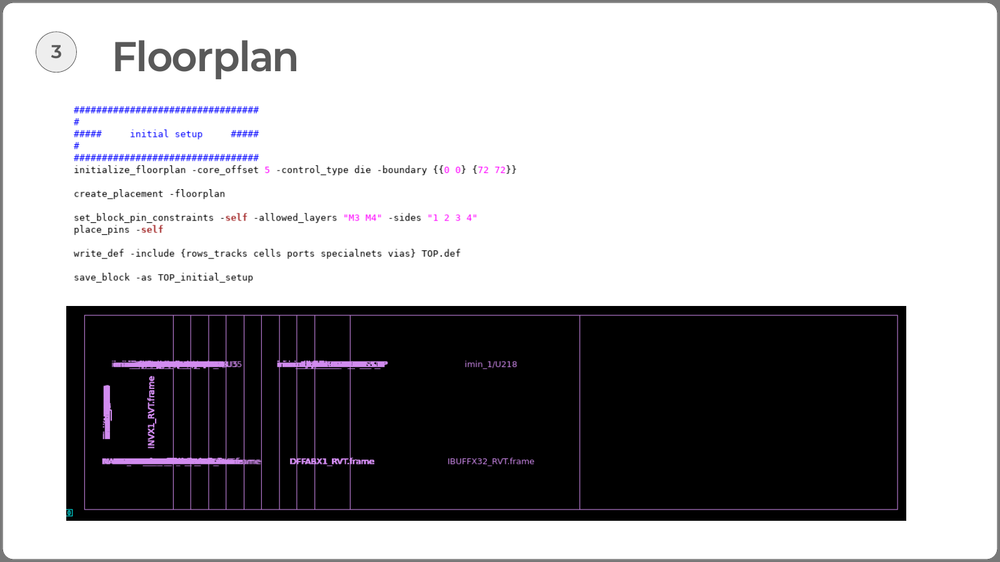

Floorplan 초기 setup 스크립트와, `initialize_floorplan` 직후의 화면입니다. 아직 배치 전이라 standard cell들이 die 밖 한쪽에 몰려 있습니다.

```tcl
initialize_floorplan -core_offset 5 -control_type die -boundary {{0 0} {72 72}}
create_placement -floorplan
set_block_pin_constraints -self -allowed_layers "M3 M4" -sides "1 2 3 4"
place_pins -self
write_def -include {rows_tracks cells ports specialnets vias} TOP.def
save_block -as TOP_initial_setup
```

---

### Slide 26 · Floorplan (2) — initialize_floorplan

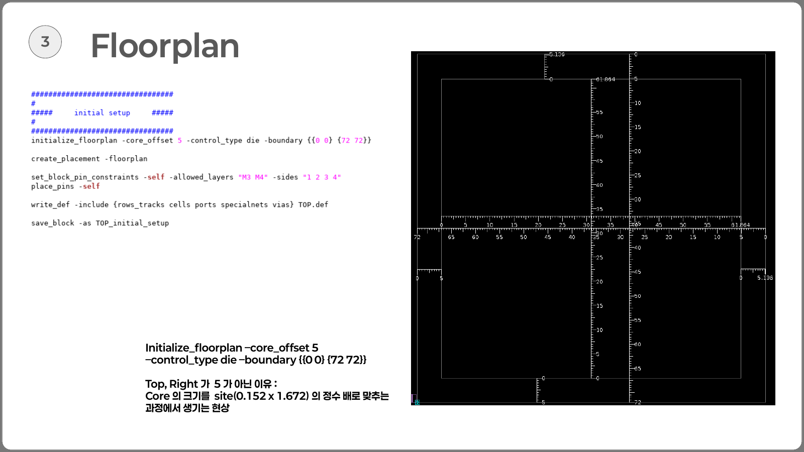

72 × 72 µm die에 core offset 5 µm로 floorplan을 생성한 결과입니다. 오른쪽 캡처의 눈금에서 core 경계를 확인할 수 있습니다.

**Top과 Right의 offset이 정확히 5가 아닌 이유**는 core 크기를 site(0.152 × 1.672)의 정수 배로 맞추는 과정에서 생기는 현상입니다.

---

### Slide 27 · Floorplan (3) — Pin 배치

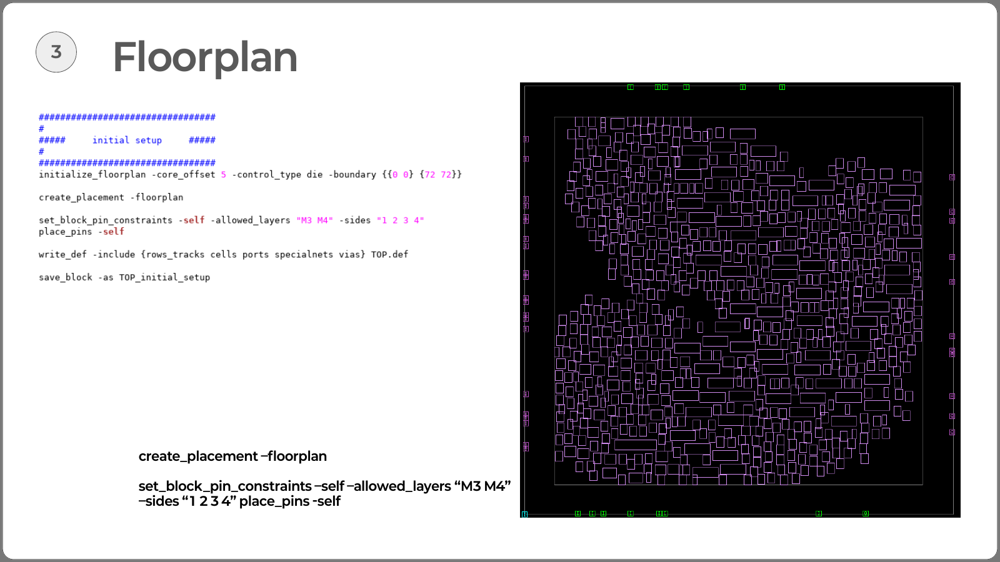

`create_placement -floorplan` 으로 cell을 core 안에 대략 배치하고, M3 / M4 layer를 사용해 네 변에 I/O pin을 배치한 결과입니다. 캡처에서 core 둘레의 pin과 core 내부에 퍼진 cell들을 확인할 수 있습니다.

---

### Slide 28 · Powerplan (1)

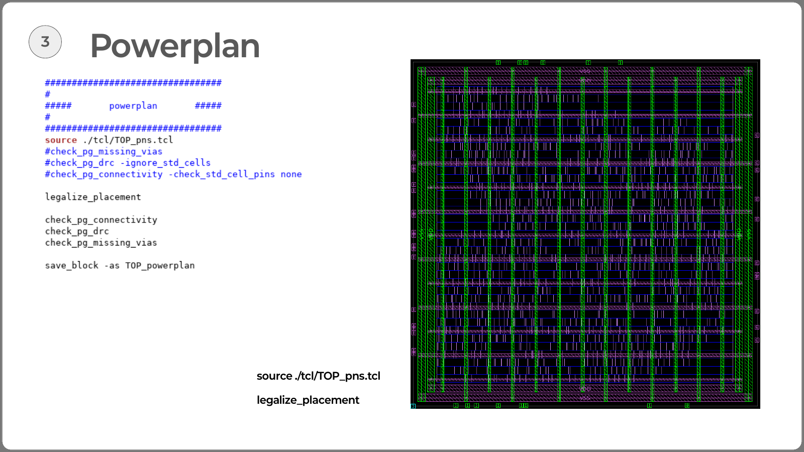

```tcl
source ./tcl/TOP_pns.tcl
legalize_placement
check_pg_connectivity
check_pg_drc
check_pg_missing_vias
save_block -as TOP_powerplan
```

PNS Tcl 스크립트로 Ring, Mesh(M3/M4), Rail(M1)을 생성한 결과입니다. 초록색 수직선이 M4, 보라색 수평선이 M3 mesh입니다.

---

### Slide 29 · Powerplan (2) — Mesh 설계

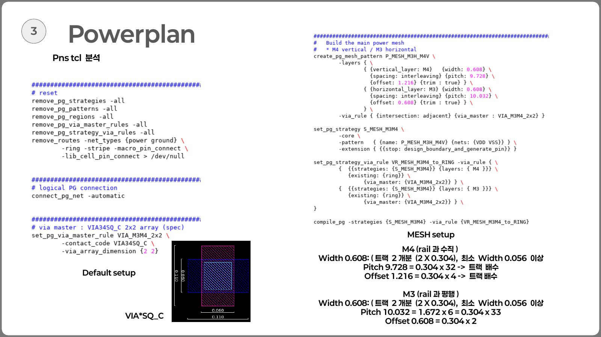

PNS Tcl 스크립트를 분석했습니다.

- **reset** — 기존 PG strategy, pattern, region, via rule과 PG route를 모두 제거
- **logical PG connection** — `connect_pg_net -automatic`
- **via master** — `VIA_M3M4_2x2` : `VIA34SQ_C`를 2 × 2 array로 사용

**Mesh 설계** — 모든 치수를 **routing track pitch(0.304)의 배수**로 계산했습니다.

| Layer | 방향 | Width | Pitch | Offset |
|---|---|---|---|---|
| M4 | rail과 수직 | 0.608 (트랙 2개, 최소 width 0.056 이상) | 9.728 = 0.304 × 32 | 1.216 = 0.304 × 4 |
| M3 | rail과 평행 | 0.608 (트랙 2개) | 10.032 = 1.672 × 6 = 0.304 × 33 | 0.608 = 0.304 × 2 |

M3 pitch는 row height(1.672)의 배수이면서 동시에 track pitch의 배수가 되도록 맞췄습니다.

---

### Slide 30 · Powerplan (3) — Ring / Rail

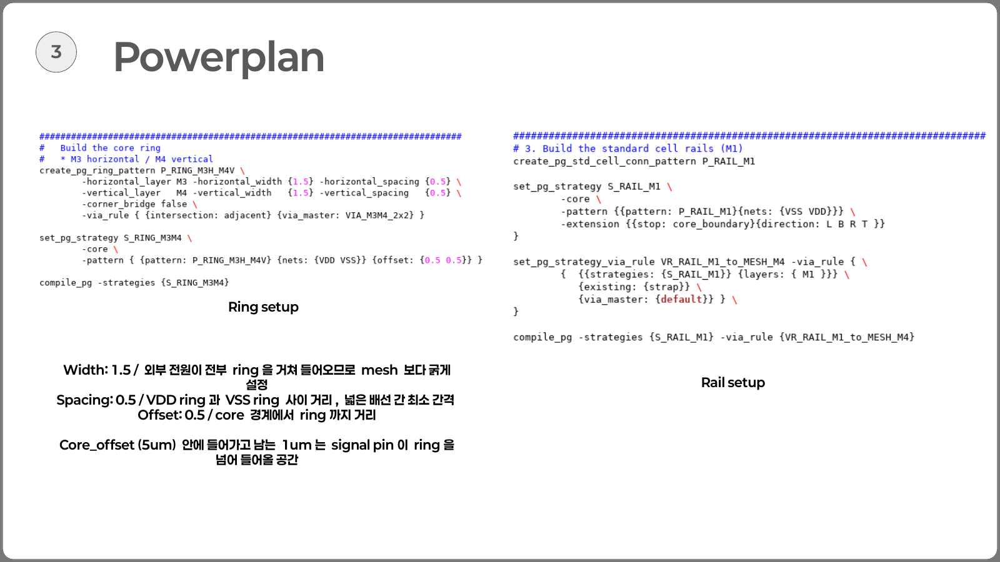

| Ring 설정 | 값 | 이유 |
|---|---|---|
| Width | 1.5 | 외부 전원이 모두 ring을 거쳐 들어오므로 mesh보다 굵게 |
| Spacing | 0.5 | VDD ring과 VSS ring 사이 거리 (넓은 배선 간 최소 간격) |
| Offset | 0.5 | core 경계에서 ring까지 거리 |

Core offset 5 µm 안에 ring이 들어가고, 남는 1 µm는 signal pin이 ring을 넘어 들어올 공간입니다.

---

### Slide 31 · Powerplan (4) — 1차 검증

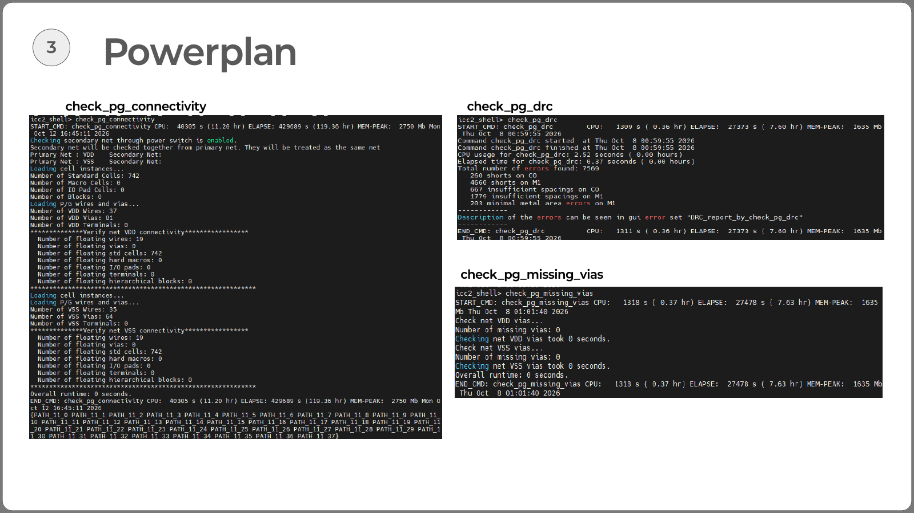

PNS 직후 PG 검증 결과, 문제가 발견되었습니다.

| 검사 | 결과 |
|---|---|
| `check_pg_connectivity` | VDD / VSS 각각 **floating wire 19개, floating std cell 742개** |
| `check_pg_drc` | 총 **7,569건** (CO short 260, M1 short 4,660, CO spacing 667, M1 spacing 1,779, M1 min area 203) |
| `check_pg_missing_vias` | 0건 |

M1 rail과 상위 mesh 사이에 via가 생기지 않아 wire가 떠 있고, cell들이 rail에 정렬되지 않은 상태였습니다.

---

### Slide 32 · Powerplan (5) — Floating wire 수정

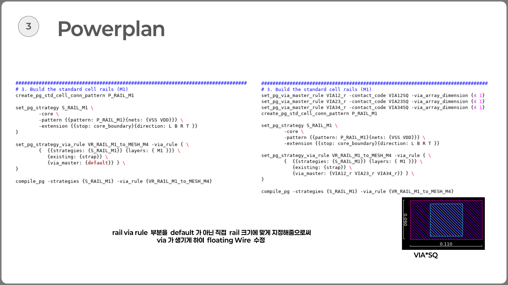

왼쪽이 수정 전, 오른쪽이 수정 후의 rail 스크립트입니다.

```tcl
set_pg_via_master_rule VIA12_r -contact_code VIA12SQ -via_array_dimension {4 1}
set_pg_via_master_rule VIA23_r -contact_code VIA23SQ -via_array_dimension {4 1}
set_pg_via_master_rule VIA34_r -contact_code VIA34SQ -via_array_dimension {4 1}
...
set_pg_strategy_via_rule VR_RAIL_M1_to_MESH_M4 -via_rule {
    {{strategies: {S_RAIL_M1}} {layers: {M1}}}
    {existing: {strap}}
    {via_master: {VIA12_r VIA23_r VIA34_r}} }
```

Rail via rule의 via master를 `default` 대신 **rail 크기에 맞는 via를 직접 지정**하자 M1 → M4까지 via stack이 생성되어 floating wire가 해결되었습니다.

---

### Slide 33 · Powerplan (6) — PG 구조

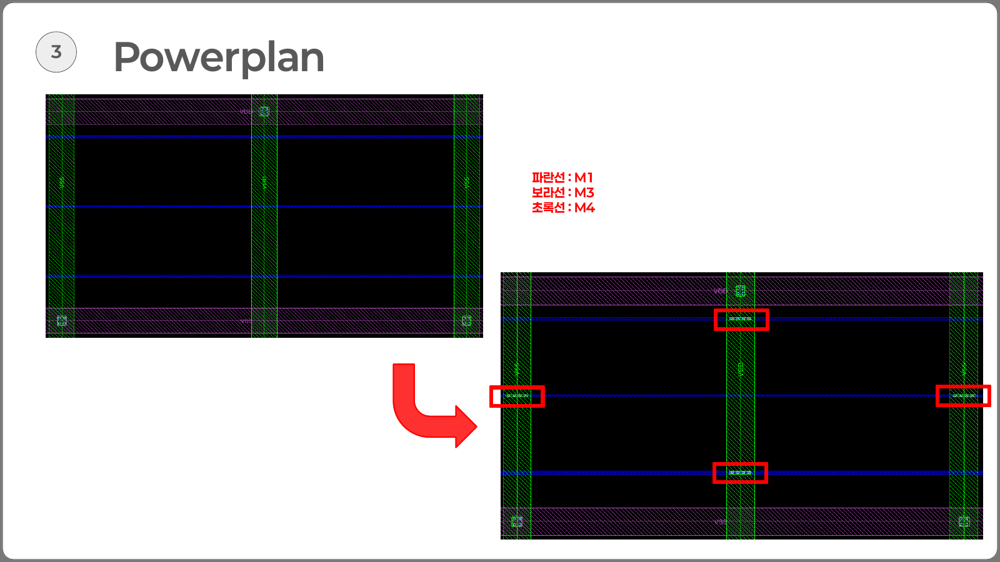

Via 수정 전(왼쪽 위)에는 M1 rail과 M4 strap이 교차해도 via가 없었지만, 수정 후(오른쪽 아래)에는 붉은 박스처럼 교차점마다 via가 생성되었습니다.

🔵 파란선: M1 (rail) · 🟣 보라선: M3 · 🟢 초록선: M4

---

### Slide 34 · Powerplan (7) — Floating std cell 수정

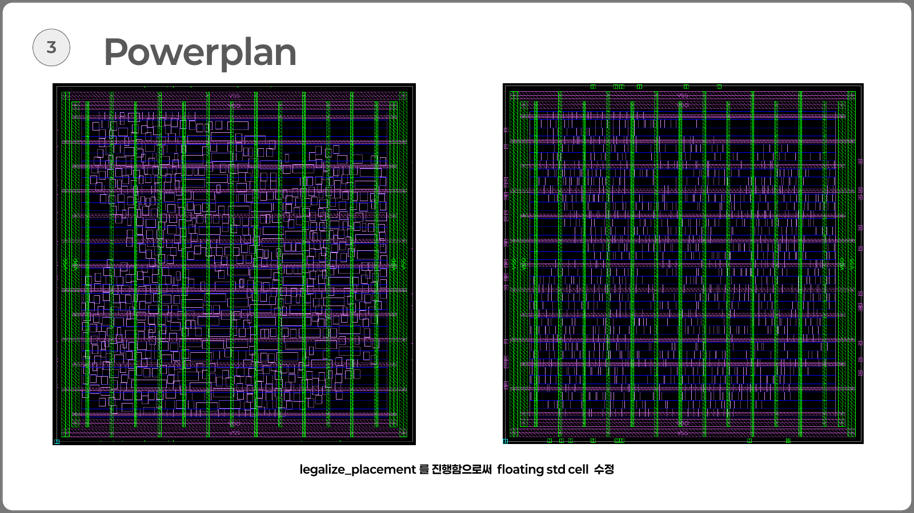

`legalize_placement`를 진행해 rail에 정렬되지 않았던 floating std cell을 수정했습니다.

---

### Slide 35 · Powerplan (8) — 최종 검증

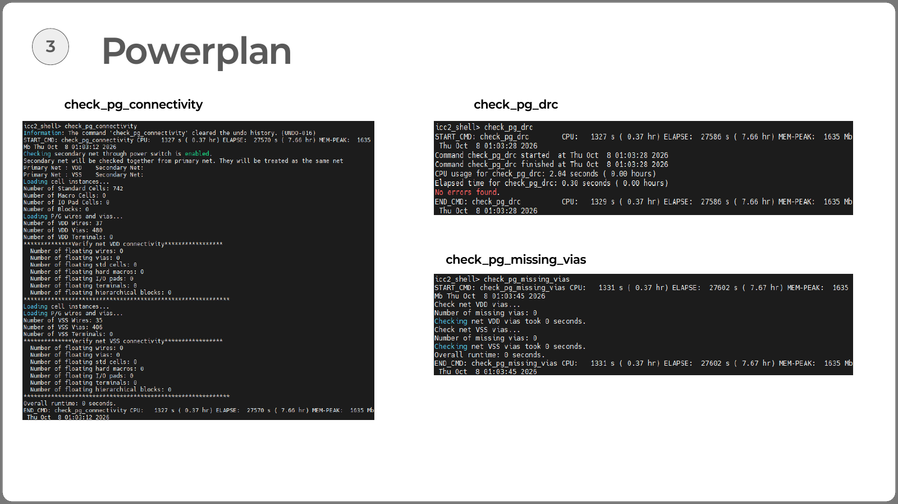

수정 후 PG 검증을 다시 실행했습니다.

| 검사 | 결과 |
|---|---|
| `check_pg_connectivity` | floating wire 0, floating via 0, floating std cell **0** |
| `check_pg_drc` | **No errors found** |
| `check_pg_missing_vias` | 0건 |

---

### Slide 36 · Placement (1) — 사전 점검

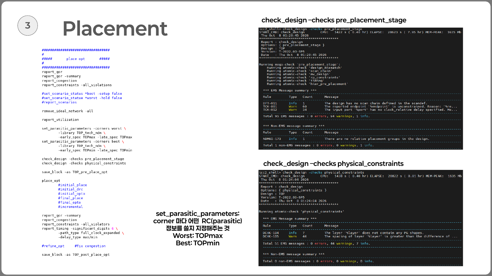

```tcl
remove_ideal_network -all
set_parasitic_parameters -corners worst -library TOP_tech_ndm -early_spec TOPmax -late_spec TOPmax
set_parasitic_parameters -corners best  -library TOP_tech_ndm -early_spec TOPmin -late_spec TOPmin
check_design -checks pre_placement_stage
check_design -checks physical_constraints
place_opt
refine_opt
```

`set_parasitic_parameters` 로 corner마다 사용할 RC 정보를 지정했습니다 (worst: `TOPmax`, best: `TOPmin`). 오른쪽은 placement 전 `check_design` 결과로, 두 검사 모두 **0 errors** 입니다.

---

### Slide 37 · Placement (2) — 점검 메시지 분석

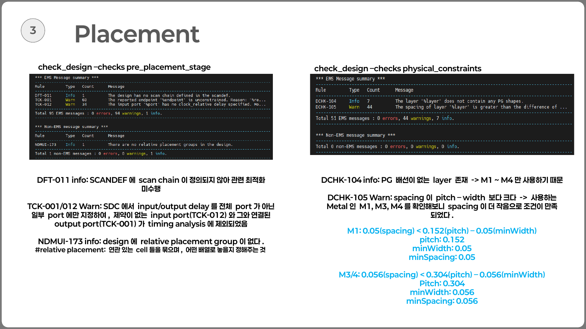

| 메시지 | 내용 |
|---|---|
| `DFT-011` Info | SCANDEF에 scan chain이 없어 관련 최적화 미수행 |
| `TCK-001/012` Warn | SDC의 input/output delay가 일부 port에만 지정되어, 제약 없는 port가 timing analysis에서 제외됨 |
| `NDMUI-173` Info | relative placement group 없음 (연관 cell을 묶어 배열을 지정하는 기능) |
| `DCHK-104` Info | PG 배선이 없는 layer 존재 → M1 ~ M4만 사용하기 때문 |
| `DCHK-105` Warn | spacing이 pitch − width보다 큼 → 직접 계산해 조건 만족 확인 |

**DCHK-105 검증**
- M1: spacing 0.05 < pitch 0.152 − minWidth 0.05
- M3 / M4: spacing 0.056 < pitch 0.304 − minWidth 0.056

---

### Slide 38 · Placement (3) — place_opt 전 / 후

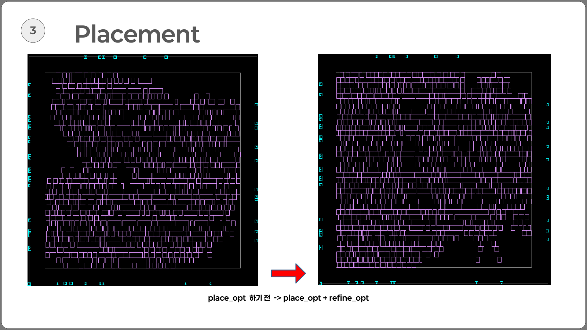

`place_opt` 전(왼쪽)과 `place_opt` + `refine_opt` 후(오른쪽)의 배치 결과입니다. 최적화 후 cell이 core 전체에 더 고르게 퍼지고, buffer 추가로 cell 수가 늘어난 것을 확인할 수 있습니다.

---

### Slide 39 · Placement (4) — QoR 비교

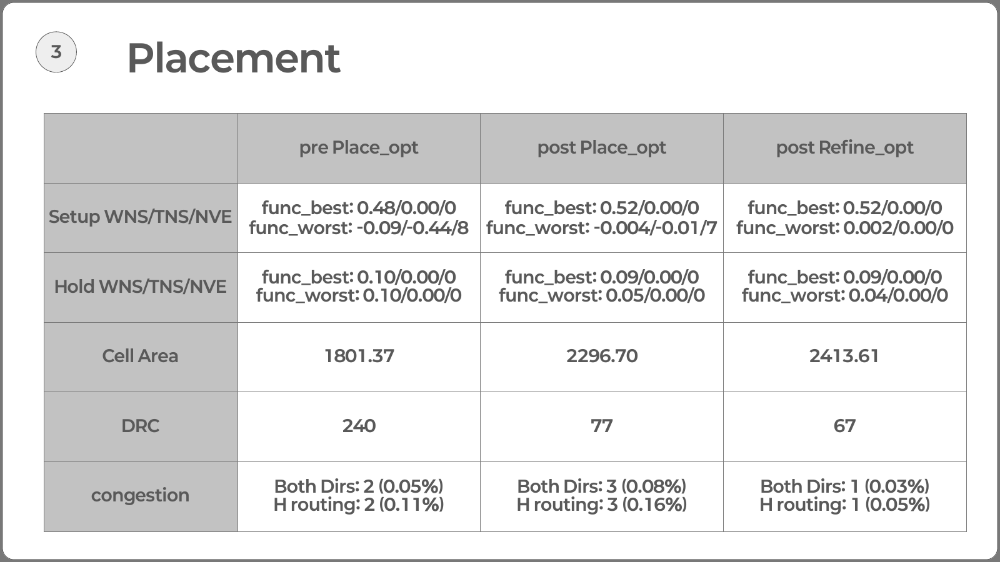

| 항목 | pre place_opt | post place_opt | post refine_opt |
|---|---|---|---|
| Setup WNS/TNS/NVE | best 0.48/0.00/0<br>worst -0.09/-0.44/8 | best 0.52/0.00/0<br>worst -0.004/-0.01/7 | best 0.52/0.00/0<br>worst **0.002/0.00/0** |
| Hold WNS/TNS/NVE | best 0.10/0.00/0<br>worst 0.10/0.00/0 | best 0.09/0.00/0<br>worst 0.05/0.00/0 | best 0.09/0.00/0<br>worst 0.04/0.00/0 |
| Cell Area | 1801.37 | 2296.70 | 2413.61 |
| DRC | 240 | 77 | 67 |
| Congestion | Both 2 (0.05%)<br>H 2 (0.11%) | Both 3 (0.08%)<br>H 3 (0.16%) | Both 1 (0.03%)<br>H 1 (0.05%) |

`refine_opt`까지 진행해 func_worst의 setup 위반을 모두 해결했고, DRC도 240 → 67로 감소했습니다.

---

### Slide 40 · CTS Setup

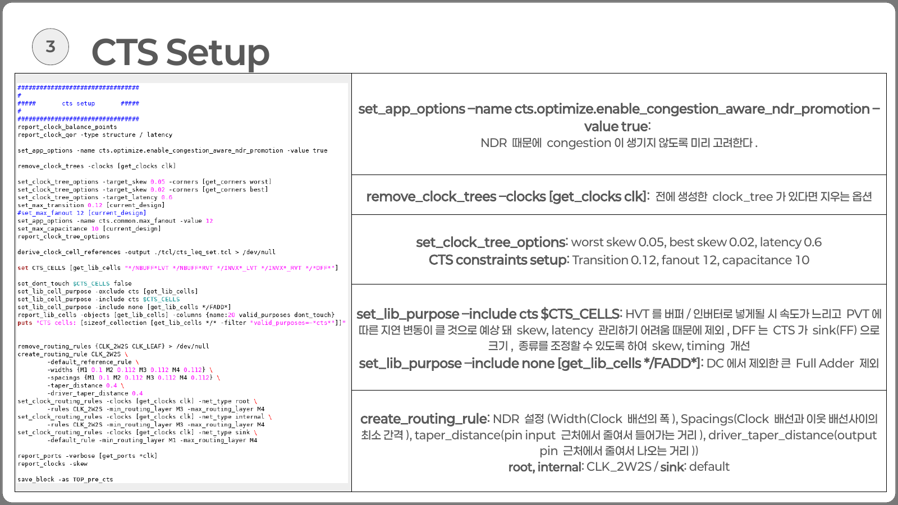

- `cts.optimize.enable_congestion_aware_ndr_promotion true` — NDR로 인한 congestion을 미리 고려
- `remove_clock_trees -clocks [get_clocks clk]` — 이전 clock tree 제거
- `set_clock_tree_options` — worst skew 0.05, best skew 0.02, latency 0.6
- CTS constraints — transition 0.12, fanout 12, capacitance 10
- `set_lib_purpose -include cts $CTS_CELLS`
  - **HVT 제외**: 느리고 PVT에 따른 delay 변동이 커 skew / latency 관리가 어려움
  - **DFF 포함**: CTS가 sink(FF)의 크기·종류를 조정해 skew와 timing을 개선할 수 있도록
- `set_lib_purpose -include none [get_lib_cells */FADD*]` — DC에서 제외한 Full Adder 제외
- `create_routing_rule` — NDR 설정 (width, spacing, taper_distance, driver_taper_distance)
  - root / internal: `CLK_2W2S`, sink: default

---

### Slide 41 · CTS (1) — Classic CTS

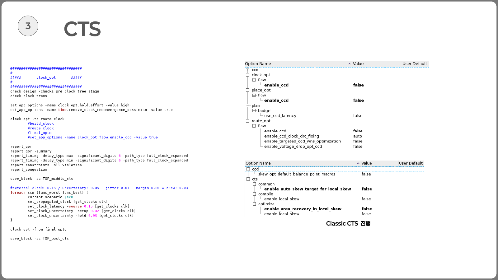

Clock tree 생성 스크립트와 CCD 관련 옵션 화면입니다.

```tcl
clock_opt -to route_clock      ;# build_clock → route_clock
...
clock_opt -from final_opto
save_block -as TOP_post_cts
```

오른쪽 옵션 목록처럼 `clock_opt`, `place_opt`, `route_opt`의 `enable_ccd`를 모두 **false**로 두어, CCD(Concurrent Clock and Data) 없이 **Classic CTS**로 진행했습니다. clock tree를 먼저 균형 있게 만든 뒤 data path를 최적화하는 방식입니다.

---

### Slide 42 · CTS (2) — pre_clock_tree_stage 점검

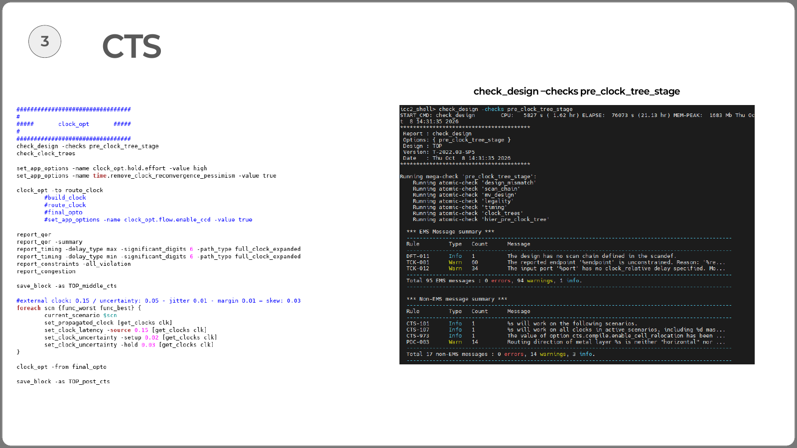

CTS 전 `check_design -checks pre_clock_tree_stage` 실행 결과입니다. **0 errors** 로 CTS를 진행할 수 있는 상태임을 확인했습니다. 메시지 내용은 다음 슬라이드에서 분석했습니다.

---

### Slide 43 · CTS (3) — 점검 메시지 분석

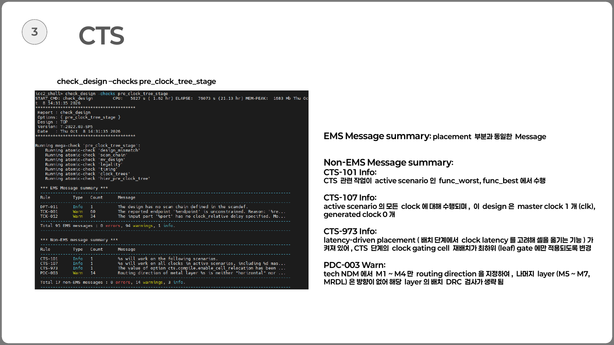

| 메시지 | 내용 |
|---|---|
| EMS summary | Placement 단계와 동일한 메시지 |
| `CTS-101` Info | CTS 작업이 active scenario인 func_worst, func_best에서 수행됨 |
| `CTS-107` Info | master clock 1개(clk), generated clock 0개 |
| `CTS-973` Info | latency-driven placement가 켜져 있어 clock gating cell 재배치가 leaf gate에만 적용 |
| `PDC-003` Warn | tech NDM에 M1 ~ M4만 routing direction이 지정되어 M5 ~ M7, MRDL의 배치 DRC 검사 생략 |

---

### Slide 44 · CTS (4) — Clock 설정

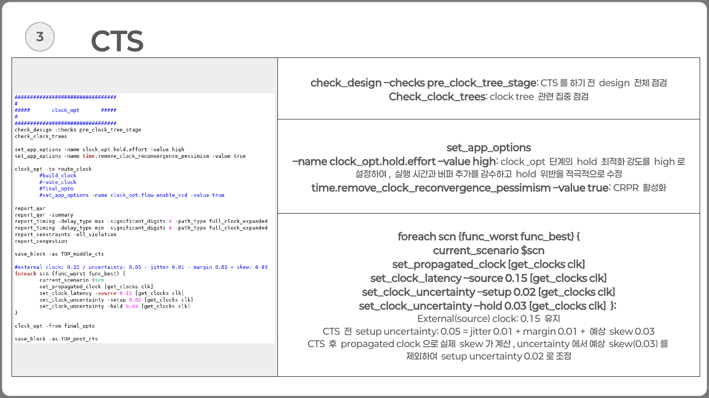

- `check_clock_trees` — clock tree 집중 점검
- `clock_opt.hold.effort high` — 실행 시간과 버퍼 추가를 감수하고 hold 위반을 적극 수정
- `time.remove_clock_reconvergence_pessimism true` — CRPR 활성화

```tcl
foreach scn {func_worst func_best} {
    current_scenario $scn
    set_propagated_clock [get_clocks clk]
    set_clock_latency -source 0.15 [get_clocks clk]
    set_clock_uncertainty -setup 0.02 [get_clocks clk]
    set_clock_uncertainty -hold  0.03 [get_clocks clk]
}
```

**Setup uncertainty 조정 근거**
- CTS 전: 0.05 = jitter 0.01 + margin 0.01 + 예상 skew 0.03
- CTS 후: propagated clock으로 실제 skew가 계산되므로 예상 skew(0.03)를 빼고 **0.02**로 조정

---

### Slide 45 · CTS (5) — clock_opt 전 / 후

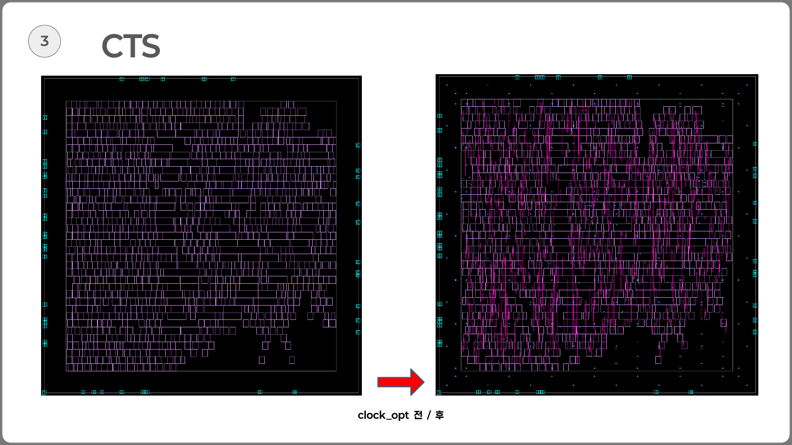

`clock_opt` 전(왼쪽)과 후(오른쪽)의 layout입니다. 오른쪽에서 보라색 clock net 배선과 clock buffer들이 design 전체에 분포된 것을 확인할 수 있습니다.

---

### Slide 46 · CTS (6) — QoR 비교

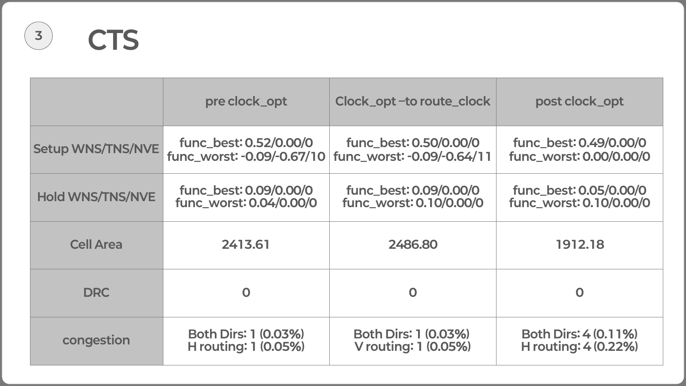

| 항목 | pre clock_opt | clock_opt -to route_clock | post clock_opt |
|---|---|---|---|
| Setup WNS/TNS/NVE | best 0.52/0.00/0<br>worst -0.09/-0.67/10 | best 0.50/0.00/0<br>worst -0.09/-0.64/11 | best 0.49/0.00/0<br>worst **0.00/0.00/0** |
| Hold WNS/TNS/NVE | best 0.09/0.00/0<br>worst 0.04/0.00/0 | best 0.09/0.00/0<br>worst 0.10/0.00/0 | best 0.05/0.00/0<br>worst 0.10/0.00/0 |
| Cell Area | 2413.61 | 2486.80 | 1912.18 |
| DRC | 0 | 0 | 0 |
| Congestion | Both 1 (0.03%)<br>H 1 (0.05%) | Both 1 (0.03%)<br>V 1 (0.05%) | Both 4 (0.11%)<br>H 4 (0.22%) |

propagated clock 적용으로 생긴 setup 위반을 `clock_opt`에서 모두 해결했고, Cell Area도 2413.61 → 1912.18로 줄었습니다.

---

### Slide 47 · Routing (1) — Routing 옵션

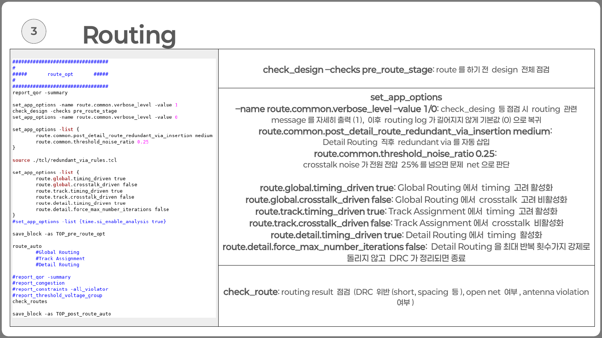

- `check_design -checks pre_route_stage` — routing 전 점검
- `route.common.verbose_level 1 → 0` — 점검 시 메시지를 자세히, 이후 기본값으로 복귀
- `post_detail_route_redundant_via_insertion medium` — detail routing 직후 redundant via 자동 삽입
- `threshold_noise_ratio 0.25` — crosstalk noise가 전원 전압의 25%를 넘으면 문제 net으로 판단
- Global / Track / Detail routing 모두 **timing-driven 활성화**, crosstalk-driven 비활성화
- `route.detail.force_max_number_iterations false` — DRC가 정리되면 최대 반복 전에 종료
- `check_route` — short, spacing, open net, antenna 위반 점검

---

### Slide 48 · Routing (2) — SI / LVS

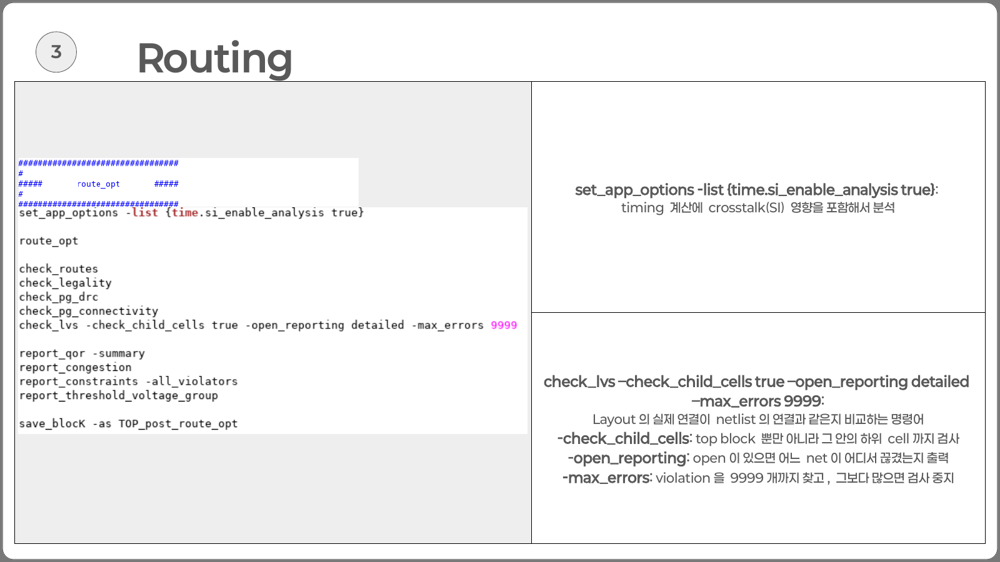

- `time.si_enable_analysis true` — timing 계산에 crosstalk(SI) 영향 포함

```tcl
check_lvs -check_child_cells true -open_reporting detailed -max_errors 9999
```

- `-check_child_cells` — top block뿐 아니라 하위 cell까지 검사
- `-open_reporting detailed` — open이 있으면 어느 net이 어디서 끊겼는지 출력
- `-max_errors 9999` — 최대 9999개 위반까지 탐색

---

### Slide 49 · Routing (3) — route_opt 전 / 후

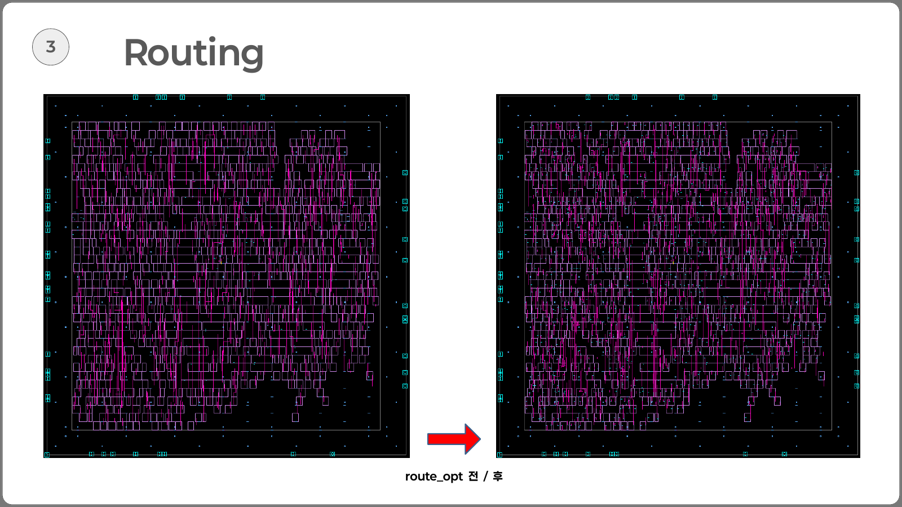

`route_opt` 전(왼쪽)과 후(오른쪽)의 layout입니다. Signal net의 detail routing이 완료되어 M1 ~ M4 배선이 design 전체를 채우고 있습니다.

---

### Slide 50 · Routing (4) — QoR 비교

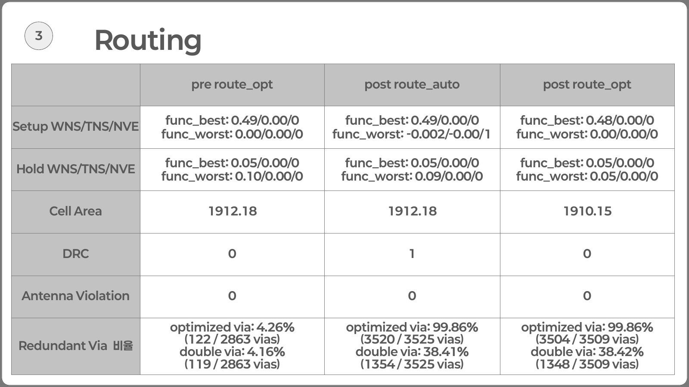

| 항목 | pre route_opt | post route_auto | post route_opt |
|---|---|---|---|
| Setup WNS/TNS/NVE | best 0.49/0.00/0<br>worst 0.00/0.00/0 | best 0.49/0.00/0<br>worst -0.002/-0.00/1 | best 0.48/0.00/0<br>worst **0.00/0.00/0** |
| Hold WNS/TNS/NVE | best 0.05/0.00/0<br>worst 0.10/0.00/0 | best 0.05/0.00/0<br>worst 0.09/0.00/0 | best 0.05/0.00/0<br>worst 0.05/0.00/0 |
| Cell Area | 1912.18 | 1912.18 | 1910.15 |
| DRC | 0 | 1 | **0** |
| Antenna | 0 | 0 | 0 |
| Optimized via | 4.26% (122/2863) | 99.86% (3520/3525) | 99.86% (3504/3509) |
| Double via | 4.16% (119/2863) | 38.41% (1354/3525) | 38.42% (1348/3509) |

`route_auto` 후 발생한 setup 위반 1건과 DRC 1건을 `route_opt`로 해결했습니다.

---

### Slide 51 · Filler Cell (1)

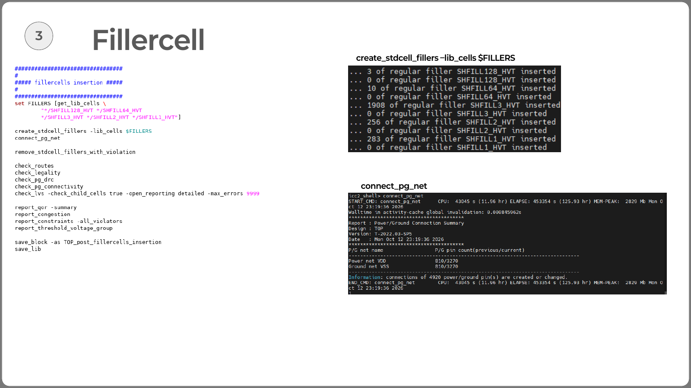

```tcl
set FILLERS [get_lib_cells "*/SHFILL128_HVT */SHFILL64_HVT */SHFILL3_HVT */SHFILL2_HVT */SHFILL1_HVT"]
create_stdcell_fillers -lib_cells $FILLERS
connect_pg_net
remove_stdcell_fillers_with_violation
```

큰 filler부터 차례로 빈 공간을 채웠습니다. 삽입 결과는 SHFILL128 3개, SHFILL64 10개, SHFILL3 1,908개, SHFILL2 256개, SHFILL1 283개입니다. 이후 `connect_pg_net` 으로 filler의 PG pin까지 연결했습니다.

---

### Slide 52 · Filler Cell (2) — 최종 Layout


Filler cell 삽입이 완료된 최종 layout입니다. Standard cell row의 빈 공간이 모두 filler로 채워져 N-well과 power rail의 연속성이 확보되었습니다.

---

### Slide 53 · Filler Cell (3) — 최종 검증


최종 sign-off 수준의 검증 결과입니다.

| 검사 | 결과 |
|---|---|
| `check_pg_connectivity` | floating wire / via / std cell 모두 0 |
| `check_pg_drc` | **No errors found** |
| `check_legality` | **succeeded** |
| `check_lvs -check_child_cells true -open_reporting detailed -max_errors 9999` | short 0, open 0 — LVS clean |

---

### Slide 54 · Filler Cell (4) — QoR 비교


| 항목 | pre filler | post filler |
|---|---|---|
| Setup WNS/TNS/NVE | best 0.48/0.00/0<br>worst 0.00/0.00/0 | best 0.48/0.00/0<br>worst -0.0003/-0.00/2 |
| Hold WNS/TNS/NVE | best 0.05/0.00/0<br>worst 0.05/0.00/0 | best 0.05/0.00/0<br>worst 0.05/0.00/0 |
| Cell Area | 1910.15 | netlist 1910.15 / physical 포함 3827.15 |
| DRC | 0 | 0 |
| Antenna | 0 | 0 |
| Optimized via | 99.86% (3504/3509) | 99.86% (3504/3509) |
| Double via | 38.42% (1348/3509) | 38.42% (1348/3509) |

---

[← 메인으로](../README.md) · [다음 Session: CISC →](../02_CISC/README.md)
