# Session 2. CISC Design Project

[← 이전 Session: TOP](../01_TOP/README.md) · [메인으로](../README.md) · [다음 Session: RISC →](../03_RISC/README.md)

> 📅 2026.10.29 · ⏱ Clock 1.4 ns (714 MHz) · 📐 L자형 Floorplan · 🧰 VCS / Design Compiler / Formality / IC Compiler II / StarRC / PrimeTime

**목차**
1. [CISC design RTL](#1-cisc-design-rtl) (Slide 3 ~ 7)
2. [Logic Synthesis (DC)](#2-logic-synthesis-dc) (Slide 8 ~ 23)
3. [Physical Design (ICC2)](#3-physical-design-icc2) (Slide 24 ~ 57)
4. [Verification and Result](#4-verification-and-result) (Slide 58 ~ 62)

---

### Slide 1 · 표지


Multi-cycle FSM 구조의 CISC 프로세서를 RTL 분석부터 Logic Synthesis(DC), Physical Design(ICC2), StarRC 기생 성분 추출과 PrimeTime Sign-off 분석까지 진행한 프로젝트입니다. 목표 동작 주파수는 **714 MHz (Clock Period 1.4 ns)** 입니다.

---

### Slide 2 · Contents

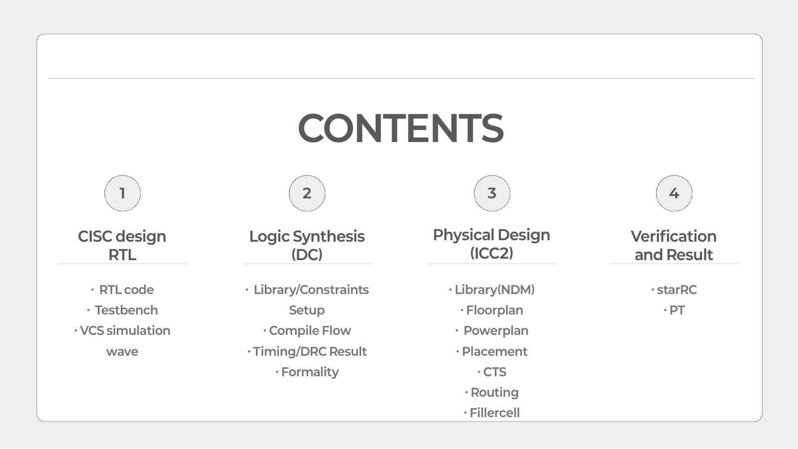

CISC design RTL → Logic Synthesis(DC) → Physical Design(ICC2) → Verification and Result(StarRC, PT) 순서로 구성했습니다.

---

## 1. CISC design RTL

### Slide 3 · RTL 코드 해석 (1) — memory / bidir_core

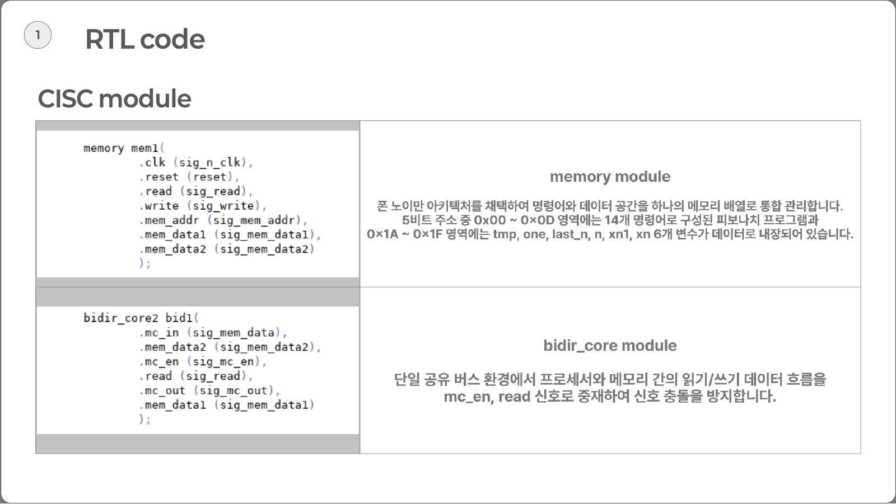

최상위 `cisc` 모듈에서 인스턴스화되는 하위 모듈을 분석했습니다.

**memory module** — **폰 노이만 아키텍처**를 채택해 명령어와 데이터를 하나의 메모리 배열로 통합 관리합니다. 5비트 주소 중 `0x00 ~ 0x0D` 영역에는 14개 명령어로 구성된 피보나치 프로그램이, `0x1A ~ 0x1F` 영역에는 `tmp`, `one`, `last_n`, `n`, `xn1`, `xn` 6개 변수가 데이터로 저장됩니다.

**bidir_core module** — 단일 공유 버스 환경에서 프로세서와 메모리 간의 읽기/쓰기 흐름을 `mc_en`, `read` 신호로 중재해 신호 충돌을 방지합니다.

---

### Slide 4 · RTL 코드 해석 (2) — clk_gen / top_mc

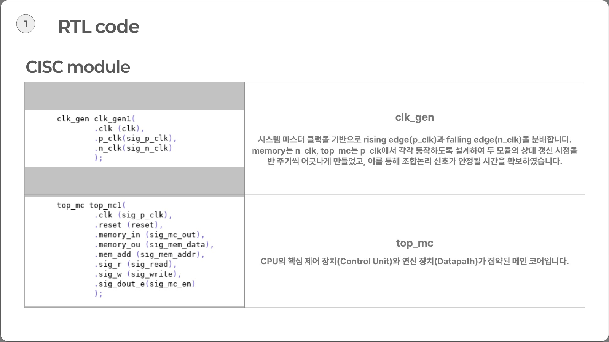

**clk_gen** — 시스템 마스터 클럭을 기반으로 rising edge(`p_clk`)와 falling edge(`n_clk`)를 분배합니다. memory는 `n_clk`, top_mc는 `p_clk`에서 동작하도록 설계해 두 모듈의 상태 갱신 시점을 **반 주기씩 어긋나게** 만들었고, 이를 통해 조합논리 신호가 안정될 시간을 확보합니다.

**top_mc** — CPU의 핵심인 제어 장치(Control Unit)와 연산 장치(Datapath)가 집약된 메인 코어입니다.

---

### Slide 5 · RTL 코드 해석 (3) — 블록별 구조

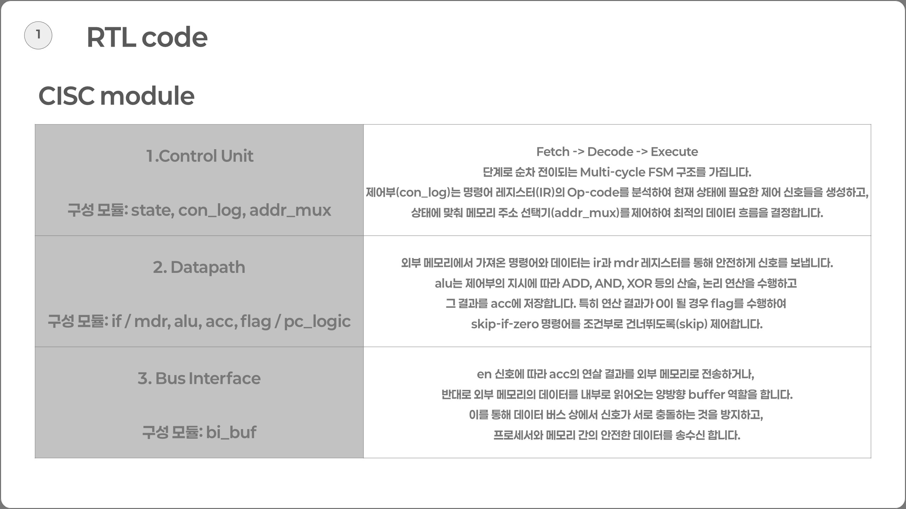

RTL을 세 개의 블록으로 나누어 분석했습니다.

**① Control Unit** (`state`, `con_log`, `addr_mux`)
Fetch → Decode → Execute 단계로 순차 전이하는 **Multi-cycle FSM** 구조입니다. `con_log`는 IR의 Op-code를 분석해 현재 상태에 필요한 제어 신호를 생성하고, `addr_mux`를 제어해 메모리 주소 선택을 결정합니다.

**② Datapath** (`ir` / `mdr`, `alu`, `acc`, `flag` / `pc_logic`)
외부 메모리의 명령어와 데이터는 `ir`, `mdr` 레지스터를 거쳐 전달됩니다. `alu`는 제어부 지시에 따라 ADD, AND, XOR 등의 연산을 수행하고 결과를 `acc`에 저장합니다. 연산 결과가 0이면 `flag`를 통해 **SKIP-if-ZERO** 명령어가 다음 명령을 건너뛰도록 제어합니다.

**③ Bus Interface** (`bi_buf`)
`en` 신호에 따라 acc의 연산 결과를 외부 메모리로 보내거나, 메모리 데이터를 내부로 읽어오는 **양방향 버퍼**입니다. 데이터 버스 상의 신호 충돌을 막아 프로세서와 메모리 간 안전한 송수신을 보장합니다.

---

### Slide 6 · VCS 시뮬레이션 파형 분석

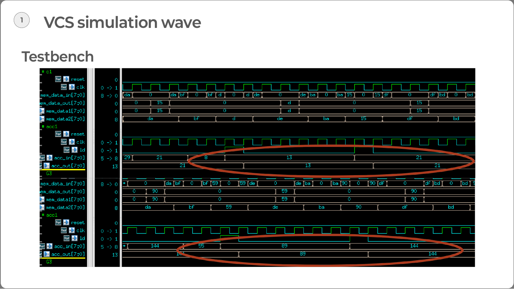

Testbench를 실행한 VCS 파형입니다. 붉은 원으로 표시한 `acc_out` 구간에서 13 → 21 …, 55 → 89 → 144 처럼 피보나치 수열이 순서대로 누적되는 것을 확인할 수 있습니다. `mem_data1`, `mem_data2`, `mem_data_out`의 변화로 메모리 read/write 동작도 함께 확인했습니다.

---

### Slide 7 · VCS 시뮬레이션 결과 정리

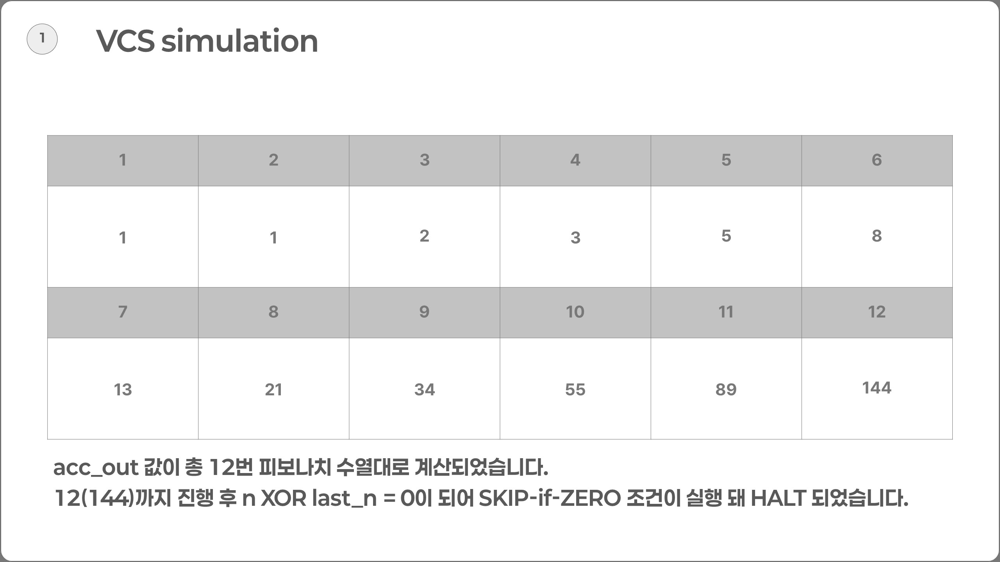

`acc_out` 값이 총 12번, 피보나치 수열대로 계산되는 것을 확인했습니다.

| 순서 | 1 | 2 | 3 | 4 | 5 | 6 | 7 | 8 | 9 | 10 | 11 | 12 |
|---|---|---|---|---|---|---|---|---|---|---|---|---|
| acc_out | 1 | 1 | 2 | 3 | 5 | 8 | 13 | 21 | 34 | 55 | 89 | 144 |

12번째 값(144)까지 진행한 뒤 `n XOR last_n = 0` 이 되어 **SKIP-if-ZERO** 조건이 실행되고, 프로세서가 **HALT** 되었습니다.

---

## 2. Logic Synthesis (DC)

### Slide 8 · Library Setup

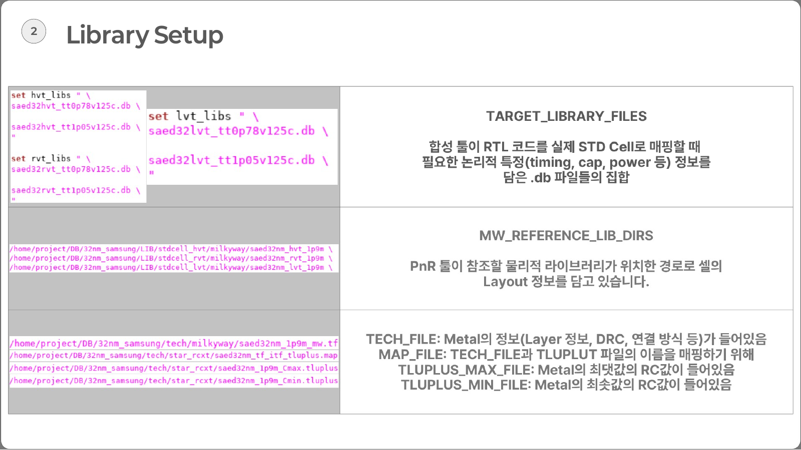

| 설정 | 내용 |
|---|---|
| `TARGET_LIBRARY_FILES` | `saed32hvt / rvt / lvt` 의 `tt0p78v125c`, `tt1p05v125c` .db — RTL을 실제 standard cell로 매핑할 때 필요한 timing, cap, power 정보 |
| `MW_REFERENCE_LIB_DIRS` | `saed32nm_hvt/rvt/lvt_1p9m` milkyway 경로 — cell layout 정보 |
| `TECH_FILE` | Metal layer 정보, DRC, 연결 방식 |
| `MAP_FILE` | TECH_FILE과 TLUPLUS의 layer 이름 매핑 |
| `TLUPLUS_MAX / MIN_FILE` | Metal의 최댓값 / 최솟값 RC 정보 (Cmax / Cmin) |

HVT / RVT / LVT 세 가지 Vth 라이브러리를 모두 지정해 Multi-Vth 최적화가 가능하도록 했습니다.

---

### Slide 9 · Constraints Setup

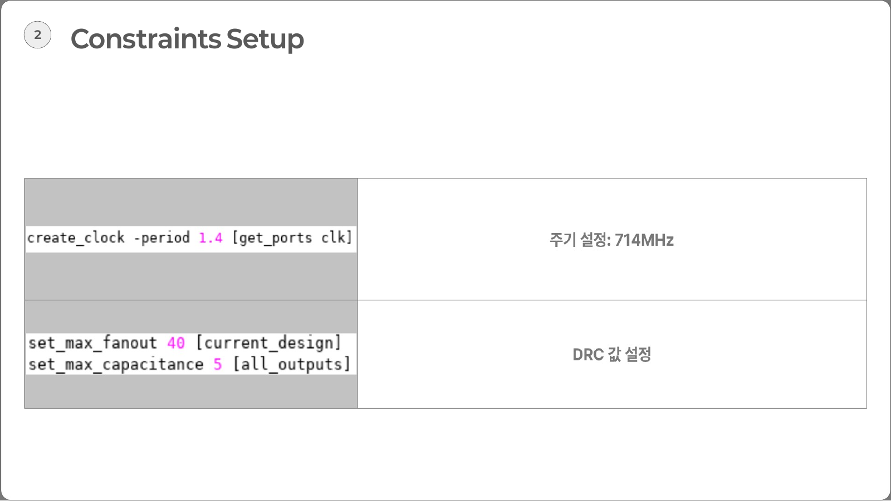

```tcl
create_clock -period 1.4 [get_ports clk]     ;# 714 MHz
set_max_fanout 40 [current_design]
set_max_capacitance 5 [all_outputs]
```

1.4 ns 주기 clock을 정의하고, fanout과 출력 port의 capacitance에 DRC 제약을 걸었습니다.

---

### Slide 10 · Compile Flow

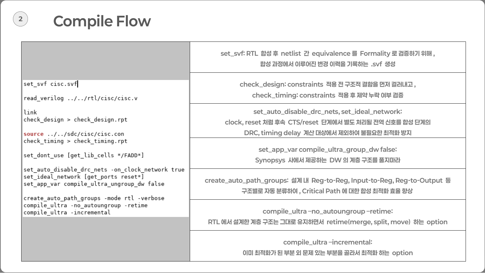

```tcl
set_svf cisc.svf
read_verilog ../../rtl/cisc/cisc.v
link
check_design > check_design.rpt
source ../../sdc/cisc/cisc.con
check_timing > check_timing.rpt
set_dont_use [get_lib_cells */FADD*]
set_auto_disable_drc_nets -on_clock_network true
set_ideal_network [get_ports reset*]
set_app_var compile_ultra_ungroup_dw false
create_auto_path_groups -mode rtl -verbose
compile_ultra -no_autoungroup -retime
compile_ultra -incremental
```

| 명령어 | 목적 |
|---|---|
| `set_svf` | RTL과 합성 netlist의 등가성을 Formality로 검증하기 위해 합성 과정의 변경 이력을 `.svf`로 기록 |
| `check_design` / `check_timing` | constraints 적용 **전** 구조적 결함을 먼저 걸러내고, 적용 **후** 제약 누락 여부를 검증 |
| `set_auto_disable_drc_nets`, `set_ideal_network` | clock, reset처럼 이후 CTS / reset tree 단계에서 별도로 처리될 전역 신호를 합성 단계의 DRC·delay 계산에서 제외 |
| `compile_ultra_ungroup_dw false` | Synopsys DesignWare(alu의 ADD)의 계층 구조를 풀지 않음 |
| `create_auto_path_groups -mode rtl` | Reg-to-Reg, Input-to-Reg, Reg-to-Output 등 구조별로 path group을 자동 분류해 critical path 최적화 효율 향상 |
| `compile_ultra -no_autoungroup -retime` | RTL의 계층 구조는 유지하면서 register를 retime(merge, split, move) |
| `compile_ultra -incremental` | 이미 최적화된 부분은 보존하고 문제 있는 부분만 재최적화 |

---

### Slide 11 · Timing Report (초기 compile)

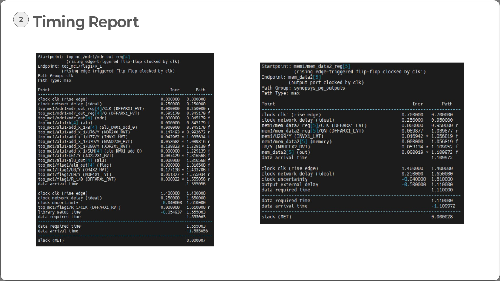

초기 compile 후의 Timing Report입니다.

- **Reg-to-Reg** (`mdr_out_reg → flag1/R_1`, clk group): slack **+0.000007** (MET)
- **Reg-to-Output** (`mem_data2_reg → mem_data2[5]`, output group): slack **+0.000028** (MET)

두 경로 모두 아슬아슬하게 timing을 만족했습니다.

---

### Slide 12 · Timing Report — falling-edge 경로 위반 해결

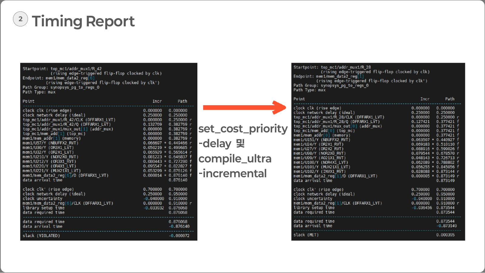

`clk'`(falling edge, memory 쪽) 기준의 `addr_mux1/R_42 → mem_data2_reg` 경로가 **-0.000072** 로 위반되었습니다.

`set_cost_priority -delay` 로 delay를 최우선 비용으로 설정한 뒤 `compile_ultra -incremental` 로 재최적화하자 같은 그룹의 slack이 **+0.000395** 로 개선되었습니다. memory가 `n_clk`(반 주기)로 동작하기 때문에 이 경로는 실질적으로 0.7 ns 안에 도달해야 하는 가장 빡빡한 경로입니다.

---

### Slide 13 · Timing Report — Path Group별 Slack 비교

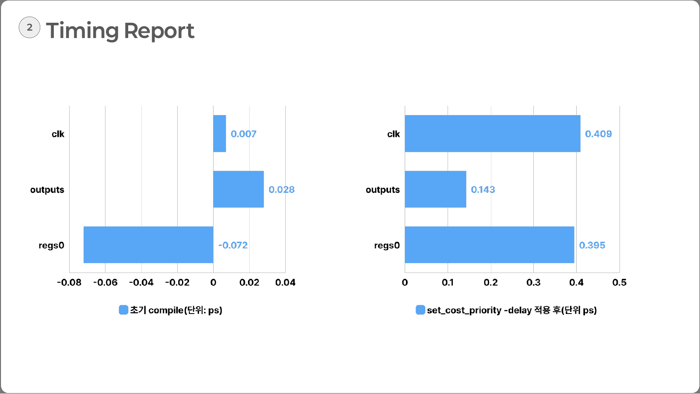

Path group별 worst slack을 그래프로 비교했습니다 (단위: ps).

| Path Group | 초기 compile | `set_cost_priority -delay` 적용 후 |
|---|---:|---:|
| clk | 0.007 | **0.409** |
| outputs | 0.028 | **0.143** |
| regs0 (clk') | **-0.072** | **0.395** |

모든 path group에서 slack이 개선되었고, 유일한 위반 그룹이던 regs0도 해결되었습니다.

---

### Slide 14 · DRC Report (1)

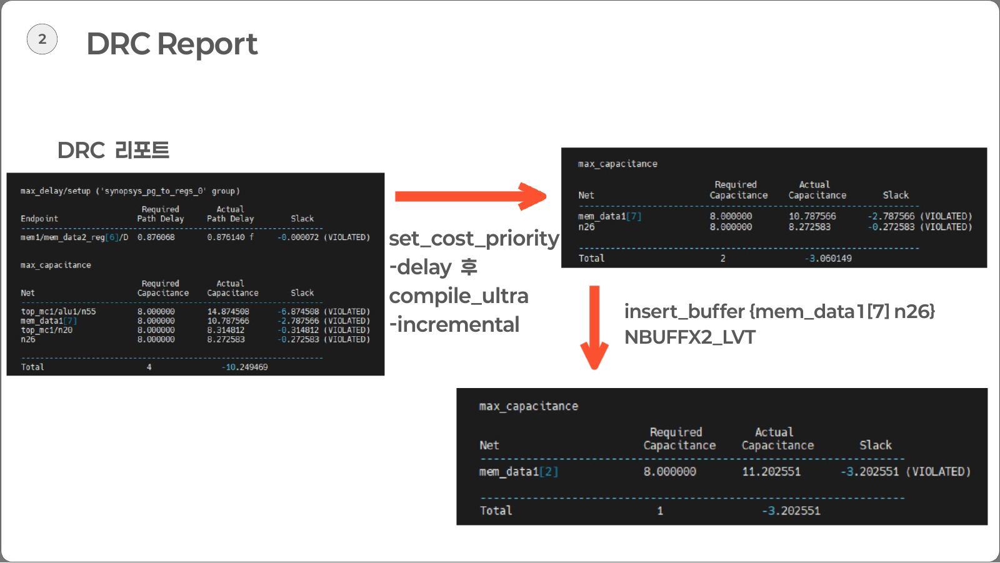

초기 DRC 리포트에는 setup 위반 1건과 **max_capacitance 위반 4건**(Total -10.249469)이 있었습니다.

`set_cost_priority -delay` 후 `compile_ultra -incremental` 로 2건(`mem_data1[7]`, `n26`, Total -3.060149)까지 줄였고, 남은 net에 buffer를 직접 삽입했습니다.

```tcl
insert_buffer {mem_data1[7] n26} NBUFFX2_LVT
```

그 결과 `mem_data1[2]`에서 새로운 위반 1건(-3.202551)이 나타났습니다.

---

### Slide 15 · DRC Report (2)

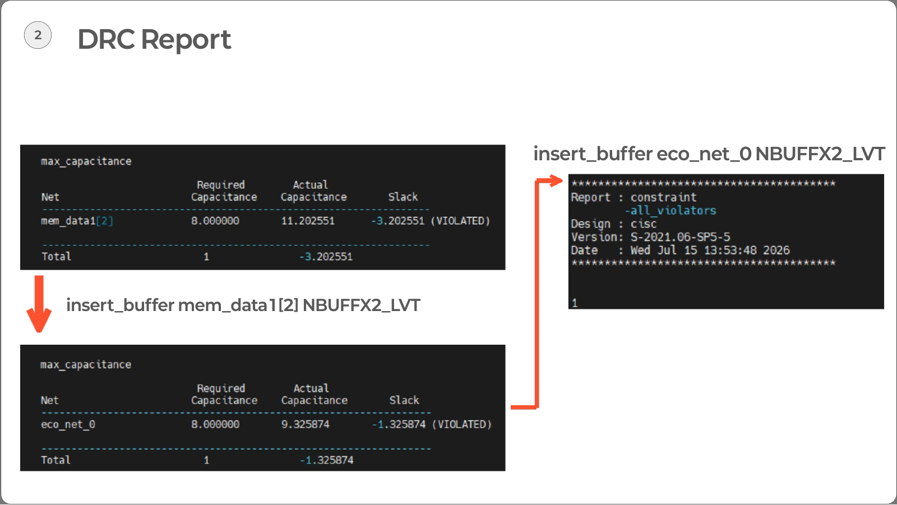

```tcl
insert_buffer mem_data1[2] NBUFFX2_LVT     ;# → eco_net_0 위반 (-1.325874)
insert_buffer eco_net_0   NBUFFX2_LVT     ;# → 위반 0건
```

buffer 삽입으로 생긴 새 ECO net(`eco_net_0`)으로 위반이 옮겨가는 것을 확인하고, 그 net까지 추적해 buffer를 추가했습니다. 최종 `report_constraint -all_violators` 결과 위반이 없음을 확인했습니다.

---

### Slide 16 · DRC 해결 과정 요약

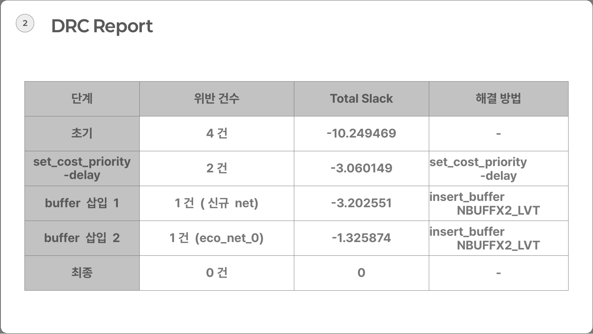

| 단계 | 위반 건수 | Total Slack | 해결 방법 |
|---|---:|---:|---|
| 초기 | 4건 | -10.249469 | – |
| set_cost_priority -delay | 2건 | -3.060149 | `set_cost_priority -delay` |
| buffer 삽입 1 | 1건 (신규 net) | -3.202551 | `insert_buffer NBUFFX2_LVT` |
| buffer 삽입 2 | 1건 (eco_net_0) | -1.325874 | `insert_buffer NBUFFX2_LVT` |
| **최종** | **0건** | **0** | – |

---

### Slide 17 · Formality

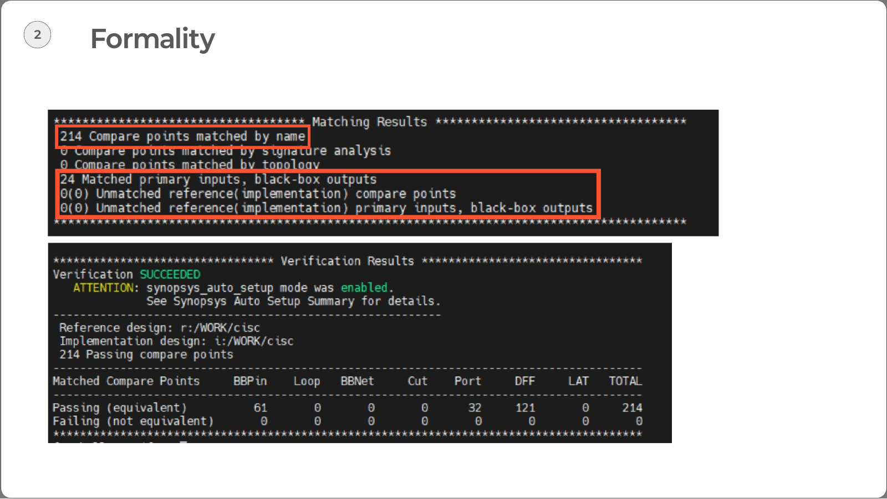

Formality 등가성 검증 결과 **Verification SUCCEEDED** 입니다.

- **214** compare points matched by name, 미매칭 0개
- **24** primary inputs / black-box outputs 매칭
- Passing 214 = BBPin 61 + Port 32 + DFF 121, Failing 0

---

### Slide 18 · RTL vs Netlist 비교 (1)

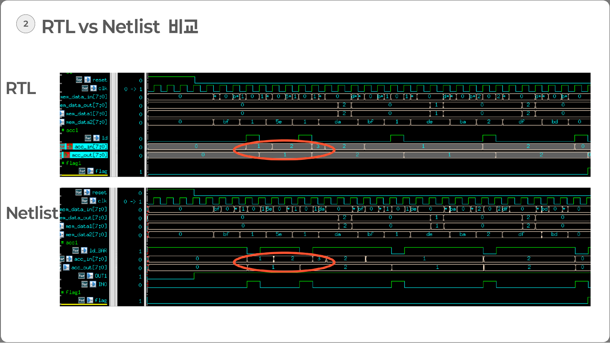

RTL 시뮬레이션과 합성 netlist(Gate-level) 시뮬레이션 파형을 비교했습니다. 붉은 원으로 표시한 `acc_in` / `acc_out` 값이 두 파형에서 동일한 순서로 변하는 것을 확인해, 합성 후에도 기능이 그대로 유지됨을 검증했습니다.

---

### Slide 19 · RTL vs Netlist 비교 (2)

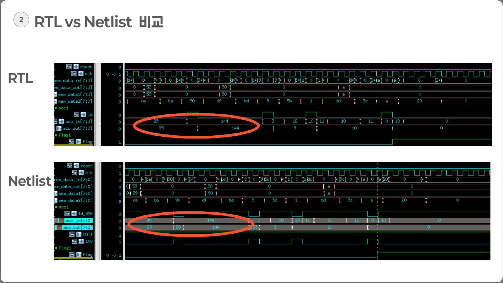

다른 구간에 대한 RTL ↔ Gate-level 파형 비교입니다. Netlist 쪽은 실제 cell delay가 반영되어 신호 전이 시점이 약간 늦지만, 출력 값은 RTL과 일치합니다.

---

### Slide 20 · TSMC 180nm 결과

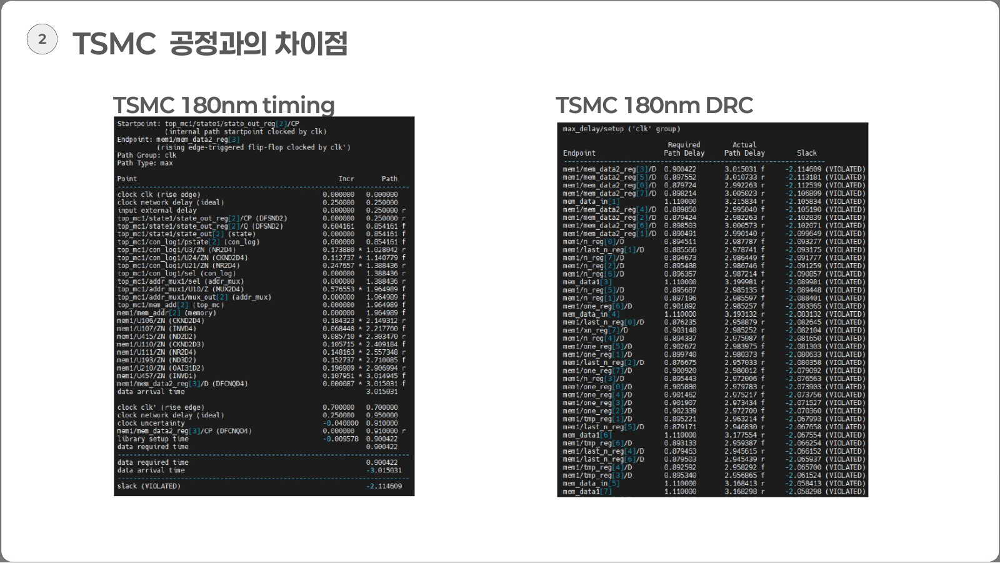

같은 RTL과 제약을 **TSMC 180nm** 라이브러리로 합성한 결과입니다.

- Timing: `state_out_reg → mem_data2_reg` 경로 slack **-2.114609** (VIOLATED)
- DRC: `clk'` 그룹의 거의 모든 endpoint에서 setup 위반 발생

180nm에서는 cell delay가 커서 1.4 ns 제약을 전혀 만족하지 못했습니다.

---

### Slide 21 · TSMC 130nm 결과 (1)

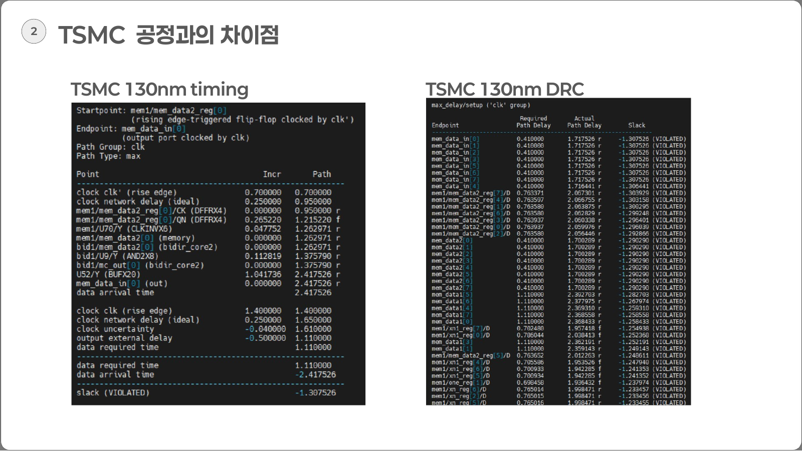

**TSMC 130nm** 라이브러리로 합성한 결과입니다.

- Timing: `mem_data2_reg → mem_data_in[0]` 경로 slack **-1.307526** (VIOLATED)
- DRC: `clk'` 그룹 다수 endpoint에서 setup 위반

180nm보다는 개선되었지만 여전히 timing을 만족하지 못했습니다.

---

### Slide 22 · TSMC 130nm 결과 (2)

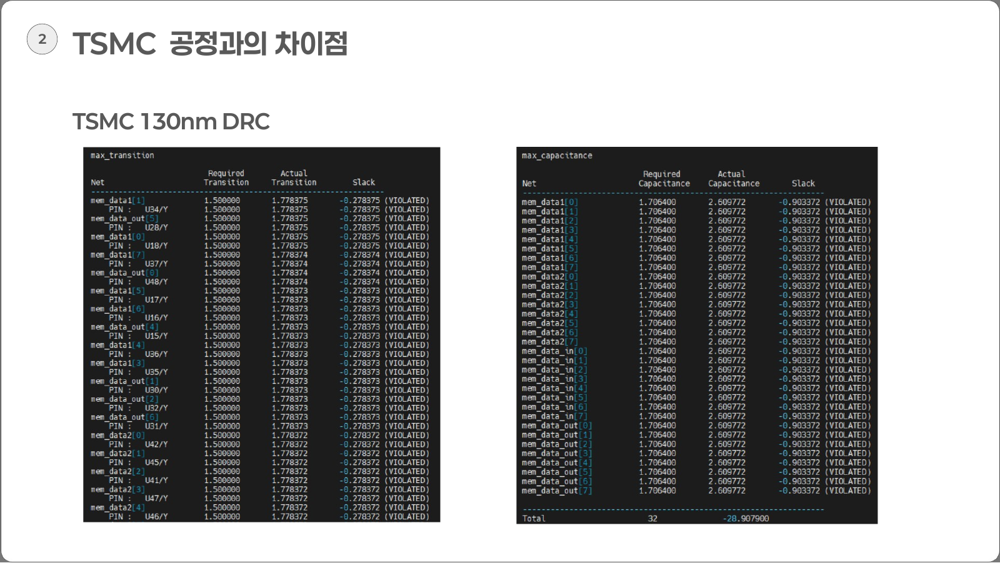

TSMC 130nm의 나머지 DRC 결과입니다.

- **max_transition**: required 1.5에 대해 약 1.778로 다수 net 위반
- **max_capacitance**: 32건 위반, Total **-20.907900**

---

### Slide 23 · 공정별 결과 비교

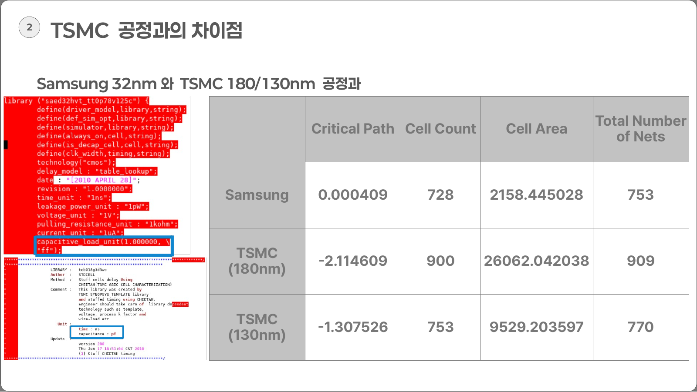

| 공정 | Critical Path | Cell Count | Cell Area | Total Nets |
|---|---:|---:|---:|---:|
| SAED 32nm | **0.000409** | 728 | 2158.445028 | 753 |
| TSMC 180nm | -2.114609 | 900 | 26062.042038 | 909 |
| TSMC 130nm | -1.307526 | 753 | 9529.203597 | 770 |

왼쪽 캡처는 두 라이브러리의 `.lib` 헤더입니다. SAED는 `capacitive_load_unit`이 **fF**, TSMC는 **pF** 로 단위가 달라 같은 수치의 제약도 실제 의미가 다르다는 점을 함께 확인했습니다.

동일한 1.4 ns 제약에서 32nm만 timing을 만족했고, 180nm 대비 Cell Area는 약 **12배** 작았습니다.

---

## 3. Physical Design (ICC2)

### Slide 24 · Library (NDM) (1) — Cell NDM 생성

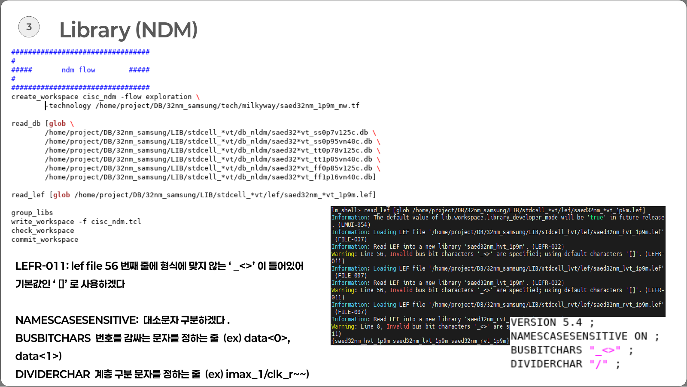

```tcl
create_workspace cisc_ndm -flow exploration -technology saed32nm_1p9m_mw.tf
read_db [glob .../saed32*vt_{ss0p7v125c,ss0p95vn40c,tt0p78v125c,tt1p05vn40c,ff0p85v125c,ff1p16vn40c}.db]
read_lef [glob .../saed32nm_*vt_1p9m.lef]
group_libs
write_workspace -f cisc_ndm.tcl
check_workspace
commit_workspace
```

TOP 프로젝트(2 corner)와 달리 **SS / TT / FF 6개 corner**의 .db를 모두 읽어 NDM을 만들었습니다.

LEF를 읽을 때 나온 메시지와 LEF 헤더 항목은 다음과 같습니다.
- `LEFR-011` — LEF 56번째 줄의 `_<>` 형식이 맞지 않아 기본값 `[]` 사용
- `NAMESCASESENSITIVE` — 대소문자 구분
- `BUSBITCHARS` — bus 번호를 감싸는 문자 (예: `data<0>`)
- `DIVIDERCHAR` — 계층 구분 문자

---

### Slide 25 · Library (NDM) (2) — check / commit

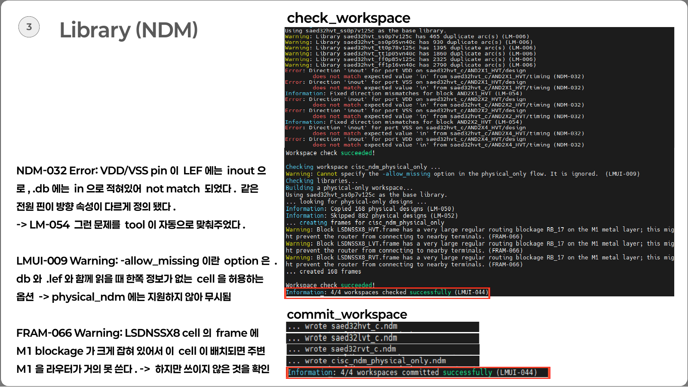

`check_workspace` → **4/4 workspaces checked successfully**, `commit_workspace` → **4/4 workspaces committed successfully** 로 `saed32hvt_c`, `saed32lvt_c`, `saed32rvt_c`, `cisc_ndm_physical_only` 4개의 NDM이 생성되었습니다.

| 메시지 | 내용 및 조치 |
|---|---|
| `NDM-032` Error → `LM-054` | VDD/VSS pin이 LEF에는 inout, .db에는 in으로 정의되어 불일치 → 툴이 자동으로 정합 |
| `LMUI-009` Warning | `-allow_missing`(한쪽 정보가 없는 cell 허용)은 physical NDM에서 지원하지 않아 무시됨 |
| `FRAM-066` Warning | `LSDNSSX8` frame의 큰 M1 blockage → 배치되면 주변 M1 사용 불가. 실제 design에서 미사용 확인 |

---

### Slide 26 · Library (NDM) (3) — Tech-only NDM

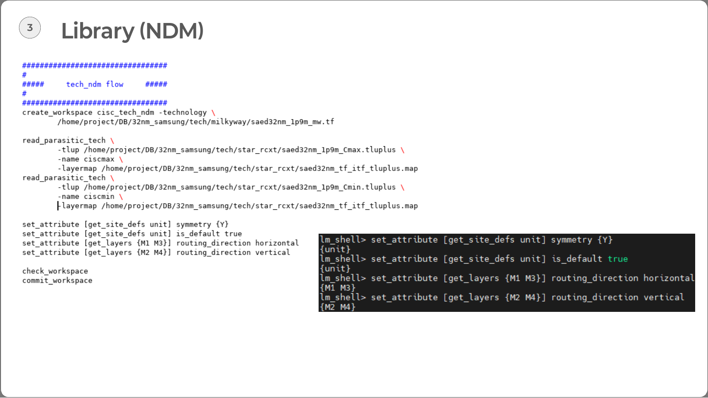

```tcl
create_workspace cisc_tech_ndm -technology saed32nm_1p9m_mw.tf
read_parasitic_tech -tlup saed32nm_1p9m_Cmax.tluplus -name ciscmax -layermap saed32nm_tf_itf_tluplus.map
read_parasitic_tech -tlup saed32nm_1p9m_Cmin.tluplus -name ciscmin -layermap saed32nm_tf_itf_tluplus.map
set_attribute [get_site_defs unit] symmetry {Y}
set_attribute [get_site_defs unit] is_default true
set_attribute [get_layers {M1 M3}] routing_direction horizontal
set_attribute [get_layers {M2 M4}] routing_direction vertical
```

Cmax / Cmin TLUplus를 `ciscmax`, `ciscmin`으로 등록하고, site symmetry와 layer별 routing 방향(M1·M3 수평, M2·M4 수직)을 지정했습니다.

---

### Slide 27 · Nlib flow

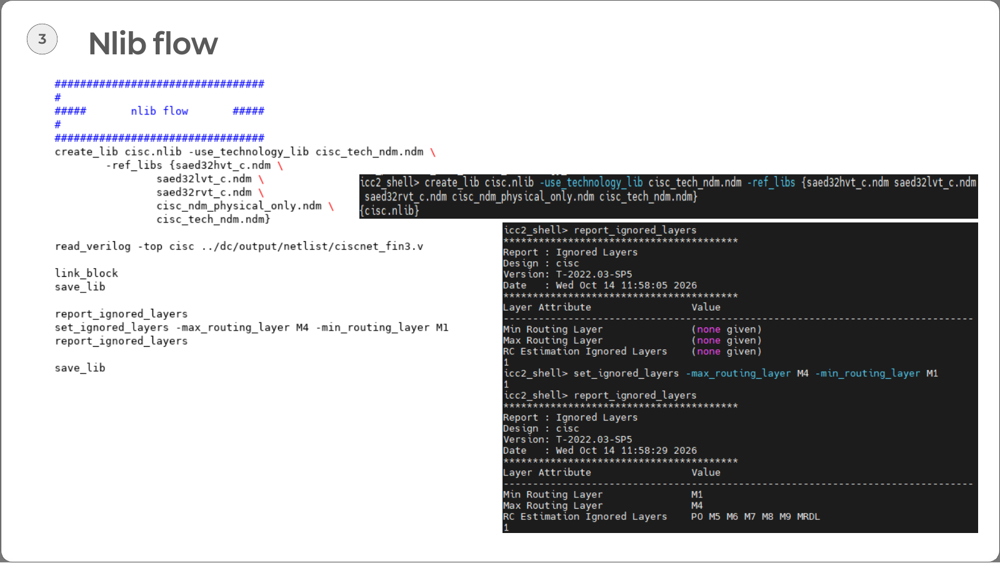

```tcl
create_lib cisc.nlib -use_technology_lib cisc_tech_ndm.ndm \
    -ref_libs {saed32hvt_c.ndm saed32lvt_c.ndm saed32rvt_c.ndm cisc_ndm_physical_only.ndm cisc_tech_ndm.ndm}
read_verilog -top cisc ../dc/output/netlist/ciscnet_fin3.v
link_block
set_ignored_layers -max_routing_layer M4 -min_routing_layer M1
report_ignored_layers
save_lib
```

DC에서 만든 netlist를 읽어 design library를 만들고, routing layer를 **M1 ~ M4**로 제한했습니다. `report_ignored_layers`에서 PO, M5 ~ M9, MRDL이 RC estimation에서 제외된 것을 확인했습니다.

---

### Slide 28 · MCMM (1) — Scenario 생성

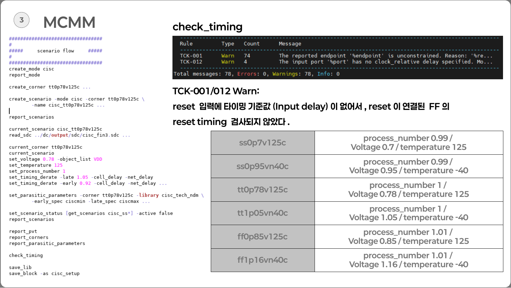

```tcl
create_mode cisc
create_corner tt0p78v125c ...          ;# 6개 corner
create_scenario -mode cisc -corner tt0p78v125c -name cisc_tt0p78v125c ...
read_sdc ../dc/output/sdc/cisc_fin3.sdc
set_voltage 0.78 -object_list VDD
set_temperature 125
set_process_number 1
set_timing_derate -late 1.05 -cell_delay -net_delay
set_timing_derate -early 0.92 -cell_delay -net_delay
set_parasitic_parameters -corner tt0p78v125c -library cisc_tech_ndm -early_spec ciscmax -late_spec ciscmax
set_scenario_status [get_scenarios cisc_ss*] -active false
```

| Corner | Process | Voltage | Temperature |
|---|---|---|---|
| ss0p7v125c | 0.99 | 0.70 V | 125 ℃ |
| ss0p95vn40c | 0.99 | 0.95 V | −40 ℃ |
| tt0p78v125c | 1 | 0.78 V | 125 ℃ |
| tt1p05vn40c | 1 | 1.05 V | −40 ℃ |
| ff0p85v125c | 1.01 | 0.85 V | 125 ℃ |
| ff1p16vn40c | 1.01 | 1.16 V | −40 ℃ |

`check_timing` 결과 `TCK-001`(74건) / `TCK-012`(4건) warning이 나왔습니다. **reset 입력에 input delay가 없어서 reset이 연결된 FF의 reset timing(recovery / removal)이 검사되지 않는다**는 의미입니다.

---

### Slide 29 · MCMM (2) — SS corner 비활성화

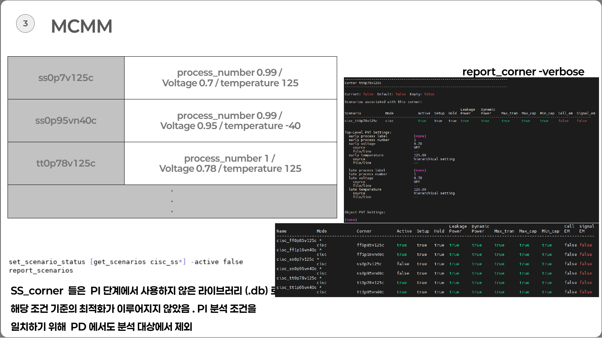

`report_corner -verbose`와 `report_scenarios`로 scenario 상태를 확인했습니다.

SS corner들은 **합성(DC) 단계에서 사용하지 않은 라이브러리**라서 그 조건 기준의 최적화가 이루어지지 않았습니다. 앞 단계와 분석 조건을 일치시키기 위해 PD에서도 `set_scenario_status [get_scenarios cisc_ss*] -active false` 로 분석 대상에서 제외했고, 나머지 **TT 2개 + FF 2개, 총 4개 scenario**로 진행했습니다.

---

### Slide 30 · Floorplan (1) — L자형 Floorplan

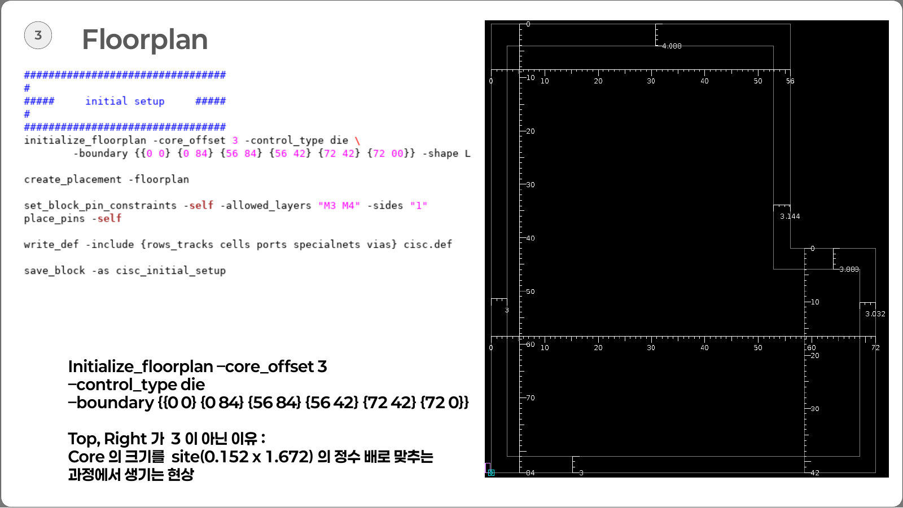

```tcl
initialize_floorplan -core_offset 3 -control_type die \
    -boundary {{0 0} {0 84} {56 84} {56 42} {72 42} {72 0}} -shape L
```

TOP 프로젝트의 정사각형과 달리, 6개 꼭짓점을 직접 지정해 **L자형(rectilinear) die**를 만들었습니다. 오른쪽 캡처에서 L자 모양의 die와 core 경계를 확인할 수 있습니다.

Top과 Right의 offset이 정확히 3이 아닌 이유는 core 크기를 site(0.152 × 1.672)의 정수 배로 맞추는 과정에서 생기는 현상입니다.

---

### Slide 31 · Floorplan (2) — Pin 배치

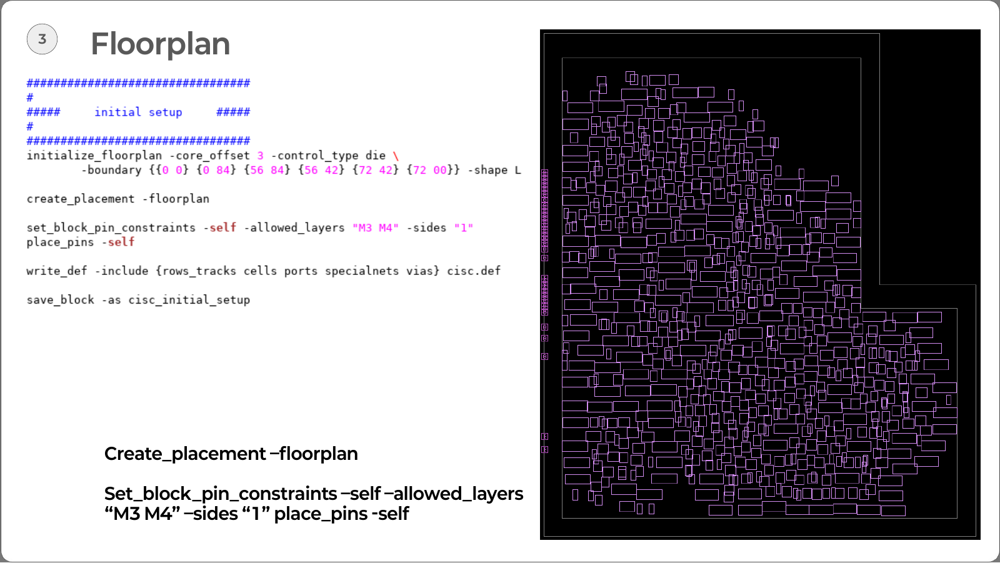

```tcl
create_placement -floorplan
set_block_pin_constraints -self -allowed_layers "M3 M4" -sides "1"
place_pins -self
write_def -include {rows_tracks cells ports specialnets vias} cisc.def
save_block -as cisc_initial_setup
```

L자 die 안에 cell을 초기 배치하고, I/O pin은 M3 / M4 layer로 **왼쪽 변(side 1)에만** 배치했습니다.

---

### Slide 32 · Powerplan (1)

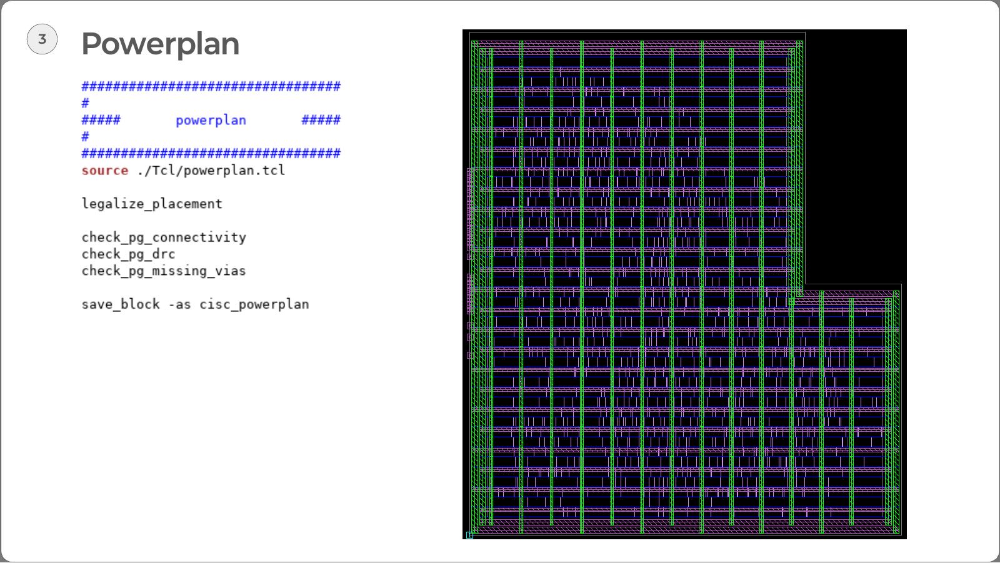

```tcl
source ./Tcl/powerplan.tcl
legalize_placement
check_pg_connectivity
check_pg_drc
check_pg_missing_vias
save_block -as cisc_powerplan
```

L자형 core를 따라 Ring, Mesh(M3/M4), Rail(M1)이 생성된 결과입니다.

---

### Slide 33 · Powerplan (2) — Ring 설계

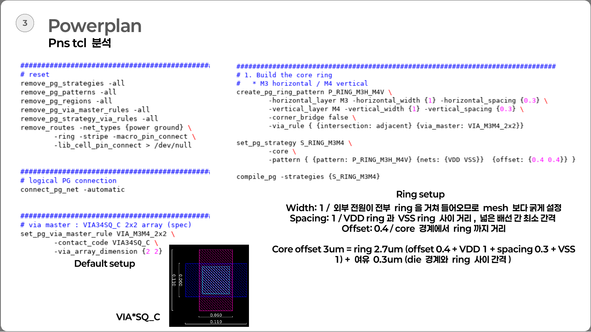

**Default setup** — 기존 PG 설정을 모두 제거(`remove_pg_*`, `remove_routes`)한 뒤 `connect_pg_net -automatic`으로 논리 연결을 만들고, M3–M4 연결용 via master `VIA_M3M4_2x2`(`VIA34SQ_C` 2 × 2)를 정의했습니다.

**Ring setup**
```tcl
create_pg_ring_pattern P_RING_M3H_M4V \
    -horizontal_layer M3 -horizontal_width {1} -horizontal_spacing {0.3} \
    -vertical_layer   M4 -vertical_width   {1} -vertical_spacing   {0.3} \
    -corner_bridge false -via_rule {{intersection: adjacent} {via_master: VIA_M3M4_2x2}}
set_pg_strategy S_RING_M3M4 -core -pattern {{pattern: P_RING_M3H_M4V} {nets: {VDD VSS}} {offset: {0.4 0.4}}}
```

| 항목 | 값 | 이유 |
|---|---|---|
| Width | 1 | 외부 전원이 모두 ring을 거쳐 들어오므로 mesh보다 굵게 |
| Spacing | 0.3 | VDD ring과 VSS ring 사이 거리 |
| Offset | 0.4 | core 경계에서 ring까지 거리 |

**Core offset 3 µm = ring 2.7 µm (offset 0.4 + VDD 1 + spacing 0.3 + VSS 1) + 여유 0.3 µm** 로, core offset을 ring 크기에 맞춰 역산해 정했습니다.

---

### Slide 34 · Powerplan (3) — Mesh / Rail 설계

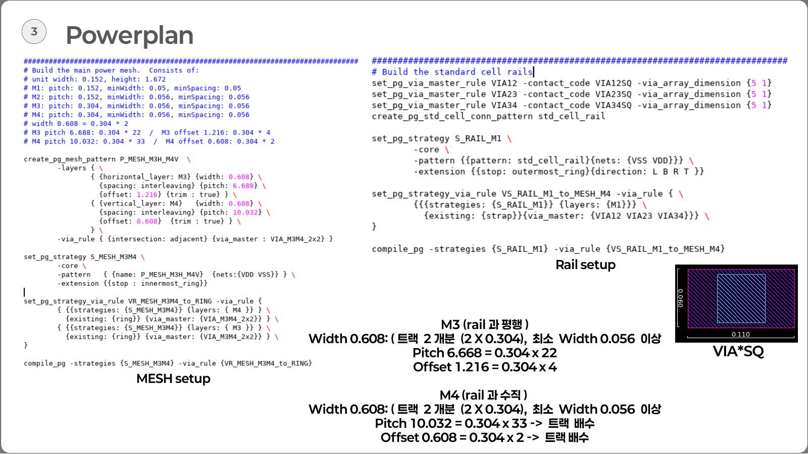

**Mesh** — 모든 치수를 routing track pitch(0.304)의 배수로 계산했습니다.

| Layer | 방향 | Width | Pitch | Offset |
|---|---|---|---|---|
| M3 | rail과 평행 | 0.608 (트랙 2개) | 6.688 = 0.304 × 22 = row height 1.672 × 4 | 1.216 = 0.304 × 4 |
| M4 | rail과 수직 | 0.608 (트랙 2개) | 10.032 = 0.304 × 33 | 0.608 = 0.304 × 2 |

**Rail** — TOP 프로젝트에서 rail via가 생성되지 않아 floating wire가 발생했던 경험을 바탕으로, 처음부터 rail via master를 직접 지정했습니다.
```tcl
set_pg_via_master_rule VIA12 -contact_code VIA12SQ -via_array_dimension {5 1}
set_pg_via_master_rule VIA23 -contact_code VIA23SQ -via_array_dimension {5 1}
set_pg_via_master_rule VIA34 -contact_code VIA34SQ -via_array_dimension {5 1}
set_pg_strategy_via_rule VS_RAIL_M1_to_MESH_M4 -via_rule {
    {{strategies: {S_RAIL_M1}} {layers: {M1}}}
    {existing: {strap}} {via_master: {VIA12 VIA23 VIA34}} }
```
→ TOP에서의 문제와 해결 과정: [TOP Slide 32 보기](../01_TOP/README.md#slide-32--powerplan-5--floating-wire-수정)

---

### Slide 35 · Powerplan (4) — 1차 검증

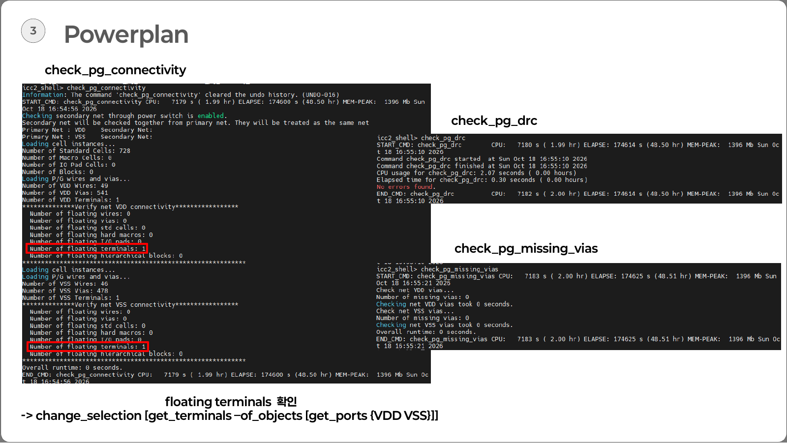

| 검사 | 결과 |
|---|---|
| `check_pg_connectivity` | floating wire / via / std cell 0, 단 **floating terminal이 VDD 1개, VSS 1개** |
| `check_pg_drc` | **No errors found** |
| `check_pg_missing_vias` | 0건 |

Rail via를 미리 지정한 덕분에 TOP 때와 달리 wire와 cell은 모두 정상 연결되었습니다. 남은 floating terminal은 위치를 찾기 위해 아래 명령으로 GUI에서 선택해 확인했습니다.
```tcl
change_selection [get_terminals -of_objects [get_ports {VDD VSS}]]
```

---

### Slide 36 · Powerplan (5) — Floating terminal 수정

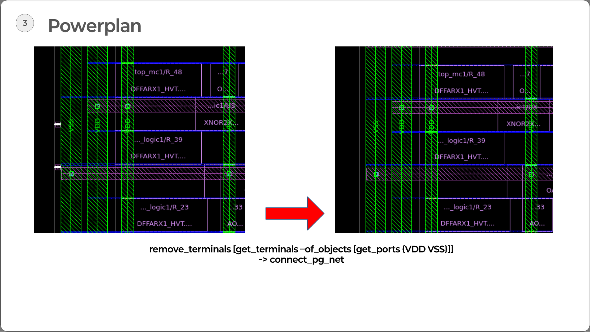

```tcl
remove_terminals [get_terminals -of_objects [get_ports {VDD VSS}]]
connect_pg_net
```

VDD/VSS port에 생성된 terminal이 PG 배선과 연결되지 않은 채 떠 있었습니다. 해당 terminal을 제거하고 `connect_pg_net`으로 다시 연결했습니다. 왼쪽(전)과 오른쪽(후) 캡처에서 terminal 주변 연결이 정리된 것을 확인할 수 있습니다.

---

### Slide 37 · Powerplan (6) — 최종 검증

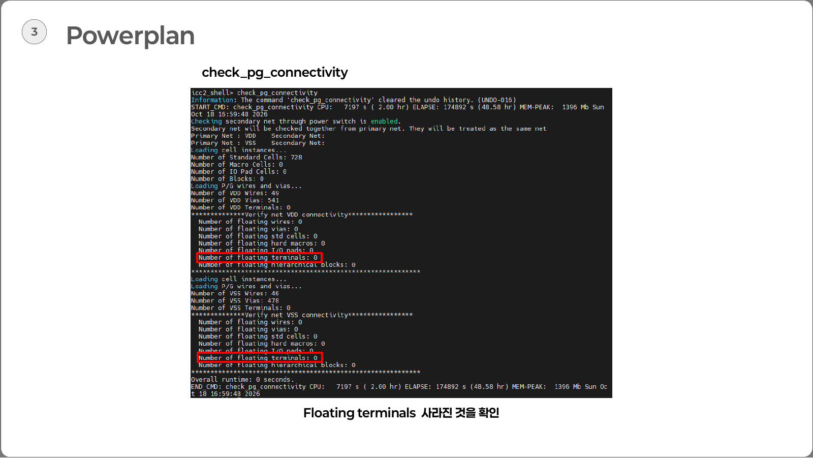

`check_pg_connectivity`를 다시 실행해 VDD / VSS 모두 **floating terminal 0**을 확인했습니다. 이로써 PG network의 floating 요소가 모두 해결되었습니다.

---

### Slide 38 · Placement (1) — place_opt 설정

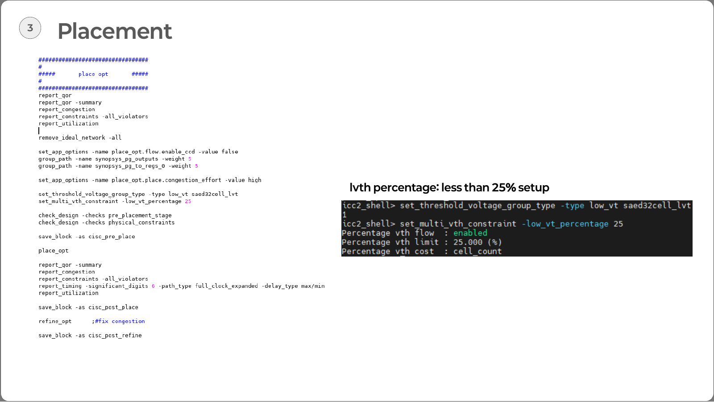

```tcl
remove_ideal_network -all
set_app_options -name place_opt.flow.enable_ccd -value false
group_path -name synopsys_pg_outputs ... -weight 5
group_path -name synopsys_pg_..._regs_0 -weight 5
set_app_options -name place_opt.place.congestion_effort -value high
set_threshold_voltage_group_type -type low_vt saed32cell_lvt
set_multi_vth_constraint -low_vt_percentage 25
place_opt
refine_opt
```

- DC에서 critical했던 output / register path group에 **weight 5**를 주어 우선 최적화
- congestion effort를 high로 설정
- **LVT cell 비율을 25% 이하**로 제한 — 속도가 빠른 LVT는 leakage가 크기 때문에, timing과 leakage power 사이의 균형을 위한 제약입니다. 오른쪽 캡처에서 `Percentage vth limit : 25.000 (%)` 적용을 확인했습니다.

---

### Slide 39 · Placement (2) — 사전 점검

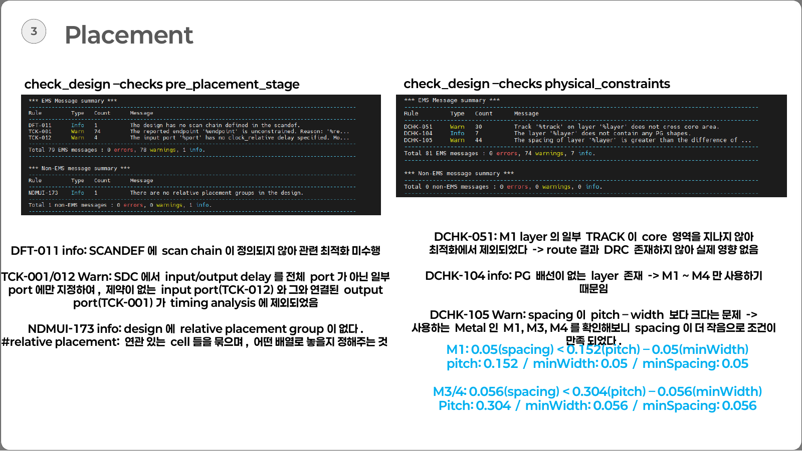

`check_design -checks pre_placement_stage` / `physical_constraints` 결과 모두 **0 errors** 입니다.

| 메시지 | 내용 |
|---|---|
| `DFT-011` Info | SCANDEF에 scan chain이 없어 관련 최적화 미수행 |
| `TCK-001/012` Warn | input/output delay가 일부 port에만 지정되어, 제약 없는 port가 timing analysis에서 제외됨 |
| `NDMUI-173` Info | relative placement group 없음 |
| `DCHK-051` Warn | M1의 일부 track이 core 영역을 지나지 않아 최적화에서 제외 → L자형 floorplan의 오목한 부분 때문이며, route 결과 DRC가 없어 실제 영향 없음 |
| `DCHK-104` Info | PG 배선이 없는 layer 존재 → M1 ~ M4만 사용하기 때문 |
| `DCHK-105` Warn | spacing > pitch − width → 직접 계산해 조건 만족 확인 (M1: 0.05 < 0.152 − 0.05, M3/M4: 0.056 < 0.304 − 0.056) |

---

### Slide 40 · Placement (3) — place_opt 전 / 후

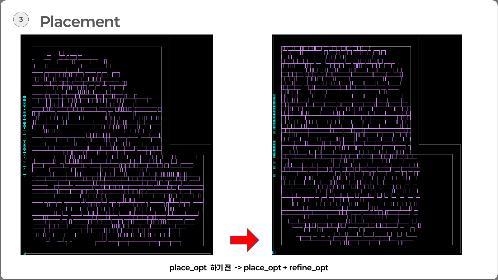

`place_opt` 전(왼쪽)과 `place_opt` + `refine_opt` 후(오른쪽)의 배치 결과입니다. L자형 core 전체에 cell이 고르게 배치된 것을 확인할 수 있습니다.

---

### Slide 41 · Placement (4) — QoR 비교

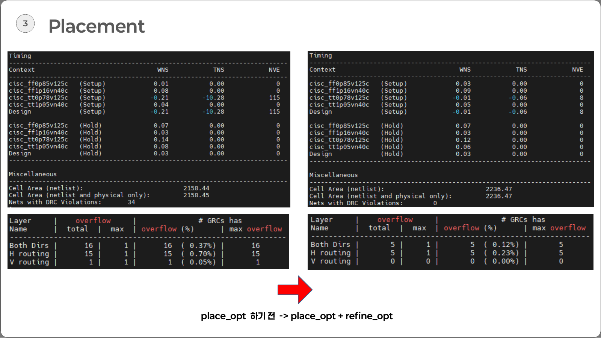

| 항목 | place_opt 전 | place_opt + refine_opt 후 |
|---|---|---|
| Setup (tt0p78v125c) WNS / TNS / NVE | -0.21 / -10.28 / 115 | **-0.01 / -0.06 / 8** |
| Setup (그 외 corner) | 모두 MET | 모두 MET |
| Hold (Design) | +0.03 | +0.03 |
| Cell Area | 2158.44 | 2236.47 |
| Nets with DRC Violations | 34 | **0** |
| Congestion (Both Dirs) | 16 (0.37%) | 5 (0.12%) |

worst corner인 tt0p78v125c의 setup 위반이 115개에서 8개로 크게 줄었고, DRC 위반 net은 모두 해결되었습니다.

---

### Slide 42 · CTS Setup

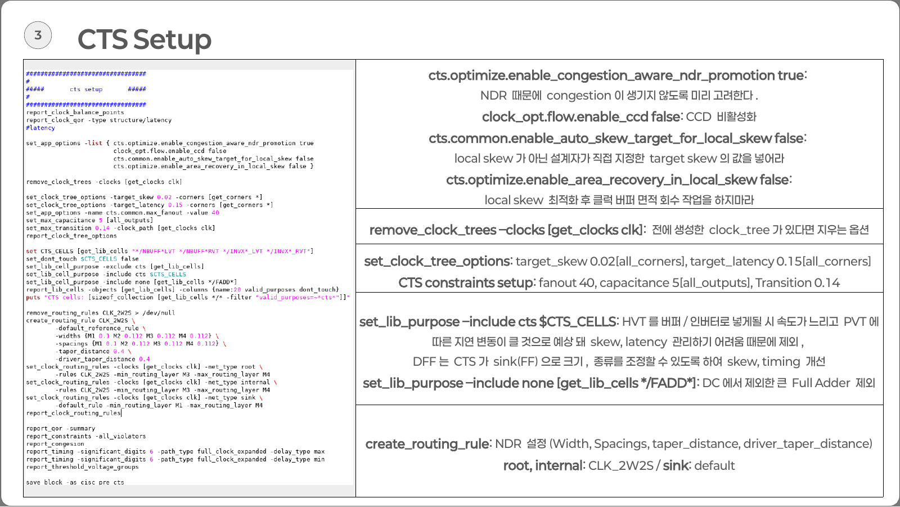

| 설정 | 의미 |
|---|---|
| `cts.optimize.enable_congestion_aware_ndr_promotion true` | NDR로 인한 congestion을 미리 고려 |
| `clock_opt.flow.enable_ccd false` | CCD 비활성화 (Classic CTS) |
| `cts.common.enable_auto_skew_target_for_local_skew false` | 자동 local skew 대신 설계자가 지정한 target skew 사용 |
| `cts.optimize.enable_area_recovery_in_local_skew false` | local skew 최적화 후 clock buffer 면적 회수 작업을 하지 않음 |
| `remove_clock_trees -clocks [get_clocks clk]` | 이전 clock tree 제거 |
| `set_clock_tree_options` | target skew **0.02**, target latency **0.15** (all corners) |
| CTS constraints | fanout 40, capacitance 5, transition 0.14 |
| `set_lib_purpose -include cts $CTS_CELLS` | HVT 제외(느리고 PVT 변동이 커 skew/latency 관리가 어려움), DFF 포함(sink sizing으로 skew 개선) |
| `set_lib_purpose -include none */FADD*` | DC에서 제외한 Full Adder 제외 |
| `create_routing_rule` | NDR — root / internal: `CLK_2W2S`, sink: default |

---

### Slide 43 · CTS (1) — Clock 설정

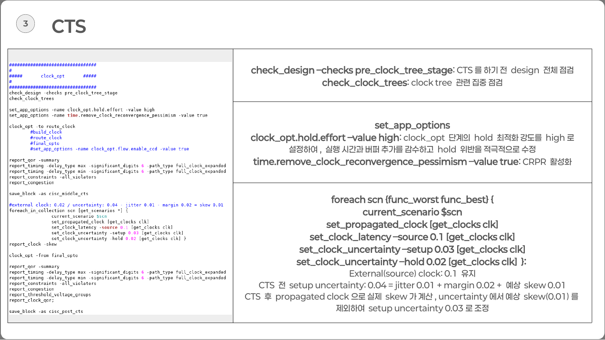

- `check_design -checks pre_clock_tree_stage` / `check_clock_trees` — CTS 전 점검
- `clock_opt.hold.effort high` — hold 위반을 적극적으로 수정
- `time.remove_clock_reconvergence_pessimism true` — CRPR 활성화

```tcl
foreach_in_collection scn [get_scenarios *] {
    current_scenario $scn
    set_propagated_clock [get_clocks clk]
    set_clock_latency -source 0.1 [get_clocks clk]
    set_clock_uncertainty -setup 0.03 [get_clocks clk]
    set_clock_uncertainty -hold  0.02 [get_clocks clk]
}
clock_opt -to route_clock
clock_opt -from final_opto
```

**Setup uncertainty 조정 근거**
- CTS 전: 0.04 = jitter 0.01 + margin 0.02 + 예상 skew 0.01
- CTS 후: propagated clock으로 실제 skew가 계산되므로 예상 skew(0.01)를 빼고 **0.03**으로 조정

---

### Slide 44 · CTS (2) — 점검 메시지 분석

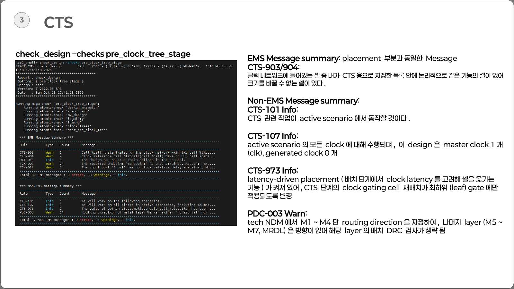

`check_design -checks pre_clock_tree_stage` 결과 **0 errors** 입니다.

| 메시지 | 내용 |
|---|---|
| `CTS-903/904` Warn | clock network의 cell 중, CTS용으로 지정한 cell 목록 안에 같은 기능의 cell이 없어 sizing할 수 없는 cell이 있음 |
| `CTS-101` Info | CTS 작업이 active scenario에서 수행됨 |
| `CTS-107` Info | master clock 1개(clk), generated clock 0개 |
| `CTS-973` Info | latency-driven placement가 켜져 있어 clock gating cell 재배치가 leaf gate에만 적용 |
| `PDC-003` Warn | M1 ~ M4만 routing direction이 지정되어 나머지 layer의 배치 DRC 검사 생략 |

---

### Slide 45 · CTS (3) — clock_opt 전 / 후

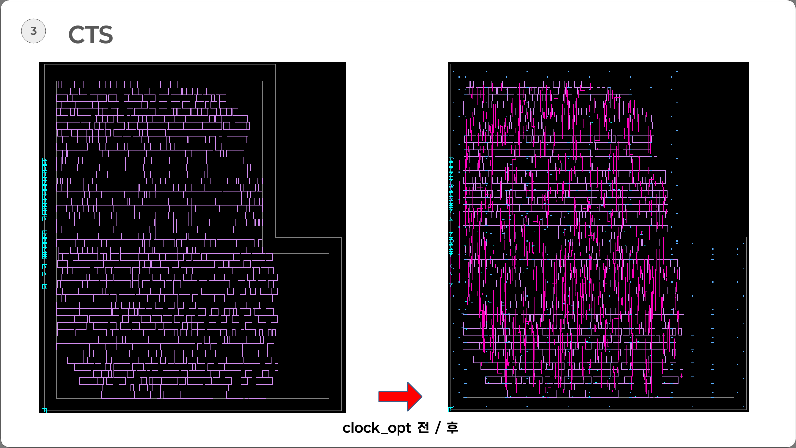

`clock_opt` 전(왼쪽)과 후(오른쪽)의 layout입니다. 오른쪽에서 clock net 배선(분홍색)과 clock buffer가 design 전체에 분포된 것을 확인할 수 있습니다.

---

### Slide 46 · CTS (4) — QoR 비교

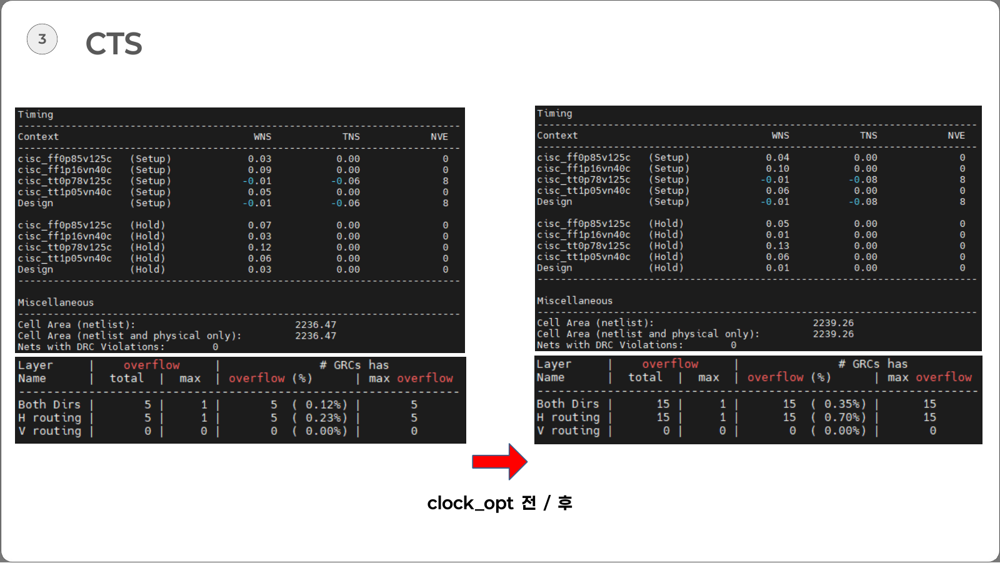

| 항목 | clock_opt 전 | clock_opt 후 |
|---|---|---|
| Setup (tt0p78v125c) WNS / TNS / NVE | -0.01 / -0.06 / 8 | -0.01 / -0.08 / 8 |
| Hold (Design) | +0.03 | +0.01 |
| Cell Area | 2236.47 | 2239.26 |
| Nets with DRC Violations | 0 | 0 |
| Congestion (Both Dirs) | 5 (0.12%) | 15 (0.35%) |

Propagated clock 적용 후에도 hold 위반 없이 clock tree가 생성되었습니다. tt0p78v125c의 미세한 setup 위반(-0.01)은 이 단계에서도 남아 있습니다.

---

### Slide 47 · Routing (1) — Routing 옵션

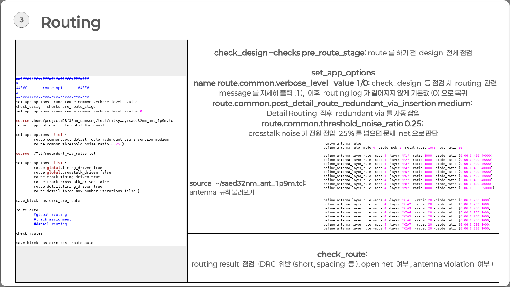

```tcl
set_app_options -name route.common.verbose_level -value 1
check_design -checks pre_route_stage
set_app_options -name route.common.verbose_level -value 0
source ~/saed32nm_ant_1p9m.tcl
set_app_options -list {
    route.common.post_detail_route_redundant_via_insertion medium
    route.common.threshold_noise_ratio 0.25 }
set_app_options -list {
    route.global.timing_driven true   route.global.crosstalk_driven false
    route.track.timing_driven true    route.track.crosstalk_driven false
    route.detail.timing_driven true   route.detail.force_max_number_iterations false }
route_auto
check_routes
```

- **antenna 규칙(`saed32nm_ant_1p9m.tcl`)을 불러와** routing 단계에서 antenna 위반을 함께 고려
- detail routing 직후 redundant via 자동 삽입, crosstalk noise가 전원 전압 25%를 넘으면 문제 net으로 판단
- `check_route` — short, spacing, open net, antenna 위반 점검

---

### Slide 48 · Routing (2) — 점검 메시지 분석

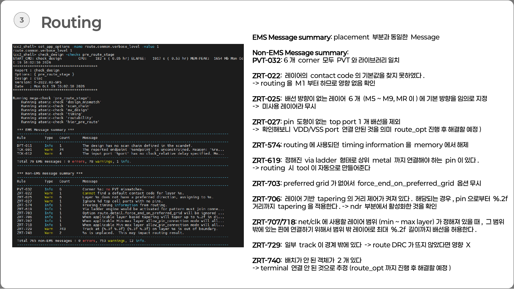

`check_design -checks pre_route_stage` 결과 **0 errors** 이며, 주요 메시지를 하나씩 확인했습니다.

| 메시지 | 내용 및 판단 |
|---|---|
| `PVT-032` | 6개 corner 모두 PVT와 라이브러리 일치 |
| `ZRT-022` | layer의 기본 contact code를 찾지 못함 → M1부터 routing하므로 영향 없음 |
| `ZRT-025` | 방향이 없는 layer 6개(M5 ~ M9, MRDL)에 기본 방향 임의 지정 → 미사용 layer라 무시 |
| `ZRT-027` | pin 도형이 없는 top port 1개를 배선에서 제외 → **VDD/VSS port 문제로 확인** (Slide 53에서 해결) |
| `ZRT-619` | via ladder로 상위 metal까지 연결해야 하는 pin 존재 → tool이 자동 생성 |
| `ZRT-703` | preferred grid가 없어 `force_end_on_preferred_grid` 옵션 무시 |
| `ZRT-706` | layer 기반 tapering 거리 제어 활성화 → NDR 설정에서 켠 것 확인 |
| `ZRT-707/718` | 지정된 layer 범위 밖의 pin 연결을 위해 범위 밖 layer 배선 허용 |
| `ZRT-729` | 일부 track이 경계 밖 → route DRC가 없으면 영향 없음 |
| `ZRT-740` | 배치되지 않은 객체 2개 → terminal 미연결로 추정 (Slide 53에서 해결) |

---

### Slide 49 · Routing (3) — route_opt / SI / LVS

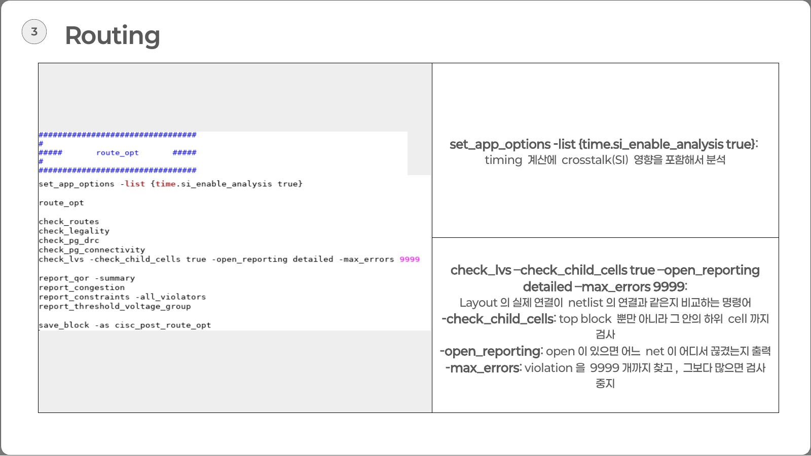

```tcl
set_app_options -list {time.si_enable_analysis true}
route_opt
check_routes
check_legality
check_pg_drc
check_pg_connectivity
check_lvs -check_child_cells true -open_reporting detailed -max_errors 9999
```

- `time.si_enable_analysis true` — timing 계산에 crosstalk(SI) 영향 포함
- `check_lvs` — layout의 실제 연결이 netlist와 같은지 비교 (`-check_child_cells` 하위 cell까지, `-open_reporting` 끊긴 위치 출력, `-max_errors` 최대 9999개)

---

### Slide 50 · Routing (4) — route_opt 전 / 후

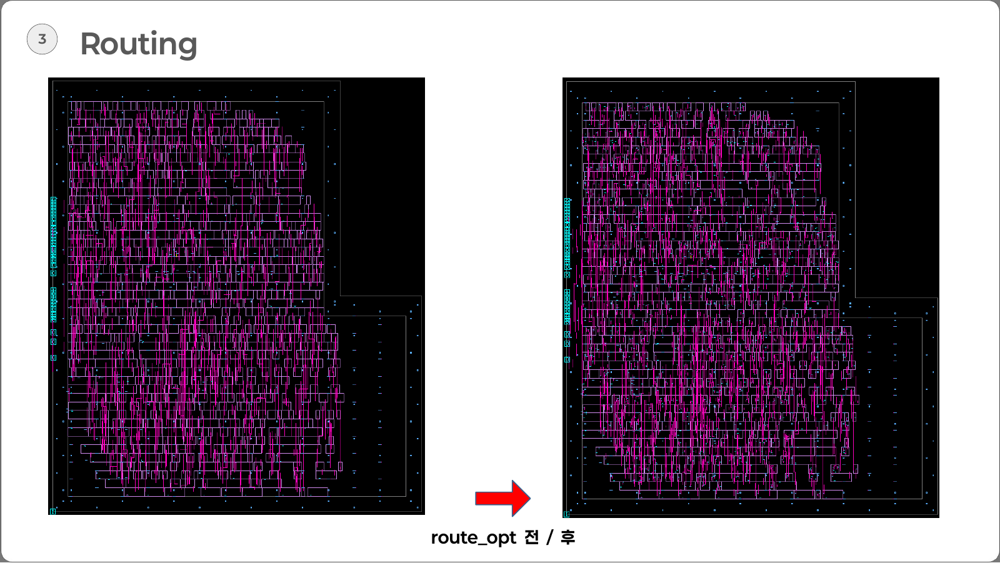

`route_opt` 전(왼쪽)과 후(오른쪽)의 layout입니다. Signal net의 detail routing이 L자형 core 전체에 완료되었습니다.

---

### Slide 51 · Routing (5) — QoR / Congestion

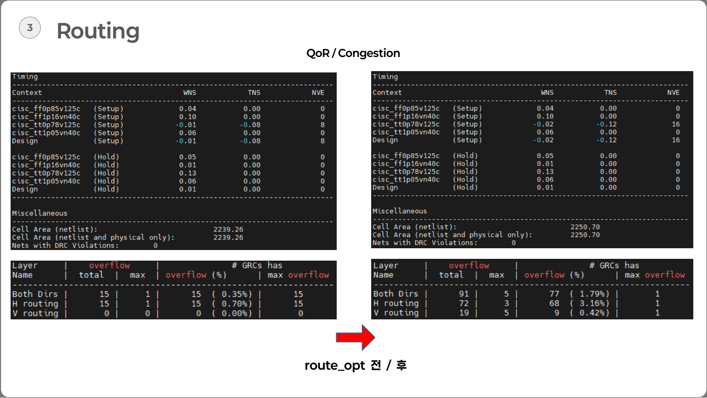

| 항목 | route_opt 전 | route_opt 후 |
|---|---|---|
| Setup (tt0p78v125c) WNS / TNS / NVE | -0.01 / -0.08 / 8 | **-0.02 / -0.12 / 16** |
| Setup (그 외 corner) | 모두 MET | 모두 MET |
| Hold (Design) | +0.01 | +0.01 |
| Cell Area | 2239.26 | 2250.70 |
| Nets with DRC Violations | 0 | 0 |
| Congestion (Both Dirs) | 15 (0.35%) | 77 (1.79%) |

실제 배선과 SI가 반영되면서 tt0p78v125c의 setup 위반이 8개에서 16개로 늘었습니다. 이 위반은 이후 PrimeTime ECO 단계에서 다시 분석했습니다.

---

### Slide 52 · Routing (6) — Redundant via / Vth 비율


| 항목 | route_opt 전 | route_opt 후 |
|---|---|---|
| Optimized via | 5.93% (256 / 4314) | **99.80%** (4906 / 4916) |
| Double via | 5.86% (253 / 4314) | 27.58% (1356 / 4916) |
| HVT / LVT / SVT cell | 169 / 166 / 395 | 239 / 177 / 315 |
| LVT 비율 | 22.74% | **24.21%** |

Redundant via 삽입으로 optimized via 비율이 99.80%까지 올라갔고, LVT 비율은 Placement에서 지정한 **25% 제약 이내**로 유지되었습니다.

---

### Slide 53 · Routing (7) — LVS 문제 해결


`check_lvs`에서 아래 warning이 나왔습니다.

```
RT-203 (warn) Port VDD have no valid pin shapes. Skip this port.
RT-203 (warn) Port VSS have no valid pin shapes. Skip this port.
```

**유효한 terminal(pin 도형)이 없는 VDD/VSS port가 routing과 LVS 검사에서 제외**되는 문제였습니다. Slide 48의 `ZRT-027`, `ZRT-740`과 같은 원인입니다. GUI에서 VDD/VSS의 **PG pin을 직접 추가**해 해결했고, 아래 캡처의 전(왼쪽) / 후(오른쪽)에서 PG 배선 위에 pin이 생성된 것을 확인할 수 있습니다.

---

### Slide 54 · Filler Cell (1)


```tcl
set FILLERS [get_lib_cells "*/SHFILL128_HVT */SHFILL64_HVT */SHFILL3_HVT */SHFILL2_HVT */SHFILL1_HVT"]
create_stdcell_fillers -lib_cells $FILLERS
connect_pg_net
remove_stdcell_fillers_with_violation
...
foreach_in_collection scn [get_scenarios *] {
    set name [get_object_name $scn]
    current_scenario $scn
    write_sdc -nosplit -output ./outputs_icc2/${name}.sdc
}
```

큰 filler부터 차례로 삽입했습니다 — SHFILL128 4개, SHFILL64 20개, SHFILL3 1,999개, SHFILL2 224개, SHFILL1 216개. `connect_pg_net`으로 filler까지 PG pin을 연결(731 → 3,194)했고, 이후 StarRC / PT 분석을 위해 **scenario별 SDC를 출력**했습니다.

---

### Slide 55 · Filler Cell (2) — 최종 Layout


Filler cell 삽입이 완료된 최종 L자형 layout입니다. Standard cell row의 빈 공간이 모두 filler로 채워졌습니다.

---

### Slide 56 · Filler Cell (3) — 최종 검증


| 검사 | 결과 |
|---|---|
| `check_pg_connectivity` | floating wire / via / std cell / terminal 모두 0 |
| `check_pg_drc` | **No errors found** |
| `check_legality` | **succeeded** |
| `check_lvs` | input nets 752, **short 0, open 0, floating route 0** — LVS clean |

---

### Slide 57 · Filler Cell (4) — 최종 QoR


| 항목 | 결과 |
|---|---|
| Setup (tt0p78v125c) WNS / TNS / NVE | -0.02 / -0.12 / 16 |
| Hold (Design) | +0.01 (위반 없음) |
| Cell Area | netlist 2251.97 / physical 포함 4400.25 |
| Nets with DRC Violations | 0 |
| `check_routes` | DRC 0, antenna 0, open net 0 |
| Optimized / Double via | 99.80% / 27.59% |
| LVT 비율 | 5.54% (HVT filler 포함 기준) |

---

## 4. Verification and Result

### Slide 58 · StarRC — 기생 성분 추출


| 항목 | 설정 |
|---|---|
| `BLOCK` | `cisc_post_fillercell` — 추출할 최종 블록 |
| `NDM_DATABASE` | ICC2 결과 `cisc2.nlib` |
| `MAPPING_FILE` | ICC2 ↔ nxtgrd layer 이름 연결 |
| `CORNERS_FILE` | corner별 nxtgrd(Cmax / Cmin)와 온도 정의 — 6개 corner |
| `SELECTED_CORNERS` | 추출할 corner |
| `SIMULTANEOUS_MULTI_CORNER` | YES — 여러 corner 동시 추출 |
| `NETLIST_FORMAT / FILE` | SPEF / 출력 파일 |
| `SUMMARY_FILE`, `STAR_DIRECTORY` | 추출 요약 리포트, 작업 폴더 |

ICC2의 RC 추정 대신 sign-off 수준의 정확한 기생 성분(SPEF)을 corner별로 추출해 PrimeTime 분석에 사용했습니다.

---

### Slide 59 · PrimeTime (1) — DMSA 설정


```tcl
set multi_scenario_working_directory ./DMSA_WORK
set_host_options -num_processes 4 -max_cores 2
start_hosts
create_scenario -name cisc_ff1p16vn40c -common_data ./dmsa/common_ff_best.tcl -specific_data ./dmsa/best_ff.tcl
create_scenario -name cisc_ff0p85v125c -common_data ./dmsa/common_ff_worst.tcl -specific_data ./dmsa/worst_ff.tcl
create_scenario -name cisc_tt0p78v125c -common_data ./dmsa/common_tt_worst.tcl -specific_data ./dmsa/worst_tt.tcl
create_scenario -name cisc_tt1p05vn40c -common_data ./dmsa/common_tt_best.tcl -specific_data ./dmsa/best_tt.tcl
current_session {cisc_ff1p16vn40c cisc_ff0p85v125c cisc_tt0p78v125c cisc_tt1p05vn40c}
```

**DMSA(Distributed Multi-Scenario Analysis)** 로 4개 scenario를 병렬 분석했습니다. worker 4개(scenario당 1개)에 각각 CPU 2코어를 할당했습니다.

- **common_data** — 라이브러리 link, post-filler netlist, ICC2에서 출력한 SDC, timing derate(late 1.05 / early 0.92)
- **specific_data** — StarRC에서 추출한 해당 corner의 SPEF(`read_parasitics`)

`report_multi_scenario_design`으로 4개 scenario가 모두 정의되고 command focus에 들어간 것을 확인했습니다.

---

### Slide 60 · PrimeTime (2) — 분석 및 ECO flow


| 명령어 | 의미 |
|---|---|
| `update_timing` | 각 scenario(worker)에서 timing 갱신 |
| `check_timing` | 각 scenario의 constraints 누락·오류 확인 |
| `report_analysis_coverage` | 검사 대상 중 실제로 분석된 비율 확인 |
| `report_timing -delay_type max -max_paths 20` | ECO 전 setup 최악 경로 20개 확인 |
| `fix_eco_timing -type setup` | 모든 scenario를 고려해 setup 위반 자동 수정 |
| `fix_eco_drc -type max_capacitance -methods size_cell` | max capacitance 위반을 cell sizing으로 수정 |
| `write_changes -format icctcl -output ./ECO/pt_timing_eco.tcl` | 수정 내용을 ICC2용 스크립트로 저장 |

`report_analysis_coverage` 결과 setup / hold 검사는 122개 중 120개(98%)가 분석되었습니다. 반면 **recovery / removal 검사는 74개 모두 untested**였는데, 이는 Slide 28의 `TCK-001/012`처럼 reset 입력에 input delay가 없기 때문입니다.

---

### Slide 61 · PrimeTime (3) — ECO 전


| 항목 | 결과 |
|---|---|
| Setup WNS / TNS / 위반 경로 | **-0.01 / -0.08 / 9** |
| Hold | 위반 없음 |
| max_capacitance | **2건** (`mem1/U281/Y` -0.16, `top_mc1/U3/Y` -0.08, ff0p85v125c) |
| Total Cell Area | 2251.97 |

Setup 위반 경로는 모두 tt0p78v125c의 `synopsys_pg_outputs` group으로, `clk'`(falling edge)에서 출발해 `mem_data_in[*]` 출력 port로 나가는 경로입니다. memory가 반 주기(`n_clk`)로 동작하고 output external delay(0.5 ns)까지 걸려 있어, 실제로 사용할 수 있는 시간이 매우 짧은 경로입니다.

---

### Slide 62 · PrimeTime (4) — ECO 후


| 항목 | ECO 전 | ECO 후 |
|---|---|---|
| max_capacitance | 2건 (cost 0.24) | **0건 (cost 0.00)** |
| Setup WNS / TNS / 위반 경로 | -0.01 / -0.08 / 9 | -0.01 / -0.08 / 9 |
| Total Cell Area | 2251.97 | 2252.48 |

`fix_eco_drc`의 cell sizing으로 **max capacitance 위반은 모두 해결**했습니다. 반면 `mem_data_in[*]` 출력 port로 가는 setup 위반 9개(-0.01 ns)는 `fix_eco_timing` 후에도 남았습니다. 이 경로는 반 주기 clock과 output delay 제약에 의해 결정되는 I/O 경계 경로라서, cell sizing만으로는 개선 여지가 거의 없는 것으로 판단됩니다.

---

[← 이전 Session: TOP](../01_TOP/README.md) · [메인으로](../README.md) · [다음 Session: RISC →](../03_RISC/README.md)
