# Session 3. RISC Design Project

[← 이전 Session: CISC](../02_CISC/README.md) · [메인으로](../README.md)

> 📅 2026.07.31 · ⏱ Clock 500 MHz · 💾 SRAM Hard Macro (SRAM1RW64x8 × 2) · 🧰 VCS / Design Compiler / Formality

**목차**
1. [RISC design RTL](#1-risc-design-rtl) (Slide 3 ~ 8)
2. [Design Compiler Setup](#2-design-compiler-setup) (Slide 9 ~ 14)
3. [합성 결과](#3-합성-결과) (Slide 15 ~ 19)
4. [Advanced 검증 및 분석](#4-advanced-검증-및-분석) (Slide 20 ~ 24)

---

### Slide 1 · 표지

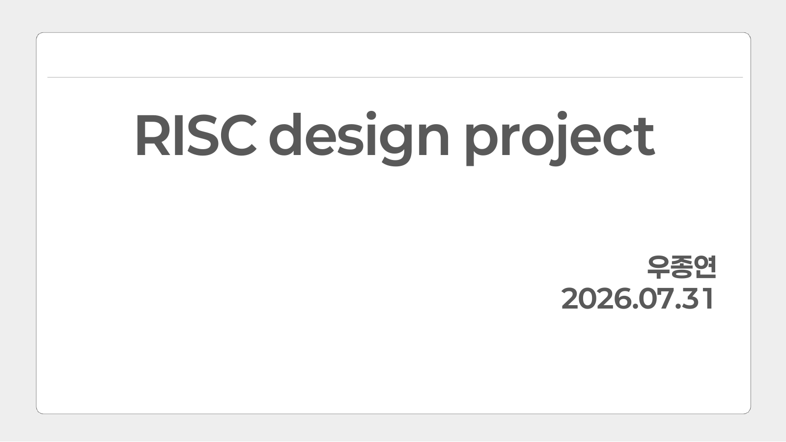

SRAM Hard Macro를 포함한 16-bit 단일 사이클 RISC 프로세서의 RTL 분석과 Logic Synthesis를 진행한 프로젝트입니다.

---

### Slide 2 · Contents

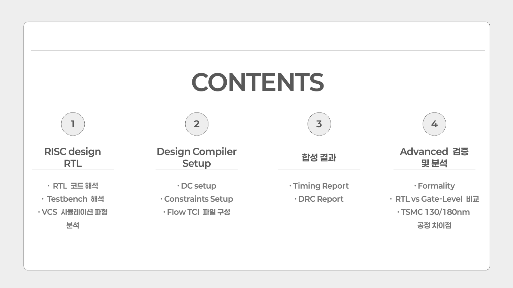

RTL / Testbench / 시뮬레이션 분석 → DC 셋업 → Timing·DRC 결과 → Formality 및 공정 비교 순서로 구성했습니다.

---

## 1. RISC design RTL

### Slide 3 · Schematic

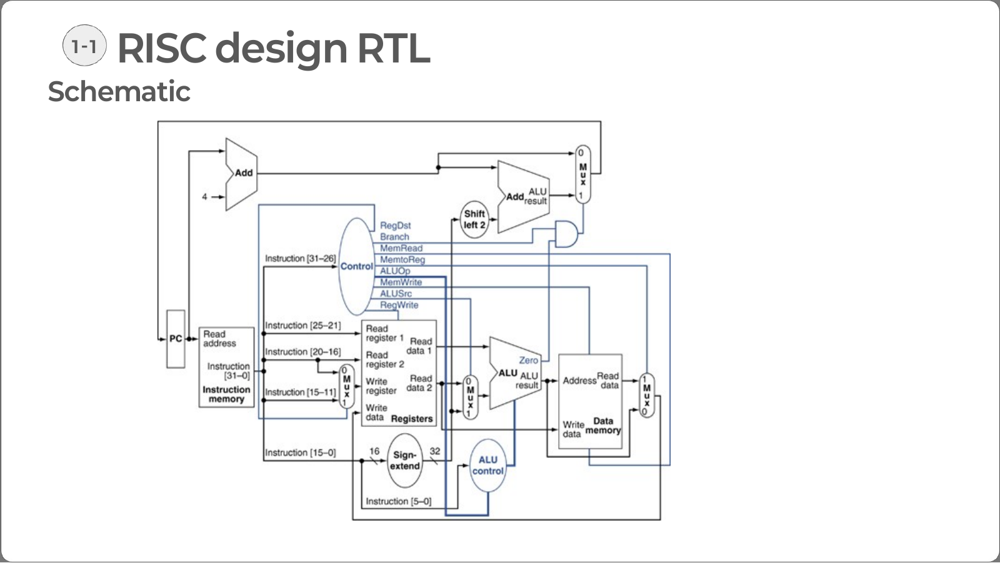

MIPS 계열 단일 사이클 프로세서의 Schematic입니다. PC → Instruction memory → Registers → ALU → Data memory → Write-back으로 이어지는 datapath와, `Instruction[31:26]`을 디코딩해 RegDst, Branch, MemRead, MemtoReg, ALUOp, MemWrite, ALUSrc, RegWrite를 생성하는 Control 블록, 그리고 PC+4 / Branch 주소를 선택하는 MUX 구조를 확인할 수 있습니다.

---

### Slide 4 · RISC_16_bit design

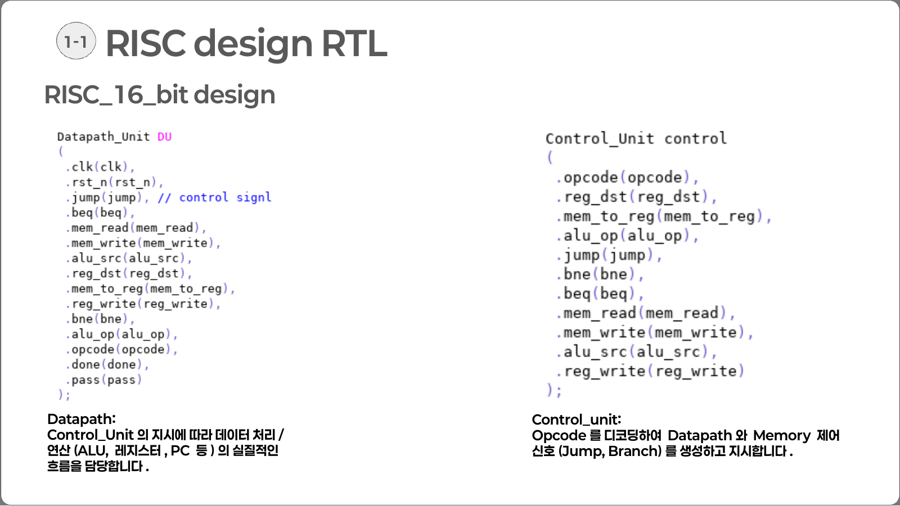

최상위 모듈은 두 블록으로 나뉩니다.

- **Datapath_Unit (DU)** — `jump`, `beq`, `bne`, `mem_read`, `mem_write`, `alu_src`, `reg_dst`, `mem_to_reg`, `reg_write`, `alu_op` 등의 제어 신호를 받아 ALU, 레지스터, PC 등 실제 데이터 흐름을 담당합니다. `opcode`를 Control로 보내고, `done` / `pass` 신호를 출력합니다.
- **Control_Unit** — `opcode`를 디코딩해 위 제어 신호들을 생성하고 Datapath와 Memory에 전달합니다.

---

### Slide 5 · RISC module 구조 분석

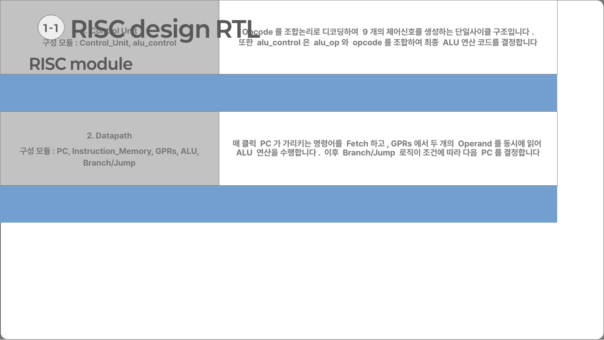

**① Control Unit** (`Control_Unit`, `alu_control`)
Opcode를 조합논리로 디코딩해 **9개의 제어신호**를 생성하는 단일 사이클 구조입니다. `alu_control`은 `alu_op`와 opcode를 조합해 최종 ALU 연산 코드를 결정합니다.

**② Datapath** (`PC`, `Instruction_Memory`, `GPRs`, `ALU`, `Branch/Jump`)
매 클럭 PC가 가리키는 명령어를 fetch하고, GPRs에서 두 operand를 동시에 읽어 ALU 연산을 수행합니다. 이후 Branch/Jump 로직이 조건에 따라 다음 PC를 결정합니다.

**③ Memory Interface** (`Data_Memory` — SRAM1RW64x8 × 2)
ALU 결과를 주소로 사용해 SRAM Hard Macro 2개(상위 / 하위 8-bit)에 접근합니다. CPU의 **Active-high** 제어신호를 SRAM용 **Active-low** 제어신호로 변환해 인터페이스합니다.

---

### Slide 6 · Testbench 분석 (1) — 메모리 preload

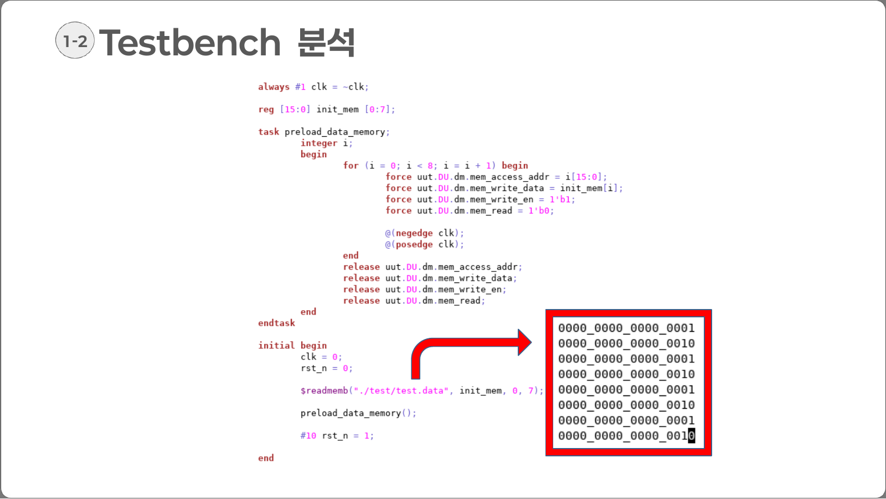

Testbench의 핵심은 `preload_data_memory` task입니다.

1. `$readmemb("./test/test.data", init_mem, 0, 7)` 로 초기 데이터 8개를 읽어옵니다 (오른쪽 캡처: `0001`, `0010`이 번갈아 저장).
2. `force` 로 `uut.DU.dm`의 `mem_access_addr`, `mem_write_data`, `mem_write_en`을 강제로 구동해 주소 0~7에 데이터를 써넣습니다.
3. negedge → posedge clk를 기다린 뒤 `release` 로 제어를 설계에 돌려줍니다.
4. preload가 끝나면 `#10 rst_n = 1` 로 reset을 해제해 프로세서를 동작시킵니다.

SRAM macro에는 직접 초기값을 넣을 수 없기 때문에, 실제 write 경로를 통해 메모리를 채우는 방식을 사용했습니다.

---

### Slide 7 · Testbench 분석 (2) — Data_memory / saed32sram

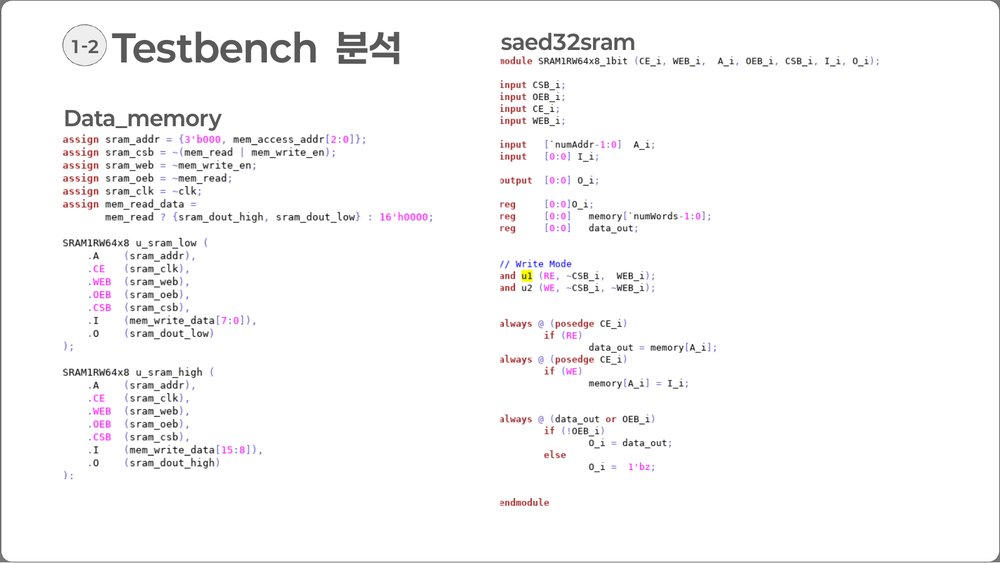

**Data_memory** (왼쪽)
```verilog
assign sram_addr = {3'b000, mem_access_addr[2:0]};
assign sram_csb  = ~(mem_read | mem_write_en);
assign sram_web  = ~mem_write_en;
assign sram_oeb  = ~mem_read;
assign sram_clk  = ~clk;
```
CPU의 Active-high 신호(`mem_read`, `mem_write_en`)를 SRAM의 **Active-low** 신호(CSB, WEB, OEB)로 변환하고, 16-bit 데이터를 `u_sram_low`(하위 8-bit)와 `u_sram_high`(상위 8-bit) 두 개의 `SRAM1RW64x8`에 나눠 저장합니다. SRAM clock은 반전된 `~clk`를 사용합니다.

**saed32sram** (오른쪽) — SRAM 모델은 CE의 posedge에서 `~CSB & WEB`이면 read, `~CSB & ~WEB`이면 write를 수행하고, `~OEB`일 때만 출력을 내보냅니다 (그 외에는 high-Z).

---

### Slide 8 · VCS 시뮬레이션 분석

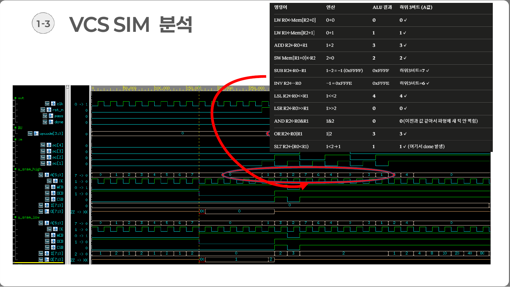

VCS 파형과 함께, 실행된 명령어별 기댓값을 표로 정리해 비교했습니다 (메모리에서 R0 = 1, R1 = 2를 load한 상태에서 시작).

| 명령어 | 연산 | ALU 결과 | 하위 3비트 (A값) |
|---|---|---|---|
| LW R0←Mem[R2+0] | 0+0 | 0 | 0 ✓ |
| LW R1←Mem[R2+1] | 0+1 | 1 | 1 ✓ |
| ADD R2←R0+R1 | 1+2 | 3 | 3 ✓ |
| SW Mem[R1+0]←R2 | 2+0 | 2 | 2 ✓ |
| SUB R2←R0−R1 | 1−2 = −1 | 0xFFFF | 7 ✓ |
| INV R2←~R0 | ~1 | 0xFFFE | 6 ✓ |
| LSL R2←R0<<R1 | 1<<2 | 4 | 4 ✓ |
| LSR R2←R0>>R1 | 1>>2 | 0 | 0 ✓ |
| AND R2←R0&R1 | 1&2 | 0 | 0 (이전과 값이 같아 파형에 새 틱이 찍히지 않음) |
| OR R2←R0\|R1 | 1\|2 | 3 | 3 ✓ |
| SLT R2←(R0<R1) | 1<2 → 1 | 1 | 1 ✓ (여기서 `done` 발생) |

SRAM 주소로는 ALU 결과의 하위 3비트만 사용되므로, 파형의 SRAM 주소(A) 값이 표의 하위 3비트와 모두 일치함을 확인했습니다.

---

## 2. Design Compiler Setup

### Slide 9 · DC setup

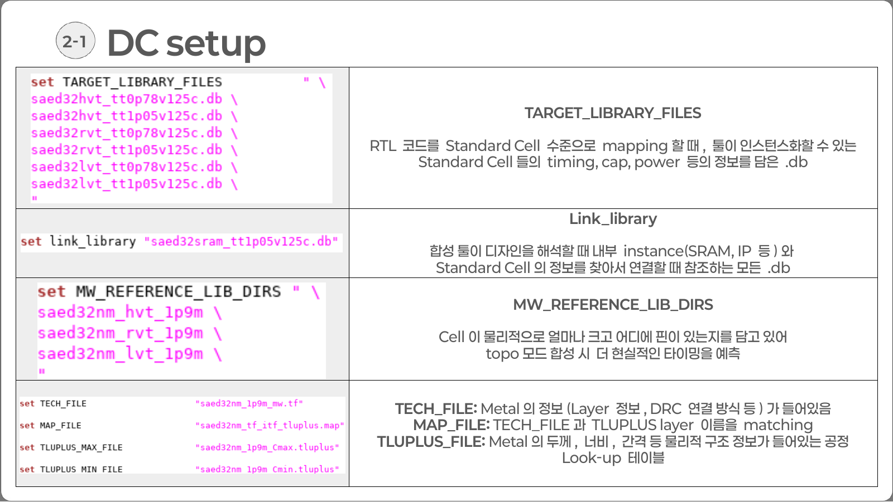

| 설정 | 내용 |
|---|---|
| `TARGET_LIBRARY_FILES` | `saed32hvt / rvt / lvt` 의 `tt0p78v125c`, `tt1p05v125c` .db — standard cell의 timing, cap, power 정보 |
| `link_library` | `saed32sram_tt1p05v125c.db` 추가 — SRAM macro 등 내부 instance와 standard cell을 찾아 연결할 때 참조 |
| `MW_REFERENCE_LIB_DIRS` | `saed32nm_hvt / rvt / lvt_1p9m` — cell의 물리적 크기와 pin 위치 → topo 모드에서 더 현실적인 timing 예측 |
| `TECH_FILE` | `saed32nm_1p9m_mw.tf` — Metal layer 정보, 연결 방식 |
| `MAP_FILE` | TECH_FILE과 TLUPLUS layer 이름 매칭 |
| `TLUPLUS_MAX / MIN_FILE` | Cmax / Cmin RC look-up 테이블 |

SRAM macro는 target library가 아니라 **link library**에만 넣어, 합성 툴이 새로 만들지 않고 참조만 하도록 했습니다.

---

### Slide 10 · Constraints Setup

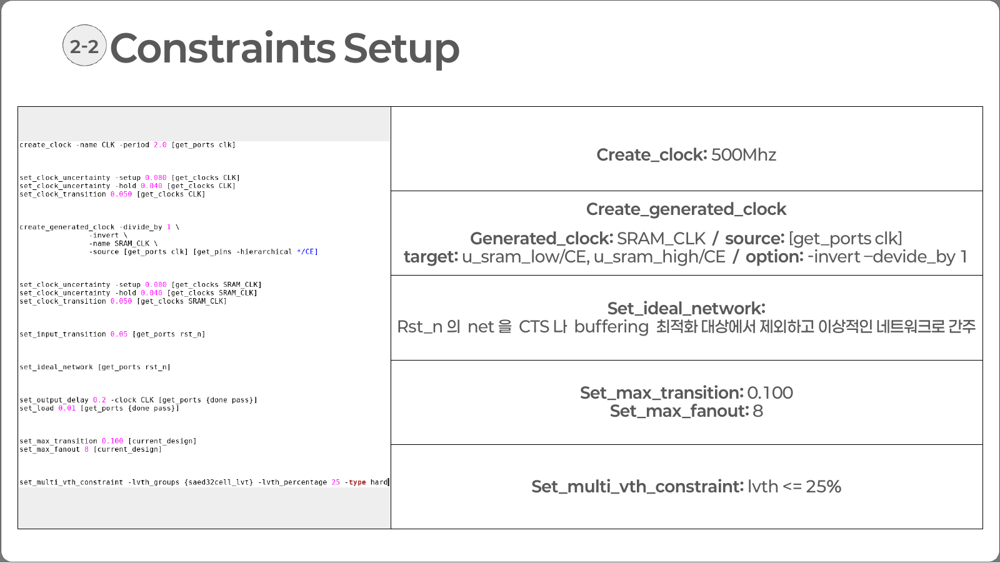

| 제약 | 설정 |
|---|---|
| `create_clock` | 500 MHz |
| `create_generated_clock` | `SRAM_CLK`, source: `clk`, target: `u_sram_low/CE`, `u_sram_high/CE`, `-invert -divide_by 1` |
| `set_ideal_network` | `rst_n` net을 CTS / buffering 최적화 대상에서 제외하고 이상적인 네트워크로 간주 |
| `set_max_transition` | 0.100 |
| `set_max_fanout` | 8 |
| `set_multi_vth_constraint` | LVT ≤ 25% |

SRAM은 반전된 clock으로 동작하도록 generated clock을 정의했습니다.

---

### Slide 11 · Tcl 구성

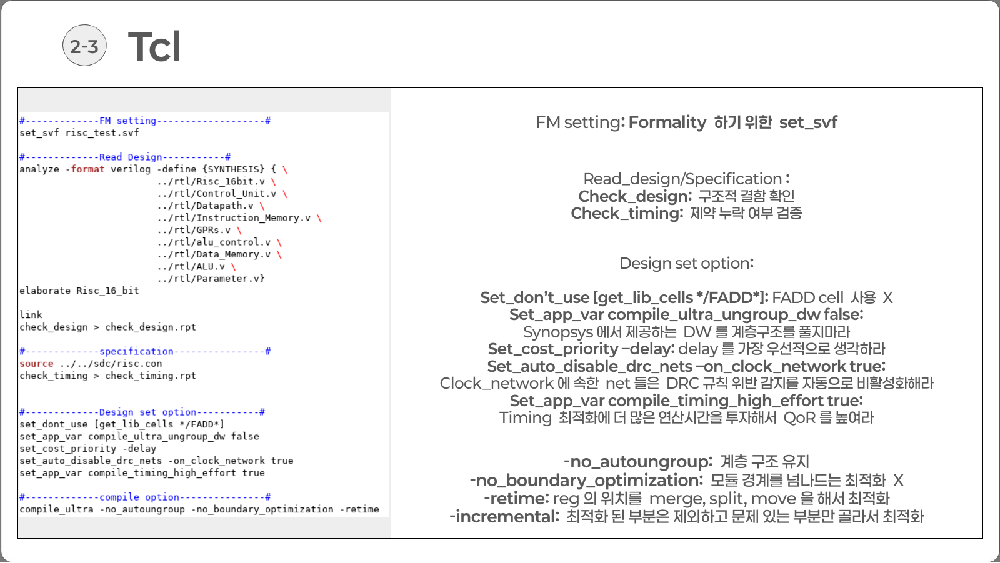

- **FM setting** — Formality를 위한 `set_svf`
- **check_design / check_timing** — 구조적 결함, 제약 누락 여부 검증
- **Design 옵션**
  - `set_dont_use [get_lib_cells */FADD*]` — FADD cell 사용 금지
  - `compile_ultra_ungroup_dw false` — DesignWare 계층을 풀지 않음
  - `set_cost_priority -delay` — delay를 최우선으로 최적화
  - `set_auto_disable_drc_nets -on_clock_network true` — clock network net의 DRC 검사 자동 비활성화
  - `compile_timing_high_effort true` — 연산 시간을 더 투자해 QoR 향상
- **Compile 옵션**
  - `-no_autoungroup` 계층 유지 / `-no_boundary_optimization` 모듈 경계 최적화 금지
  - `-retime` 레지스터 위치를 merge·split·move해 최적화
  - `-incremental` 이미 최적화된 부분은 제외하고 문제 구간만 재최적화

---

### Slide 12 · check_design / check_timing 결과

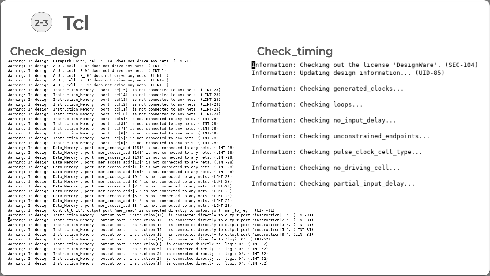

합성 전 `check_design`과 `check_timing`을 실행한 결과 화면입니다.

- **check_design** — LINT-1, 28, 31, 52 warning 다수 (다음 슬라이드에서 분석)
- **check_timing** — generated_clocks, loops, no_input_delay, unconstrained_endpoints, pulse_clock_cell_type, no_driving_cell, partial_input_delay 항목을 모두 점검

---

### Slide 13 · check_design 분석

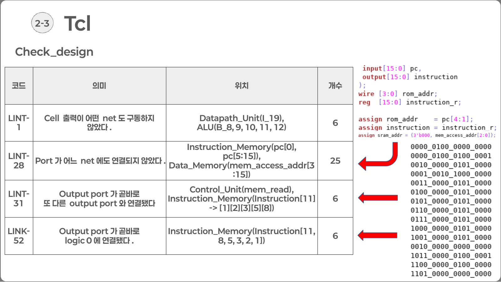

| 코드 | 의미 | 위치 | 개수 |
|---|---|---|---:|
| LINT-1 | Cell 출력이 어떤 net도 구동하지 않음 | Datapath_Unit(I_19), ALU(B_8~12) | 6 |
| LINT-28 | Port가 어느 net에도 연결되지 않음 | Instruction_Memory(pc[0], pc[5:15]), Data_Memory(mem_access_addr[3:15]) | 25 |
| LINT-31 | Output port가 다른 output port와 직결 | Control_Unit(mem_read), Instruction_Memory(Instruction[11] → [1][2][3][5][8]) | 6 |
| LINT-52 | Output port가 logic 0에 직결 | Instruction_Memory(Instruction[11, 8, 5, 3, 2, 1]) | 6 |

대부분 사용하지 않는 주소 비트나 상수로 고정된 명령어 비트에서 발생한 warning으로, 기능상 문제가 없음을 확인했습니다.

---

### Slide 14 · check_timing 분석

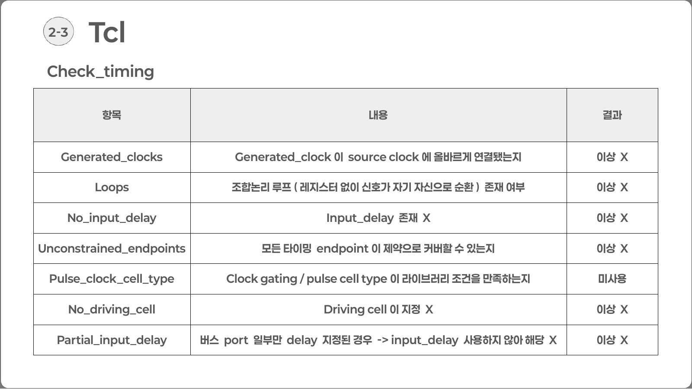

| 항목 | 내용 | 결과 |
|---|---|---|
| Generated_clocks | generated clock이 source clock에 올바르게 연결됐는지 | 이상 없음 |
| Loops | 레지스터 없이 자기 자신으로 순환하는 조합논리 루프 | 이상 없음 |
| No_input_delay | input delay 미지정 port | 이상 없음 |
| Unconstrained_endpoints | 모든 timing endpoint가 제약으로 커버되는지 | 이상 없음 |
| Pulse_clock_cell_type | clock gating / pulse cell 조건 | 미사용 |
| No_driving_cell | driving cell 미지정 | 이상 없음 |
| Partial_input_delay | bus port 일부만 delay 지정 | 해당 없음 |

---

## 3. 합성 결과

### Slide 15 · Timing Report (DRC 해결 전)

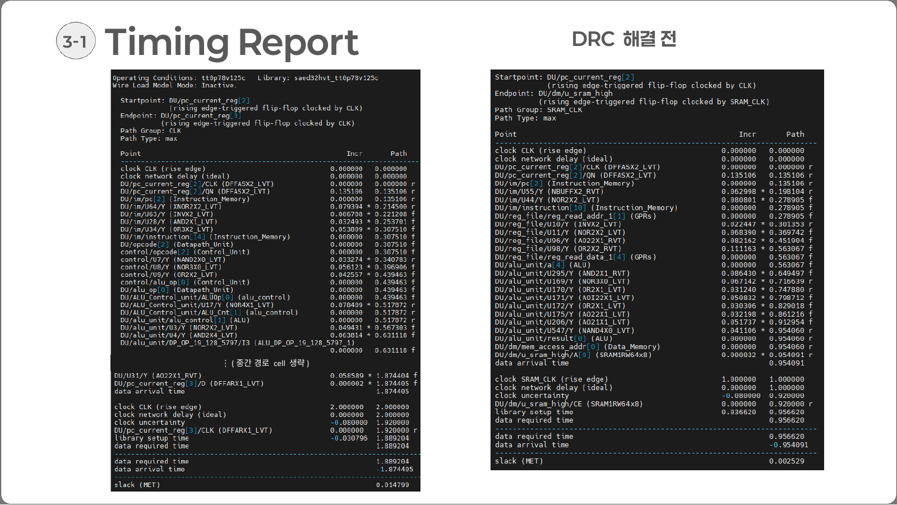

DRC 해결 전 Timing Report입니다 (중간 경로 cell 생략).

- **CLK group**: `DU/pc_current_reg[2] → DU/pc_current_reg[13]` slack **+0.014799** (MET)
- **SRAM_CLK group**: `DU/pc_current_reg[2] → DU/dm/u_sram_high` slack **+0.002529** (MET)

PC → Instruction memory → Register file → ALU를 거치는 단일 사이클 경로가 critical path입니다.

---

### Slide 16 · Timing Report (DRC 해결 후)

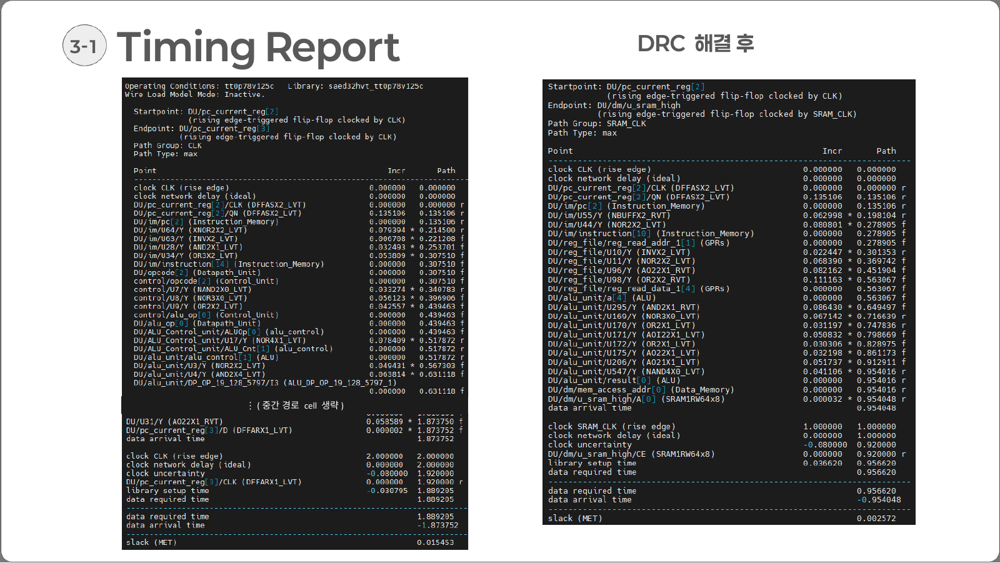

DRC 해결 후 Timing Report입니다.

- **CLK**: slack **+0.015453** (MET)
- **SRAM_CLK**: slack **+0.002572** (MET)

buffer 삽입과 cell sizing으로 DRC를 해결하면서도 timing은 오히려 소폭 개선되었습니다.

---

### Slide 17 · DRC Report (1) — only_design_rule

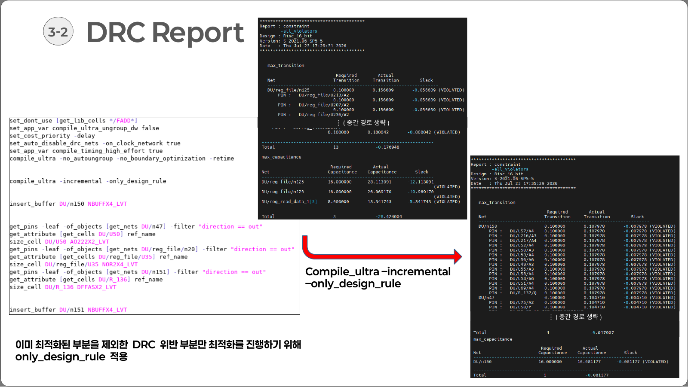

왼쪽은 DRC 해결에 사용한 스크립트 전체이고, 오른쪽은 리포트 변화입니다.

```tcl
compile_ultra -incremental -only_design_rule
```

이미 최적화된 timing은 건드리지 않고 **DRC 위반 부분만** 최적화하기 위해 `-only_design_rule`을 적용했습니다. 그 결과 max_transition / max_capacitance 위반 **13건(Total -0.176948) → 4건(Total -0.017907)** 으로 줄었습니다.

남은 위반은 `get_pins -leaf -of_objects [get_nets ...] -filter "direction == out"` 로 **driver pin을 찾고**, `get_attribute ... ref_name` 으로 **cell 종류를 확인**한 뒤 `size_cell` / `insert_buffer` 로 처리했습니다.

---

### Slide 18 · DRC Report (2) — insert_buffer / size_cell

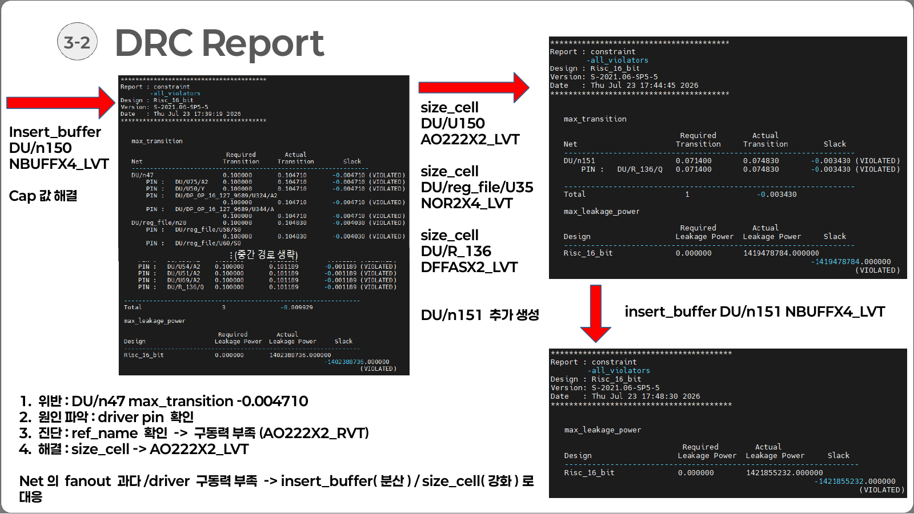

남은 위반을 하나씩 원인 분석 후 수정했습니다.

```tcl
insert_buffer DU/n150 NBUFFX4_LVT          ;# cap 위반 해결
size_cell DU/U150         AO222X2_LVT
size_cell DU/reg_file/U35 NOR2X4_LVT
size_cell DU/R_136        DFFASX2_LVT      ;# → DU/n151 위반 추가 발생
insert_buffer DU/n151 NBUFFX4_LVT
```

**분석 예시** — `DU/n47` max_transition -0.004710
1. 원인 파악: driver pin 확인
2. 진단: ref_name 확인 → `AO222X2_RVT`의 구동력 부족
3. 해결: `size_cell` 로 `AO222X2_LVT` 교체

> net의 **fanout 과다** → `insert_buffer` (부하 분산) / **driver 구동력 부족** → `size_cell` (강화)

---

### Slide 19 · DRC 해결 과정 요약

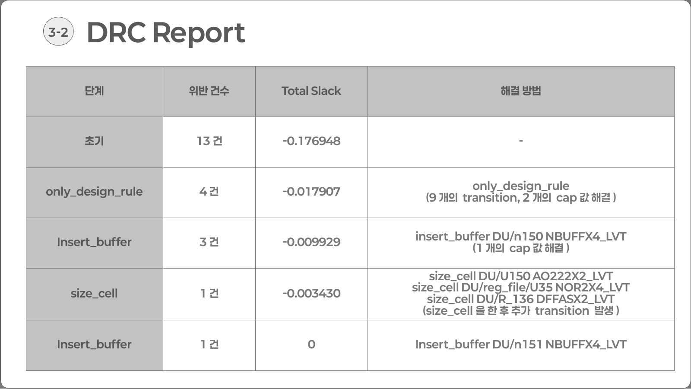

| 단계 | 위반 건수 | Total Slack | 해결 방법 |
|---|---:|---:|---|
| 초기 | 13건 | -0.176948 | – |
| only_design_rule | 4건 | -0.017907 | transition 9건, cap 2건 해결 |
| insert_buffer | 3건 | -0.009929 | `DU/n150 NBUFFX4_LVT` (cap 1건 해결) |
| size_cell | 1건 | -0.003430 | 3개 cell sizing (이후 transition 1건 추가 발생) |
| **insert_buffer** | **0건** | **0** | `DU/n151 NBUFFX4_LVT` |

---

## 4. Advanced 검증 및 분석

### Slide 20 · Formality

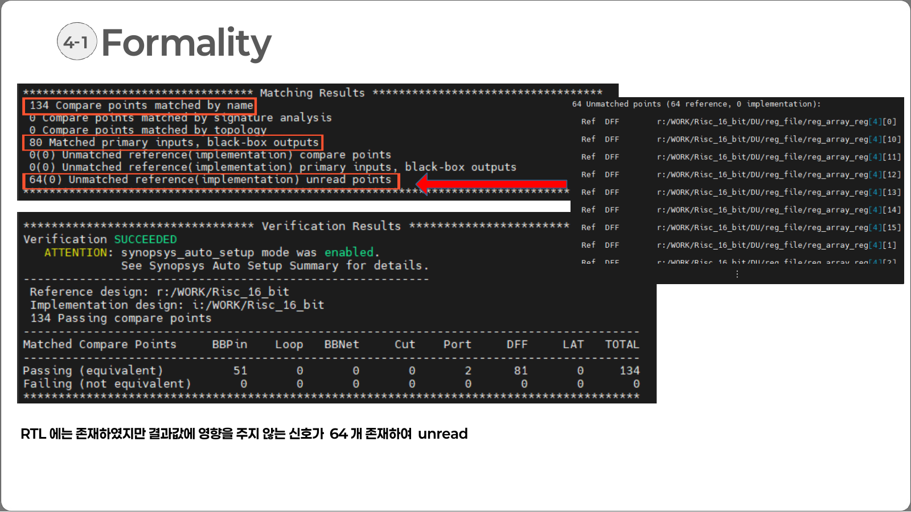

Formality 등가성 검증 결과 **Verification SUCCEEDED** 입니다.

- **134** compare points matched by name
- **80** primary inputs / black-box outputs 매칭
- Passing 134 = BBPin 51 + Port 2 + DFF 81, Failing 0
- **64개 unread points** — 오른쪽 목록처럼 `reg_file/reg_array_reg[*]` DFF들로, RTL에는 존재하지만 출력에 영향을 주지 않아 합성 시 제거된 레지스터입니다.

---

### Slide 21 · RTL vs Gate-level 비교

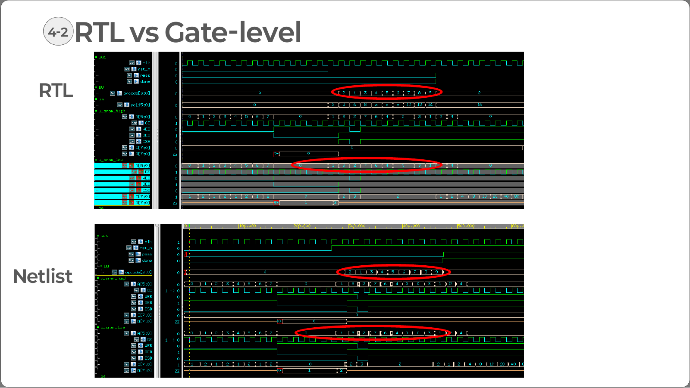

RTL 시뮬레이션과 Gate-level netlist 시뮬레이션 파형을 비교했습니다. 붉은 원으로 표시한 레지스터 값과 SRAM 주소의 변화 순서가 두 파형에서 동일해, 합성 후에도 기능이 유지됨을 확인했습니다.

---

### Slide 22 · TSMC 180nm / 130nm QoR

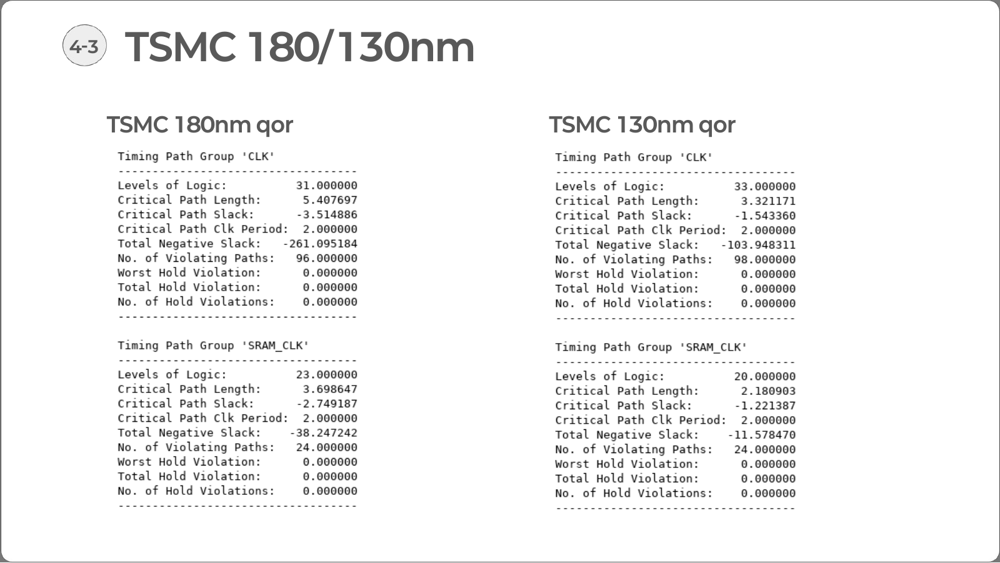

같은 RTL과 제약을 TSMC 라이브러리로 합성한 `report_qor` 결과입니다.

| 항목 | TSMC 180nm | TSMC 130nm |
|---|---:|---:|
| CLK — Critical Path Slack | -3.514886 | -1.543360 |
| CLK — Total Negative Slack | -261.095184 | -103.948311 |
| CLK — Violating Paths | 96 | 98 |
| SRAM_CLK — Critical Path Slack | -2.749187 | -1.221387 |
| SRAM_CLK — Violating Paths | 24 | 24 |
| Hold Violations | 0 | 0 |

두 공정 모두 500 MHz setup을 만족하지 못했고, hold 위반은 없었습니다.

---

### Slide 23 · SAED 32nm vs TSMC 180/130nm 결과 비교

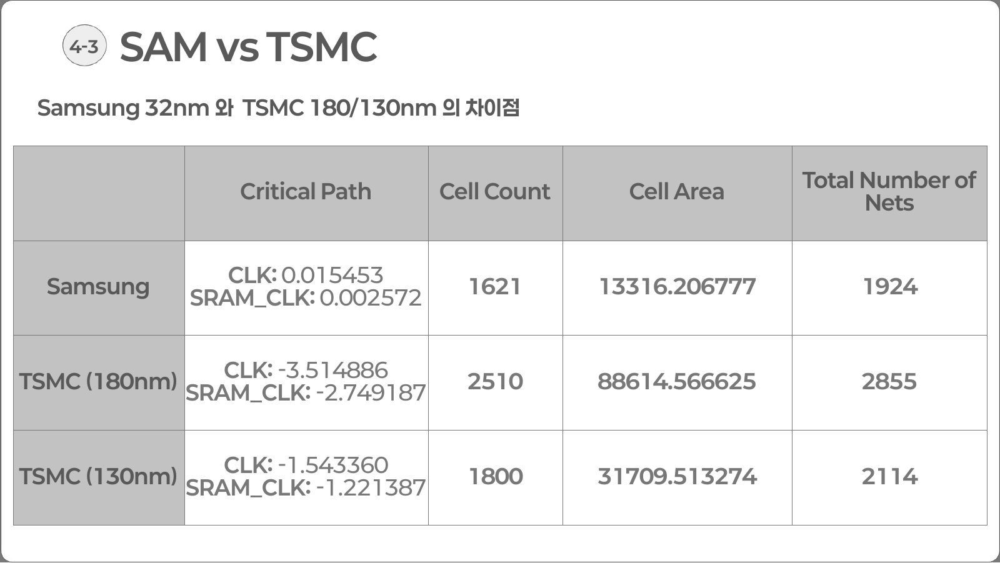

| 공정 | Critical Path (CLK / SRAM_CLK) | Cell Count | Cell Area | Total Nets |
|---|---|---:|---:|---:|
| SAED 32nm | **0.015453 / 0.002572** | 1621 | 13316.206777 | 1924 |
| TSMC 180nm | -3.514886 / -2.749187 | 2510 | 88614.566625 | 2855 |
| TSMC 130nm | -1.543360 / -1.221387 | 1800 | 31709.513274 | 2114 |

32nm에서만 500 MHz timing을 만족했고, 공정이 커질수록 timing을 맞추기 위해 cell 수와 면적이 함께 증가했습니다.

---

### Slide 24 · 기본 Cell 특성 비교

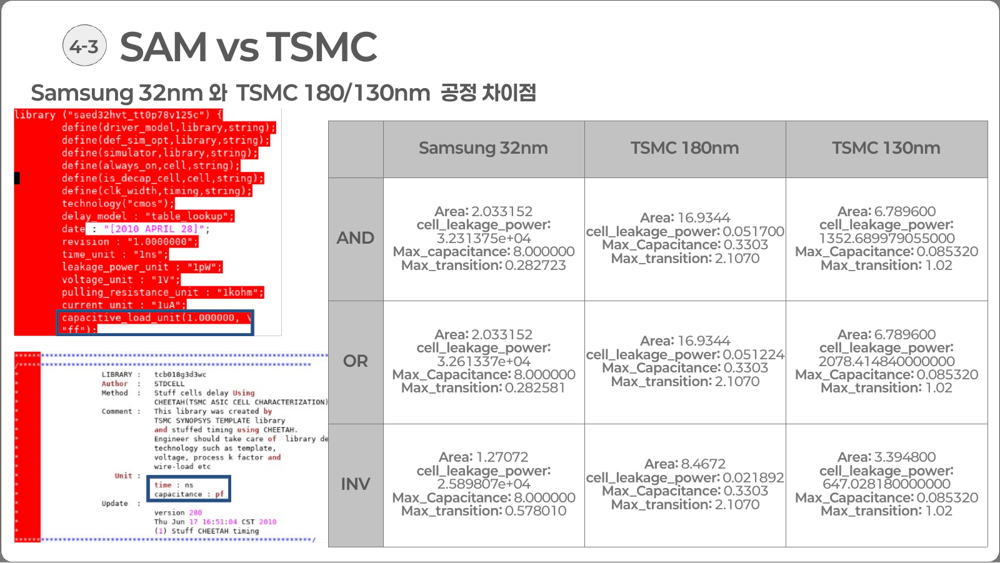

결과 차이의 원인을 cell 단위로 확인하기 위해 AND / OR / INV cell의 라이브러리 값을 비교했습니다.

| Cell | 항목 | SAED 32nm | TSMC 180nm | TSMC 130nm |
|---|---|---:|---:|---:|
| AND | Area | 2.033152 | 16.9344 | 6.789600 |
| | Max Capacitance | 8.000000 | 0.3303 | 0.085320 |
| | Max Transition | 0.282723 | 2.1070 | 1.02 |
| OR | Area | 2.033152 | 16.9344 | 6.789600 |
| | Max Capacitance | 8.000000 | 0.3303 | 0.085320 |
| | Max Transition | 0.282581 | 2.1070 | 1.02 |
| INV | Area | 1.27072 | 8.4672 | 3.394800 |
| | Max Capacitance | 8.000000 | 0.3303 | 0.085320 |
| | Max Transition | 0.578010 | 2.1070 | 1.02 |

> Leakage power와 capacitance는 라이브러리마다 단위가 다르므로(예: pW/nW, fF/pF) `.lib` 헤더의 unit 정의를 함께 확인해야 합니다.

---

[← 이전 Session: CISC](../02_CISC/README.md) · [메인으로](../README.md)
