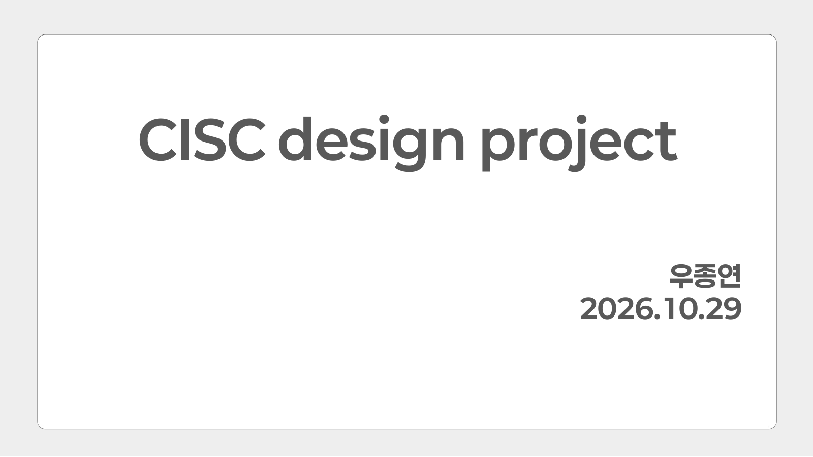

# 우종연 | Digital IC Design Portfolio

> RTL 설계 → Logic Synthesis → Physical Design(RTL-to-GDSII) → Sign-off 분석까지 직접 수행한 프로젝트를
> **발표 자료(PPT) 페이지 순서대로** 정리한 포트폴리오입니다.

📧 your.email@example.com

---

## 📂 Sessions

| # | Session | 기간 | 주요 내용 |
|:---:|---|---|---|
| 1 | [**TOP Design Project**](./01_TOP/README.md) | 2026.10 | 5단 Pipeline · DC 합성 · **ICC2 RTL-to-GDSII** (Floorplan ~ Filler) |
| 2 | [**CISC Design Project**](./02_CISC/README.md) | 2026.10 | Multi-cycle FSM CISC · DC 합성 · **L자형 ICC2 P&R** · 6-corner MCMM · **StarRC / PrimeTime DMSA ECO** |
| 3 | [**RISC Design Project**](./03_RISC/README.md) | 2026.07 | 16-bit RISC + SRAM Macro · DC 합성 · DRC 13건 → 0건 · 공정/셀 비교 |

<table>
<tr>
<td align="center" width="33%"> <b>Session 1 · TOP</b></td>
<td align="center" width="33%"> <b>Session 2 · CISC</b></td>
<td align="center" width="33%"> <b>Session 3 · RISC</b></td>
</tr>
</table>

---

## 🛠 Tools

`Verilog` · `Synopsys VCS` · `Design Compiler` · `Formality` · `IC Compiler II` · `StarRC` · `PrimeTime` · `Tcl`
Library: SAED 32nm, TSMC 180nm / 130nm
